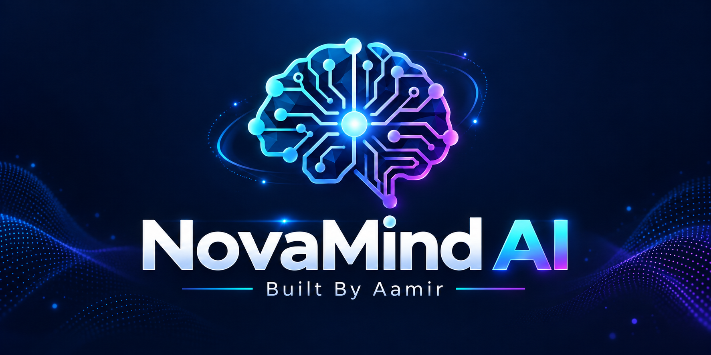
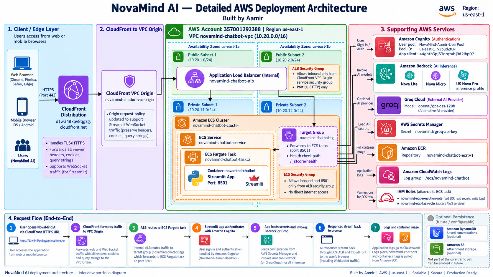
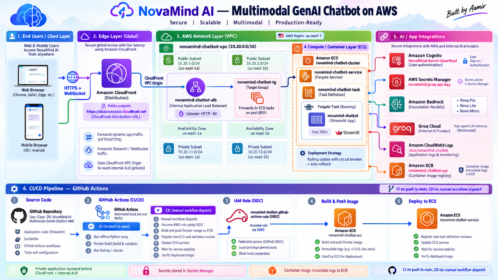

  

# NovaMind AI — Project Interview Questions & Spoken Answers

### AWS Generative AI Engineer · Generative AI Engineer · AI Engineer

**NovaMind AI | Built by Aamir**

---

## How to use this guide

This is a speaking guide, not a script to memorize. Read the technical explanation, trace the evidence in the repository, close the document, and answer aloud in your own words.

Use this learning loop:

> **Understand → Speak → Explain Why → Defend → Practice**

For the 20 core questions, three answer lengths are provided:

- **Short:** 30–45 seconds for HR or an initial screen.
- **Standard:** 1–2 minutes for a technical interview.
- **Advanced:** a structured 3–5 minute discussion; shorten or expand it based on the interviewer.

Every project claim uses one of these evidence boundaries:

- **Implemented:** directly supported by source code, tests, Docker, or workflow YAML.
- **Deployment-evidenced:** visible in repository architecture diagrams or screenshots, but not reproducible from infrastructure as code in this repository.
- **Optional:** code exists but requires configuration and pre-existing resources.
- **Proposed or unverified:** a production improvement or live AWS setting that must be checked in the account.

> [!IMPORTANT]
> NovaMind AI is a multimodal generative-AI application. It is not currently an agentic system: it has no autonomous planning loop, tool registry, tool execution, or multi-agent coordination.

## Evidence baseline

- The application launches through [`mod_chatbot_frontend.py`](./mod_chatbot_frontend.py) and composes modular UI, domain, orchestration, and service layers.
- Amazon Bedrock uses `converse_stream`; Groq is an optional text-only SSE adapter.
- Cognito is the default authentication mode; demo mode is explicitly local-only.
- The Docker image runs Streamlit as a non-root user on port 8501.
- CI runs automatically on pushes and pull requests to `main`; CD is manual through `workflow_dispatch`.
- Repository history contains the application baseline plus CI, CI correction, CD, and documentation/image commits. It does not prove an exact step-by-step original development chronology.
- The guarded offline suite was independently run during repository documentation on 13 October 2026: 500 tests passed in 16.545 seconds. This is not coverage, load, browser, or live-AWS evidence.
- No Terraform, CloudFormation, CDK, exported route tables, or IAM trust policy is stored here. Exact live subnet routing, task public-IP setting, NAT/endpoints, security-group rules, alarms, and deployment circuit-breaker state remain verification items.

## Question map

1. [Project introduction and business problem](#category-1)
2. [How I built the application](#category-2)
3. [Complete architecture explanation](#category-3)
4. [Python and Streamlit](#category-4)
5. [Generative AI and LLM concepts](#category-5)
6. [Amazon Bedrock and Groq](#category-6)
7. [Multimodal processing](#category-7)
8. [Authentication and security](#category-8)
9. [AWS networking](#category-9)
10. [Docker and ECS Fargate](#category-10)
11. [GitHub Actions CI/CD and OIDC](#category-11)
12. [Monitoring and troubleshooting](#category-12)
13. [Cost, scalability, and reliability](#category-13)
14. [Design decisions and alternatives](#category-14)
15. [Advanced defense scenarios](#category-15)
16. [Three mock interviews](#mock-interviews)
17. [Communication and confidence](#communication)

---

# 1. Project Introduction and Business Problem

## 1. Tell me about your NovaMind AI project. — Core

**Interviewer Question:** Tell me about your NovaMind AI project.

### My Spoken Answer — Short

“I built NovaMind AI, a secure multimodal chatbot that runs as a container on AWS. A signed-in user can have streaming text conversations, analyze supported images, or ask questions about a document using Amazon Bedrock. I also added an optional Groq text provider, Cognito authentication, strict file and request validation, bounded conversation history, Docker packaging, automatic CI, and a manually controlled ECS deployment through GitHub OIDC.”

### My Spoken Answer — Standard

“NovaMind AI is an end-to-end generative-AI application rather than only an API demo. I built the interface in Streamlit and separated the code into UI, domain state, orchestration, and external-service layers. Users authenticate with Cognito, select a supported model, and submit text or one validated image or document. Amazon Bedrock uses the Converse streaming API, while Groq is an optional text-only provider.

What makes the project technically interesting is the engineering around inference. I validate the complete request before a network call, limit file and context sizes, keep visible history separate from model history, and commit an assistant response to future context only after the stream finishes correctly. I containerized it as a non-root process and designed the AWS path as CloudFront through a VPC origin to an internal ALB and ECS Fargate. CI runs offline tests and a Docker build; CD is manual, uses OIDC, tags ECR images with the commit SHA, and verifies the ECS rollout.”

### My Spoken Answer — Advanced

“I describe NovaMind AI in three layers: product behavior, application engineering, and cloud delivery.

At the product layer, an authenticated user gets one workspace for multi-turn text chat, image understanding, and direct document question answering. The user can choose among configured Bedrock models—Amazon Nova Pro, Nova Lite, Nova Micro, or Claude 3.5 Sonnet—and one allowlisted Groq text model. The UI also exposes persona, response language, temperature, and output-token controls.

At the application layer, the Streamlit page is only the composition surface. Domain modules own session and usage rules; orchestration modules connect user actions to services; provider classes own Bedrock and Groq calls. Before inference, the application validates model capability, file type and structure, attachment counts, serialized payload size, estimated context, and output reservation. Images are fully decoded under dimension and pixel limits. Documents go through signature and bounded structural checks. During streaming, visible partial output is different from trusted model memory. Only a correctly completed result becomes a history pair, which prevents a failed half-answer from contaminating the next prompt.

At the cloud layer, the documented architecture uses CloudFront as the public HTTPS edge, a CloudFront VPC origin to an internal Application Load Balancer, and a Streamlit container on ECS Fargate. Cognito handles user identity, Bedrock handles managed model inference, ECR stores the image, Secrets Manager is part of the runtime secret design, and CloudWatch receives operational logs. I distinguish those diagrammed deployment facts from settings the repository cannot prove, such as exact route tables or live security-group rules.

For delivery, CI runs a guarded offline regression suite on Windows with Python 3.14.6, then builds the Linux Docker image. CD is deliberately manual. It runs only from `main`, verifies successful push CI for the exact `github.sha`, assumes an AWS deployment role through OIDC, publishes or reuses the SHA-tagged ECR image, changes only the container image in a new task-definition revision, updates ECS, waits for stability, and verifies the deployed revision and image.

The main boundaries are equally important: direct document Q&A is not RAG, Groq is text-only here, active Streamlit sessions are in memory, persistence is optional, and the application is not agentic. Those honest boundaries give me a clear production roadmap.”

**Technical Understanding:** A credible GenAI application includes identity, validation, state, provider abstraction, deployment, and failure behavior—not only a prompt and a model call. The strongest answer moves from user value to code mechanism to cloud operations.

**Project Evidence:** [`novamind/ui/app.py`](./novamind/ui/app.py), [`services/bedrock_service.py`](./services/bedrock_service.py), [`services/groq_service.py`](./services/groq_service.py), [`services/auth_service.py`](./services/auth_service.py), [`Dockerfile`](./Dockerfile), and both architecture diagrams under `project-pic/`.

**Interviewer Follow-Up:** What is the most important engineering feature beyond the model call?

**My Follow-Up Answer:** “For me it is transactional stream handling. I let the user see partial text, but I do not treat it as trusted conversation memory unless the provider stream completes correctly. That prevents an interrupted or malformed result from affecting later prompts.”

**Mistakes to Avoid:** Do not call it RAG, agentic, automatically horizontally stateful, or fully production-proven. Do not claim every AWS detail is stored as code.

## 2. Why did you build this application? — Core

**Interviewer Question:** Why did you build NovaMind AI?

### My Spoken Answer — Short

“I built it to learn and demonstrate the complete engineering lifecycle of a generative-AI product. I wanted to go beyond a simple chatbot API call and solve identity, multimodal validation, streaming state, AWS networking, container deployment, CI/CD, and operational failure handling in one project.”

### My Spoken Answer — Standard

“My goal was to build a portfolio project that reflects the work of an AWS Generative AI Engineer, not just a UI around an API. The interesting problems are around the model: how I authenticate users, route different model capabilities, safely process files, bound context and cost, handle partial streams, deploy an immutable container, and troubleshoot identity or network failures. NovaMind AI gave me one system where I could connect Python application design with Bedrock, Cognito, ECS, CloudFront, IAM, Docker, and GitHub Actions.”

### My Spoken Answer — Advanced

“I started from a learning and product gap. A minimal chatbot shows that a model can answer text, but it does not show how to operate the application safely or explain architecture decisions. I wanted a project where every layer raised a real engineering question.

For example, at the input layer I had to decide what ‘supported image’ means. I did not want to trust an extension, so the service checks size, signature, decoding, dimensions, pixel count, and frames. At the request layer I had to account for aggregate payload and context, not just individual files. At the inference layer I needed a common streaming contract while preserving different model capabilities. At the state layer I needed to separate what the user sees from what the model may reuse. At the identity layer I needed Cognito authentication plus application authorization, because a valid token alone does not prove ownership of a stored conversation.

The same reasoning continues into AWS. Streamlit is a long-running interactive process, so a Fargate container is a natural fit. CloudFront and a VPC origin allow a public edge with an internal ALB. GitHub OIDC avoids long-lived deployment keys. An immutable commit-SHA image makes a release traceable.

So the project was designed to help me understand the full system and defend its trade-offs. I can show what is implemented, identify what is only evidenced by diagrams, and propose production improvements without pretending they already exist.”

**Technical Understanding:** A strong project motivation connects a user problem and a learning goal to concrete engineering constraints. “I wanted to use AWS” is weaker than explaining what each boundary taught you.

**Project Evidence:** The modular service structure, validation modules, Dockerfile, workflow files, and Git history support this end-to-end scope. The exact historical requirements process is not recorded, so this is a logical rationale rather than a timestamped origin story.

**Interviewer Follow-Up:** What did you learn that a basic chatbot would not teach you?

**My Follow-Up Answer:** “I learned that correctness lives around the model: identity, request admission, state transitions, provider failure, observable attempts, and repeatable delivery. The model response is only one step in a much larger trust chain.”

**Mistakes to Avoid:** Do not invent a customer, business revenue, production traffic, or personal history not supported by evidence.

## 3. What business problem does NovaMind AI solve?

**Interviewer Question:** What business problem does this project solve?

**My Spoken Answer:** “I position it as a secure AI workspace for users who need text assistance plus one-image or one-document understanding without switching between separate tools. The business value is a unified, authenticated experience with controlled model choice and predictable input boundaries. It is a portfolio implementation, so I do not claim measured revenue or user adoption. The code demonstrates how the solution could support knowledge workers, students, developers, or analysts, while the actual market fit would still need user research and evaluation.”

**Technical Understanding:** Separate demonstrated product capability from proven business impact. A prototype can solve a plausible workflow without having production metrics.

**Project Evidence:** [`novamind/ui/chat.py`](./novamind/ui/chat.py), [`novamind/ui/attachments.py`](./novamind/ui/attachments.py), and configured choices in [`novamind/config/settings.py`](./novamind/config/settings.py).

**Interviewer Follow-Up:** How would you validate product-market fit?

**My Follow-Up Answer:** “I would select a narrow user group, define representative tasks and quality criteria, instrument completion and failure rates with consent, interview users, and compare the workflow with their current process. I would not treat model usage volume alone as proof of value.”

**Mistakes to Avoid:** Do not invent customers, adoption numbers, productivity percentages, or ROI.

## 4. What was your role and contribution? — Core

**Interviewer Question:** What exactly was your role in this project?

### My Spoken Answer — Short

“I built and integrated the repository represented here: the Streamlit application structure, model-provider boundaries, validation and session controls, Docker path, automated CI, manual ECS deployment workflow, and project documentation. Git history attributes the current commits to my GitHub identity. I still distinguish repository work from live AWS settings that are not exported as infrastructure as code.”

### My Spoken Answer — Standard

“My role covered application and cloud-delivery engineering. I worked on the Python and Streamlit modules, Bedrock and optional Groq adapters, Cognito session flow, authorization scopes, file and request guards, conversation memory, Docker packaging, offline test workflow, and manual CD workflow. I also documented the architecture and operational boundaries. I can trace that work through the repository and commits, but I do not use Git metadata to claim facts it cannot prove, such as every action performed in the AWS console or exclusive authorship outside the repository.”

### My Spoken Answer — Advanced

“I describe my contribution by responsibility rather than by a vague percentage.

First, I owned the application structure: a small launcher, a Streamlit composition layer, domain state, orchestration functions, and service boundaries. Second, I integrated inference through Bedrock Converse streaming and an optional Groq text adapter while keeping model capability rules explicit. Third, I implemented reliability and security controls around the model call—Cognito verification, session ownership, layered file validation, aggregate request limits, bounded history, safe errors, attempt-level usage records, and optional owner-scoped persistence.

Fourth, I packaged the app into a pinned Linux container running as a non-root user with a health endpoint. Fifth, I implemented repository automation: automatic offline Python tests, a dependent Linux Docker build, and a manually dispatched deployment that checks the exact commit's CI result, authenticates to AWS using OIDC, uses an immutable SHA image, registers a minimally changed task definition, and verifies ECS stability.

The repository history currently attributes all six commits to `aamir490`, including the application baseline, CI addition and correction, CD, and architecture assets. I present that as evidence for the repository work. I do not claim that Git proves every external AWS action, and I would adjust this answer if collaborators contributed outside that recorded history.”

**Technical Understanding:** Scope your ownership by artifacts and decisions. Commit authorship is evidence, but it is not perfect proof of sole authorship or live-account activity.

**Project Evidence:** `git log`, the source tree, [`.github/workflows/ci.yml`](./.github/workflows/ci.yml), [`.github/workflows/cd.yml`](./.github/workflows/cd.yml), and architecture assets.

**Interviewer Follow-Up:** Which contribution best demonstrates senior engineering judgment?

**My Follow-Up Answer:** “I would choose the explicit evidence boundaries and failure contracts. For example, a partial stream can be displayed but is not committed to model memory, and a diagrammed circuit breaker is not described as proven live configuration. That discipline prevents hidden state corruption and misleading operational claims.”

**Mistakes to Avoid:** Do not say “I did everything” without evidence. Do not imply that repository commits prove console configuration or production usage.

## 5. What makes NovaMind AI different from a basic chatbot?

**Interviewer Question:** What makes this different from a basic chatbot tutorial?

**My Spoken Answer:** “The difference is the control plane around inference. I added verified identity and owner-scoped state, capability-aware model routing, image and document validation, aggregate request limits, bounded two-layer history, transactional streaming, optional persistence, structured usage records, container hardening, and an exact-artifact delivery pipeline. A tutorial often sends one text string to one model. This application treats the request, user, stream, and deployment as separate trust boundaries.”

**Technical Understanding:** Production-minded GenAI work is mostly integration, safety, state, and operations. The model API is necessary but not sufficient.

**Project Evidence:** [`services/authorization.py`](./services/authorization.py), [`services/request_limits.py`](./services/request_limits.py), [`services/conversation_memory.py`](./services/conversation_memory.py), and [`services/usage_accounting.py`](./services/usage_accounting.py).

**Interviewer Follow-Up:** What is still prototype-level?

**My Follow-Up Answer:** “Active sessions are process-local, infrastructure is not codified, there is no load-test evidence, direct document Q&A is not RAG, and full production monitoring and policy enforcement are future work.”

**Mistakes to Avoid:** Do not equate a large test count with production readiness.

---

# 2. How I Built the Application

## 6. How did you build this application from scratch? — Core

**Interviewer Question:** Walk me through how you built NovaMind AI from scratch.

### My Spoken Answer — Short

“I would describe the logical build sequence as requirements, modular Streamlit UI, authentication and scoped state, provider adapters, multimodal validation, bounded memory and streaming, tests, Docker, AWS runtime architecture, and CI/CD. I call it a logical reconstruction because the first Git commit contains the application baseline rather than one commit per development step.”

### My Spoken Answer — Standard

“I first defined the supported experiences and their boundaries: text chat, one supported attachment, explicit models, streaming, authentication, and AWS deployment. I created a modular Streamlit shell, then added Cognito and session ownership before connecting private state. Next I created a small provider interface and implemented Bedrock Converse streaming plus optional Groq text streaming. I added layered image and document validators, request budgets, two histories, and commit-on-success streaming. After that I added offline tests, a pinned non-root Docker image, the CloudFront-to-Fargate architecture, automatic CI, and manual OIDC-based CD. That is the dependency-correct build order; Git only proves the baseline and later CI/CD/documentation changes.”

### My Spoken Answer — Advanced

“I reconstruct the project in dependency order rather than pretending Git has a commit for every development stage.

I would begin with requirements: authenticated multi-turn text, supported image and document input, model selection, streaming, failure behavior, and a containerized AWS path. Then I would choose Python and Streamlit for rapid AI UI development, Bedrock Converse for structured multimodal messages, Cognito for identity, and Fargate for the long-running Streamlit process.

Next I would establish module boundaries. The launcher calls `novamind.ui.app.main`; UI files render and coordinate; domain files own state invariants; orchestration files connect workflows; services own AWS, providers, validation, persistence, and logging. That structure lets me test logic without launching a browser or calling AWS.

Before inference, I would establish identity and authorization. Cognito verifies the access token through `GetUser`, then `DataScope` binds histories, attachments, and clients to the authenticated subject. With that boundary in place, I would add a provider contract and implement Bedrock and Groq. Bedrock builds Converse content blocks and processes stream events; Groq converts text history to OpenAI-compatible messages and parses SSE. Capability policy prevents unsupported modality from reaching either adapter.

Then I would build reliability around input and state. Images receive signature, decode, dimension, pixel, and frame checks. Documents receive extension, signature, archive/PDF/Office structure, size, and resource ceilings. The aggregate request validator checks message count, attachments, serialized bytes, output settings, and estimated context. Conversation memory keeps complete pairs, and the UI commits the model history only when a stream returns a valid completion.

Finally I would add optional owner-scoped DynamoDB/S3 save behavior, structured telemetry, deterministic offline tests, a Python 3.14.6 non-root Docker image, and the AWS delivery path. CI validates Python and Docker. CD manually promotes only a successful `main` SHA through OIDC, ECR, a new task revision, and ECS stability verification.

That is how the current design fits together. The actual Git history proves one large baseline commit followed by specific CI, CD, and documentation changes, so I do not present this logical sequence as a dated historical diary.”

**Technical Understanding:** Build order should follow dependencies: requirements before architecture, identity before private state, validation before provider calls, deterministic tests before deployment automation.

**Project Evidence:** [`PROJECT-BUILD-GUIDE-AND-INTERVIEW-PREPARATION.md`](./PROJECT-BUILD-GUIDE-AND-INTERVIEW-PREPARATION.md), `git log`, and the module tree.

**Interviewer Follow-Up:** What would you implement earlier if you restarted?

**My Follow-Up Answer:** “I would codify the AWS infrastructure and define observability acceptance criteria earlier. The repository has strong application and workflow evidence, but IaC would make network, IAM, alarm, and rollback assumptions reviewable and repeatable.”

**Mistakes to Avoid:** Do not narrate the logical sequence as verified chronological history.

## 7. How did you decide the project requirements?

**Interviewer Question:** How did you translate the idea into technical requirements?

**My Spoken Answer:** “I divided requirements into user capabilities and engineering invariants. User capabilities included authenticated chat, selected models, streaming, and supported image or document input. Invariants included no unsupported modality, no unbounded request, no foreign session state, no incomplete response in model history, no embedded credentials, and no deployment of an untested commit. That distinction helped me turn product behavior into code and pipeline checks.”

**Technical Understanding:** Functional requirements describe what users do. Non-functional requirements cover security, reliability, operability, and constraints.

**Project Evidence:** Capability maps in [`novamind/config/settings.py`](./novamind/config/settings.py), limits in [`services/request_limits.py`](./services/request_limits.py), and exact-SHA validation in CD.

**Interviewer Follow-Up:** How would you prioritize requirements?

**My Follow-Up Answer:** “I would prioritize identity, data isolation, input admission, and correct stream state before convenience features because mistakes there can create security or correctness failures.”

**Mistakes to Avoid:** Do not say all features had equal priority.

## 8. Why did you organize the code into UI, domain, orchestration, and services?

**Interviewer Question:** Explain your module structure.

**My Spoken Answer:** “I wanted each layer to have one reason to change. Streamlit UI modules render widgets and responses. Domain modules own session and usage state. Orchestration modules coordinate workflows such as creating a provider or processing an upload. Service modules own external boundaries and reusable policies such as Bedrock, Cognito, files, storage, and validation. That structure makes the core behavior testable and prevents AWS logic from spreading through widget callbacks.”

**Technical Understanding:** Separation of concerns lowers coupling and lets mocks replace external boundaries during tests.

**Project Evidence:** `novamind/ui/`, `novamind/domain/`, `novamind/orchestration/`, and `services/`.

**Interviewer Follow-Up:** Is this strict clean architecture?

**My Follow-Up Answer:** “I would call it pragmatic layered modularity, not claim a formal architecture pattern. There are still Streamlit-specific state interactions, but the important provider and validation contracts are separated.”

**Mistakes to Avoid:** Do not use architecture labels more strictly than the dependency graph supports.

## 9. How do dependencies and local setup work?

**Interviewer Question:** How can another engineer reproduce the application locally?

**My Spoken Answer:** “The documented baseline is standard 64-bit CPython 3.14.6 on Windows. I create a fresh `.venv`, install `requirements.txt`, run `pip check`, and execute `scripts/run_offline_tests.ps1`. The application does not auto-load `.env`; configuration must be exported into the launching process. Local AWS mode requires the explicit `novamind` profile in `us-east-1`. Cognito is the default auth mode, while demo mode must be explicitly enabled and bound to loopback only.”

**Technical Understanding:** A reproducible environment needs a fixed interpreter, pinned dependencies, configuration rules, and an offline verification path.

**Project Evidence:** [`docs/setup.md`](./docs/setup.md), [`docs/dependencies.md`](./docs/dependencies.md), [`.env.example`](./.env.example), and requirements files.

**Interviewer Follow-Up:** Why separate Windows and Linux requirements?

**My Follow-Up Answer:** “The functional local and CI baseline is Windows, while the deployment container is Linux. Separate locks make platform-specific wheels and transitive dependencies explicit, and the Docker job validates the Linux target.”

**Mistakes to Avoid:** Do not copy secrets into `.env` and assume the application loads them.

## 10. How did you test the application while avoiding real AWS calls?

**Interviewer Question:** How did you make your tests deterministic and offline?

**My Spoken Answer:** “I use `tests.run_offline` as the canonical runner. Its support layer controls the environment and blocks DNS, sockets, AWS client creation, credential resolution, and API calls. Provider boundaries are mocked, and the guard records prohibited attempts even if application code catches the immediate exception. This lets the suite test stream behavior, validation, auth state, storage logic, and Streamlit interactions without credentials or billable calls.”

**Technical Understanding:** Mocking expected calls is not enough; a network guard detects accidental calls that tests did not anticipate.

**Project Evidence:** [`tests/run_offline.py`](./tests/run_offline.py) and [`tests/offline_support.py`](./tests/offline_support.py).

**Interviewer Follow-Up:** What does this suite not prove?

**My Follow-Up Answer:** “It does not prove live IAM permissions, Cognito configuration, Bedrock model access, Groq reachability, browser rendering, network routing, load capacity, or availability.”

**Mistakes to Avoid:** Do not call an offline unit/regression suite an end-to-end cloud test.

---

# 3. Complete Architecture Explanation

## 11. Explain your complete AWS architecture. — Core

**Interviewer Question:** Explain the complete AWS architecture of NovaMind AI.

### My Spoken Answer — Short

“The public entry point is CloudFront. It reaches an internal Application Load Balancer through a CloudFront VPC origin, and the ALB forwards traffic to a Streamlit task on ECS Fargate over port 8501. The application uses Cognito for users, Bedrock for AWS model inference, optional Groq over HTTPS, Secrets Manager for runtime secrets in the documented design, ECR for images, CloudWatch for logs, and IAM roles for workload and deployment permissions.”

### My Spoken Answer — Standard

“A user opens the CloudFront HTTPS URL. CloudFront handles the public edge and sends the request through a VPC origin to an internal ALB. The ALB health-checks and forwards to the ECS Fargate task running Streamlit on port 8501. Streamlit maintains the interactive browser session and invokes Cognito for authentication and either Bedrock or optional Groq for inference. ECR stores the container image; ECS task definitions identify the image and runtime settings; CloudWatch is the logging destination shown by the deployment evidence. IAM separates execution permissions, application task permissions, and GitHub deployment permissions. The repository diagrams show a multi-AZ VPC with public and private subnet tiers, but route tables, exact task subnet IDs, NAT or endpoints, and exact security-group rules are not exported, so I describe those as live verification items.”

### My Spoken Answer — Advanced

“I split the AWS design into request, identity/inference, delivery, and operations planes.

In the request plane, CloudFront is the internet-facing HTTPS endpoint. Its VPC origin provides the path to a private origin—the internal ALB. The ALB is a Layer 7 router and health boundary; it forwards to the Streamlit container target on TCP 8501. Streamlit needs more than a one-time HTTP page load because the browser maintains an interactive channel, so CloudFront behavior, upgrade headers, cookies, origin protocol, and timeout alignment matter.

In the workload plane, ECS maintains the desired Fargate task. The container is built from a pinned Python slim image, runs as UID 10001, and exposes Streamlit's health endpoint. The task execution role supports bootstrap concerns such as ECR pull and configured logging. The task role authorizes Python's runtime AWS calls. Those roles should remain separate and least-privileged.

In the identity and inference plane, Cognito performs username/password authentication and supported SMS or TOTP MFA challenges. The app does not rely on decoded JWT claims alone; it requires `GetUser` for the exact access token. Bedrock receives structured Converse messages and streams model events. Groq is optional and text-only, requiring controlled HTTPS egress and a runtime secret. Secrets Manager is included in the documented architecture, while optional DynamoDB and S3 code paths can store owner-scoped conversation snapshots and attachments if configured.

In the delivery plane, ECR stores SHA-tagged images. GitHub Actions uses OIDC to assume a deployment role, registers a new task-definition revision, updates the ECS service, and verifies stability. In the operations plane, container events and structured application logs flow to CloudWatch according to the deployment evidence.

The diagrams show VPC `10.20.0.0/16`, two Availability Zones, public and private subnet tiers, and an internal ALB. I do not infer public-IP assignment, NAT gateways, VPC endpoints, precise route tables, or exact SG rules because those are not stored as IaC. My intended security pattern is VPC-origin-to-ALB access, ALB-to-task port 8501, and controlled task egress.”

**Technical Understanding:** Each AWS service should have a distinct responsibility: edge delivery, private routing, load balancing, compute, identity, inference, registry, secrets, IAM, and telemetry.

**Project Evidence:** Runtime architecture diagram above, [`Dockerfile`](./Dockerfile), [`services/aws_config.py`](./services/aws_config.py), authentication/provider code, and CD workflow.

**Interviewer Follow-Up:** Which parts are implemented versus only evidenced by deployment artifacts?

**My Follow-Up Answer:** “Application behavior, Docker, and workflows are source-verified. CloudFront, internal ALB, ECS, ECR, Cognito, Secrets Manager, and CloudWatch are deployment-evidenced through diagrams and screenshots. Exact live networking and IAM policy details require account verification because there is no IaC export.”

**Mistakes to Avoid:** Never call the internal ALB internet-facing or claim tasks are in a particular subnet without live evidence.

## 12. Explain the complete user request flow. — Core

**Interviewer Question:** Trace one user request from browser to model response.

### My Spoken Answer — Short

“The browser reaches CloudFront, which uses its VPC origin to reach the internal ALB and Fargate Streamlit task. The app verifies the Cognito session, reads the selected model and settings, validates text and any attachment, builds bounded history, and routes to Bedrock or Groq. It renders streamed deltas, records usage and safe errors, and commits the assistant turn to model history only after successful completion.”

### My Spoken Answer — Standard

“When the user opens the URL, CloudFront and the VPC-origin path deliver the Streamlit app through the internal ALB. The UI requires an authenticated Cognito session before private state is initialized. The sidebar controls the model and inference settings. When the user submits text or an attachment, upload services validate the file, and `validate_request` checks capabilities, counts, serialized size, token estimates, and output settings. `request_history` selects recent complete pairs. The provider factory creates Bedrock or Groq. Bedrock calls `converse_stream`; Groq parses SSE. The chat UI writes deltas into a placeholder. On valid completion, the service returns updated model history and usage. On failure, the UI can show safe partial status, but incomplete text is not committed to model context.”

### My Spoken Answer — Advanced

“I trace the request across four boundaries.

First is the network boundary. The browser uses HTTPS to CloudFront. CloudFront routes through the VPC origin to the internal ALB, which forwards to a healthy ECS target on port 8501. Streamlit serves the page and maintains its interactive browser/server connection.

Second is identity and state. `novamind.ui.app.main` configures the page and `_run_app` gates the private interface behind authentication. Cognito login uses `InitiateAuth`; supported MFA uses `RespondToAuthChallenge`; session verification requires `GetUser` for the exact access token. The application creates a `DataScope` tied to mode, issuer, and subject, then initializes model history, visible history, attachment state, usage, metrics, and provider objects within that scope.

Third is admission and inference. The sidebar maps a display label to an allowlisted model ID and sets temperature, output tokens, persona, and language instruction. `_handle_user_input` normalizes bounded text and captures the current scope. If a file was uploaded, orchestration has already read and validated it into an image or document result. `request_history` validates historical role pairs and chooses a recent bounded suffix. `validate_request` then checks model capability, message structure, counts, raw and serialized bytes, context estimate, output reservation, and settings before any provider request.

For Bedrock, the service builds structured content blocks, placing attachment data and text in the expected Converse message format. It calls `converse_stream`, processes message and content events, captures stop reason and token metadata, and applies one very narrow Nova Pro fallback only after an access-denied error before any output. For Groq, the adapter rejects attachments, maps text messages to the OpenAI-compatible schema, sends the HTTPS request, and parses SSE chunks.

Fourth is commit and observation. `_stream_and_display_response` displays text increments. A completed `GenerationResult` replaces the working model history with the validated new pair and creates usage/latency metrics. If the stream fails or stops incorrectly, a safe error is shown and the visible transcript can preserve an incomplete marker, but the model history remains unchanged. That separation prevents a transport failure from becoming future prompt context.”

**Technical Understanding:** The flow is a sequence of trust transitions: reachability, identity, authorization, validation, provider invocation, stream interpretation, and state commit.

**Project Evidence:** [`novamind/ui/app.py`](./novamind/ui/app.py), [`novamind/ui/chat.py`](./novamind/ui/chat.py), [`novamind/orchestration/uploads.py`](./novamind/orchestration/uploads.py), [`services/conversation_memory.py`](./services/conversation_memory.py), and provider services.

**Interviewer Follow-Up:** What happens if the stream fails after showing some text?

**My Follow-Up Answer:** “I preserve a safe visible indication for the user, close the generator, record the failed attempt, and do not commit that partial assistant output into the model history.”

**Mistakes to Avoid:** Do not collapse network, authentication, validation, and inference into “the request goes to Bedrock.”

## 13. What are the main trust boundaries?

**Interviewer Question:** Where are the trust boundaries in your architecture?

**My Spoken Answer:** “I treat browser input, uploaded bytes, decoded token claims, session-state objects, provider events, persisted records, and deployment artifacts as separate trust boundaries. Each boundary has its own verification: Cognito `GetUser`, `DataScope` ownership, signature and structural file checks, aggregate request admission, stream event validation, storage version/owner checks, and exact-SHA CI/CD verification.”

**Technical Understanding:** A trust boundary is a place where data changes authority or origin. Validation should occur at the boundary, not only at the UI.

**Project Evidence:** Authentication, authorization, file services, request limits, conversation store, and workflows.

**Interviewer Follow-Up:** Is CloudFront alone a security boundary?

**My Follow-Up Answer:** “It is one network control point, but not the whole security model. I still need private-origin controls, security groups, application authentication, authorization, input validation, and least-privilege roles.”

**Mistakes to Avoid:** Do not assume traffic is trusted after it enters the VPC.

## 14. What happens if one architecture component fails?

**Interviewer Question:** How does the system behave when CloudFront, ALB, ECS, Cognito, or a model provider fails?

**My Spoken Answer:** “I diagnose by layer. CloudFront or VPC-origin failure prevents edge-to-origin access. An unhealthy ALB target prevents routing to the task. ECS startup failure appears in service events, stopped-task reasons, and logs. Cognito failure blocks login or session verification rather than falling back to demo. Provider failure produces a safe generation error and does not commit an incomplete turn. The repository has error-handling code and deployment checks, but it does not prove multi-region failover or a complete alarm strategy.”

**Technical Understanding:** Failure containment is more important than claiming every dependency is highly available. Fail closed for identity and preserve state correctness for inference.

**Project Evidence:** Auth fail-closed behavior, `GenerationError`, health check, and CD stability checks.

**Interviewer Follow-Up:** Would you automatically switch from Bedrock to Groq?

**My Follow-Up Answer:** “Not silently. The providers can differ in capability, policy, privacy, and answer behavior. I would require an explicit, policy-approved fallback contract and user-visible semantics.”

**Mistakes to Avoid:** Do not promise zero downtime or multi-provider failover when it is not implemented.

## 15. How do the runtime and CI/CD architectures connect?

**Interviewer Question:** Explain how your application architecture and delivery architecture connect.

**My Spoken Answer:** “The runtime architecture serves users from a specific ECS task-definition revision and ECR image. The delivery architecture creates that linkage. CI validates a Git commit. Manual CD verifies that exact SHA, produces or reuses the SHA-tagged ECR image, registers a new task definition pointing to it, updates the ECS service, and verifies the primary deployment. That connects source evidence to the container actually serving through the ALB.”

**Technical Understanding:** A delivery pipeline is part of the architecture because it controls which binary enters the runtime and how it is recovered.

**Project Evidence:** [CI workflow](./.github/workflows/ci.yml), [CD workflow](./.github/workflows/cd.yml), and the CI/CD architecture diagram.

**Interviewer Follow-Up:** What breaks traceability if you use `latest`?

**My Follow-Up Answer:** “A moving tag no longer uniquely connects a task to a reviewed commit. A SHA tag and resolved digest make audit and rollback decisions much clearer.”

**Mistakes to Avoid:** Do not say a Git commit itself is deployed; a built image referenced by a task definition is deployed.

---

# 4. Python and Streamlit

## 16. Why did you choose Streamlit? — Core

**Interviewer Question:** Why did you choose Streamlit instead of React and FastAPI?

### My Spoken Answer — Short

“I chose Streamlit because the main goal was to build and demonstrate AI interaction quickly in Python. It gives me chat widgets, file upload, session state, and incremental rendering without maintaining a separate frontend. The trade-off is tighter coupling to Streamlit's rerun and process-local session model, so for a large consumer product I would consider a separate frontend and stateless API.”

### My Spoken Answer — Standard

“Streamlit matched the current product shape: a Python-first interactive AI workspace with model settings, chat history, attachments, and streaming output. It reduced frontend overhead and let the same language handle UI orchestration, validation, and providers. I managed its rerun model by putting state transitions into domain and authorization functions rather than relying on arbitrary widget state. I also keep external calls in services. The cost is that active sessions are server-process state and horizontal scaling needs a deliberate shared-state and routing design. React plus FastAPI would provide stronger frontend/API separation, but it would add more code and operational components before the project needed them.”

### My Spoken Answer — Advanced

“I selected Streamlit based on delivery speed and workload shape, not because it is universally better.

The requirements were an authenticated chat interface, a sidebar with model and inference controls, one attachment preview, token-by-token display, and a portfolio-friendly codebase. Streamlit provides `chat_input`, chat message containers, file upload, placeholders for streaming text, and session state directly in Python. That let me focus on the GenAI and AWS boundaries.

I also designed around Streamlit's constraints. `app.py` is the composition root for each rerun. Authentication gates the private page before state initialization. Domain functions create and rotate scoped state. Upload callbacks reject stale object identities. `chat.py` captures the scope before a long stream and revalidates it before publishing results, so a logout or conversation rotation cannot adopt an old response. External services do not live inside UI widgets, which keeps them unit-testable.

The trade-offs are real. A Streamlit process combines presentation and server-side session behavior. Active history is in memory unless explicitly saved, and adding replicas requires careful consideration of session affinity, reconnect behavior, shared persistence, and long-running connections. Fine-grained frontend control and API reuse are also more limited than in React plus FastAPI.

For this project's stage, Streamlit was the right optimization: rapid, Python-native multimodal interaction with enough structure to show serious engineering. If requirements moved toward thousands of users, independent mobile clients, complex accessibility, or a public API, I would consider a separate frontend, stateless backend APIs, and asynchronous workers.”

**Technical Understanding:** Technology selection is a constraint match. Streamlit optimizes Python UI iteration; React/FastAPI optimizes separation, client flexibility, and independent scaling.

**Project Evidence:** [`novamind/ui/app.py`](./novamind/ui/app.py), [`novamind/ui/chat.py`](./novamind/ui/chat.py), [`novamind/domain/session.py`](./novamind/domain/session.py), and Streamlit AppTests under `tests/`.

**Interviewer Follow-Up:** How do Streamlit reruns affect your application?

**My Follow-Up Answer:** “Every interaction can rerun the script, so I make initialization idempotent and store only validated scoped state. I also protect long-running callbacks from publishing into a session that changed while the request was active.”

**Mistakes to Avoid:** Do not claim Streamlit is stateless or that adding ECS tasks automatically shares sessions.

## 17. How do you manage Streamlit session state safely?

**Interviewer Question:** How is session state organized and protected?

**My Spoken Answer:** “I centralize initialization and reset behavior in `novamind/domain/session.py`. Authentication establishes a server-created `DataScope`, and private objects such as visible history, model history, attachments, provider clients, and usage belong to that scope. Operations capture and revalidate the scope before publishing. Logout and conversation rotation clear or replace scoped state, which prevents stale callbacks or browser-provided identifiers from adopting another session's data.”

**Technical Understanding:** Session state is convenient but not an authorization mechanism by itself. Ownership must be checked independently.

**Project Evidence:** [`novamind/domain/session.py`](./novamind/domain/session.py) and [`services/authorization.py`](./services/authorization.py).

**Interviewer Follow-Up:** What happens after a task restart?

**My Follow-Up Answer:** “Unsaved active state is lost because it is process memory. Optional persistence can restore explicitly saved snapshots, but it does not make live sessions transparently distributed.”

**Mistakes to Avoid:** Do not say Streamlit session state is a durable database.

## 18. How is streaming implemented in the UI?

**Interviewer Question:** How do you show the answer token by token?

**My Spoken Answer:** “The provider exposes a generator-like `stream_response` contract. `_stream_and_display_response` consumes text deltas and updates a Streamlit placeholder while retaining provider attempt and usage information. When the generator completes correctly, the returned result supplies committed history. On error, the UI produces a safe visible status and closes the stream without promoting partial output into model context.”

**Technical Understanding:** Streaming has a data path for deltas and a control path for completion, stop reason, usage, and errors. Correct commit semantics depend on the control path.

**Project Evidence:** [`novamind/ui/chat.py`](./novamind/ui/chat.py) and provider `stream_response` implementations.

**Interviewer Follow-Up:** Is each displayed chunk a token?

**My Follow-Up Answer:** “Not necessarily. Providers emit deltas or events whose boundaries may not equal tokenizer tokens. I call them streamed text chunks unless the provider explicitly defines token boundaries.”

**Mistakes to Avoid:** Do not equate UI chunks with exact billable tokens.

## 19. How do you separate visible and model history?

**Interviewer Question:** Why are there two conversation histories?

**My Spoken Answer:** “Visible history is for user experience; it can show status, safe errors, or an incomplete response marker. Model history is a stricter sequence of completed user-assistant pairs that may be sent back to the provider. Keeping them separate prevents UI diagnostics or failed output from becoming prompt context. I also bound model history to 40 messages and visible history to 200.”

**Technical Understanding:** Presentation data and inference context have different integrity requirements.

**Project Evidence:** [`services/conversation_memory.py`](./services/conversation_memory.py), [`novamind/ui/chat.py`](./novamind/ui/chat.py), and request limits.

**Interviewer Follow-Up:** Why remove complete pairs rather than individual messages?

**My Follow-Up Answer:** “Removing a single role can create invalid ordering or detached answers. Trimming complete user-assistant pairs preserves conversation structure.”

**Mistakes to Avoid:** Do not say the model remembers past conversations independently.

## 20. How do you handle Python errors without leaking details?

**Interviewer Question:** How does your error-handling strategy work?

**My Spoken Answer:** “I classify errors at service boundaries and expose safe messages to the UI while preserving chained causes for controlled diagnostics. Provider failures become `GenerationError`; validation failures use explicit validation or request-limit errors; AWS configuration fails early. Structured logs allowlist operational fields instead of writing prompts, tokens, document contents, or raw secrets.”

**Technical Understanding:** User-facing errors should be actionable but sanitized. Operators still need correlation and classification without sensitive payloads.

**Project Evidence:** [`services/bedrock_service.py`](./services/bedrock_service.py), [`services/observability.py`](./services/observability.py), and validation modules.

**Interviewer Follow-Up:** Would you catch every exception at the top level?

**My Follow-Up Answer:** “I keep a final safety boundary, but I prefer classification near the failing dependency so the system can preserve the right state and produce useful diagnostics.”

**Mistakes to Avoid:** Do not show raw provider exceptions, stack traces, tokens, or request bodies to users.

---

# 5. Generative AI and LLM Concepts

## 21. What is a foundation model, and how do you use one?

**Interviewer Question:** What is a foundation model in the context of this project?

**My Spoken Answer:** “A foundation model is trained broadly and can perform many tasks from instructions and context without me training a separate model for each task. In NovaMind AI, I send a system instruction, prior messages, current user content, and optional supported image or document blocks to a selected Bedrock model. I am doing inference and prompt configuration, not training or fine-tuning the model.”

**Technical Understanding:** Training changes model parameters; inference uses fixed parameters to produce output. Prompting supplies temporary context.

**Project Evidence:** Model choices in [`novamind/config/settings.py`](./novamind/config/settings.py) and Bedrock payload construction.

**Interviewer Follow-Up:** Did you fine-tune these models?

**My Follow-Up Answer:** “No. This implementation uses managed foundation models through inference APIs. I would only claim fine-tuning if the repository contained a training pipeline and evaluated model artifact.”

**Mistakes to Avoid:** Do not confuse system prompts, personas, or conversation history with fine-tuning.

## 22. How do tokens and context windows affect your design?

**Interviewer Question:** How do you manage context-window limits?

**My Spoken Answer:** “I treat the context as a shared budget for system instructions, prior messages, current text, attachments, and requested output. The application uses a conservative local estimate and model policy budgets, reserves output capacity, and chooses a recent suffix of complete conversation pairs. The estimate is an admission guard, not the provider's exact tokenizer.”

**Technical Understanding:** Tokenization is model-specific. Conservative estimation reduces avoidable oversized requests but cannot guarantee exact provider token counts.

**Project Evidence:** [`services/request_limits.py`](./services/request_limits.py) and [`services/conversation_memory.py`](./services/conversation_memory.py).

**Interviewer Follow-Up:** Why not always send the full transcript?

**My Follow-Up Answer:** “It can exceed the context window, increase cost and latency, and include irrelevant history. I preserve recent complete turns under the budget.”

**Mistakes to Avoid:** Do not present a character estimate as exact tokenization.

## 23. How does prompt engineering work here?

**Interviewer Question:** What prompt-engineering techniques did you use?

**My Spoken Answer:** “I separate instructions from conversation content. The selected persona or custom system prompt defines behavior, the language setting adds an output-language instruction, prior messages provide dialogue context, and the current content contains text plus an optional attachment. I keep document names neutral and treat prompts as behavior guidance, not a security boundary.”

**Technical Understanding:** Prompt hierarchy and structured roles help behavior, but an LLM can still follow malicious or conflicting content. Authorization must remain outside the prompt.

**Project Evidence:** Persona/language settings and Bedrock message construction.

**Interviewer Follow-Up:** How would you evaluate prompts?

**My Follow-Up Answer:** “I would create a versioned dataset of representative and adversarial tasks, define correctness and safety rubrics, compare models and prompt versions, and track regressions rather than selecting prompts by a few examples.”

**Mistakes to Avoid:** Do not claim prompt engineering guarantees factual or safe output.

## 24. What do temperature and maximum tokens do?

**Interviewer Question:** Explain the inference parameters exposed in the UI.

**My Spoken Answer:** “Temperature controls sampling variability: lower settings tend to be more consistent and higher settings more diverse. Maximum tokens caps generated output and reserves context headroom. My UI bounds temperature from zero to one and output choices up to 8,192, and the request validator checks both before inference.”

**Technical Understanding:** Temperature does not add knowledge or factuality. Maximum tokens is an upper bound, not a guarantee of response length.

**Project Evidence:** Settings controls and [`services/request_limits.py`](./services/request_limits.py).

**Interviewer Follow-Up:** Would you use high temperature for code?

**My Follow-Up Answer:** “Usually I would start lower for consistency, but I would validate against task quality rather than apply one universal value.”

**Mistakes to Avoid:** Do not say temperature is model confidence.

## 25. Is NovaMind AI an agentic system?

**Interviewer Question:** Would you describe this as an AI agent?

**My Spoken Answer:** “No. I describe it as a multimodal generative-AI chatbot. It routes a user request to a selected model and streams the response, but it does not let the model plan goals, select tools, execute actions, observe results, or iterate autonomously. To make it agentic, I would add a permissioned tool registry, an orchestration loop, state and termination rules, approval gates, audit logs, and evaluations for tool misuse.”

**Technical Understanding:** Model selection is routing; agency requires a controlled action loop with tools and feedback.

**Project Evidence:** Provider and orchestration modules contain no tool-call execution loop.

**Interviewer Follow-Up:** Could conversation memory alone make it agentic?

**My Follow-Up Answer:** “No. Memory preserves context, but it does not create autonomous planning or action.”

**Mistakes to Avoid:** Do not use “agentic” as a marketing synonym for any LLM application.

---

# 6. Amazon Bedrock and Groq Integration

## 26. How did you integrate Amazon Bedrock? — Core

**Interviewer Question:** How did you integrate Amazon Bedrock into the application?

### My Spoken Answer — Short

“I wrapped Bedrock in `BedrockService`. It receives validated text, bounded history, and optional supported attachment bytes, builds structured Converse messages, and calls `converse_stream` with the selected model, system prompt, temperature, and maximum tokens. It parses streamed events, captures usage and stop reason, and returns history only after successful completion.”

### My Spoken Answer — Standard

“The orchestration layer creates or reuses a `BedrockService` with the selected settings and authenticated scope. Before the call, conversation memory chooses valid recent pairs and `validate_request` checks capability, payload, context, and output limits. The service builds Bedrock content blocks—text plus image or document blocks when allowed—and calls `converse_stream`. It handles message start, content deltas, metadata, completion, and errors. Usage is stored per attempt. The one automatic fallback is intentionally narrow: Nova Pro can retry once from the base model ID to the US inference profile only after `AccessDeniedException` and only before output has started.”

### My Spoken Answer — Advanced

“I integrated Bedrock behind a service boundary so the UI never constructs AWS payloads directly.

Configuration begins in `services/aws_config.py`, which fixes the expected region to `us-east-1`, enforces one explicit local profile in local mode, and accepts only ECS container-role credentials in task-role mode. The model selector maps user-facing labels to allowlisted model IDs. Orchestration constructs `BedrockService` with the selected system prompt, temperature, token limit, and authenticated session.

For each request, `request_history` verifies complete historical pairs and selects a recent suffix. `validate_request` checks role/content structure, model capability, attachment counts, raw and base64-size estimates, message count, temperature, output reservation, and estimated context. Only then does `BedrockService` build the Converse payload. The `system` field contains the application instruction. `messages` contain structured roles and content blocks. The current user block orders an image or document before its accompanying text, and document names are neutralized. `inferenceConfig` contains maximum tokens and temperature.

The service calls the Bedrock Runtime client's `converse_stream`. I process stream events rather than assuming every event contains text. I track message/content boundaries, deltas, metadata, token usage, latency, stop reason, and provider attempts. A valid completion returns a `GenerationResult` and updated history. An exception is classified into a safe `GenerationError`, with no unsafe replay after output.

The only fallback is an explicit compatibility case for Nova Pro. If the base model ID receives access denied before any output, the code retries once using `us.amazon.nova-pro-v1:0`. It does not switch providers, change to a cheaper model, retry arbitrary errors, or replay a partial stream. That protects semantics and cost from hidden behavior.

This design gives me a clear contract: admission before network, structured request construction, incremental output, attempt-level observability, and commit only on success.”

**Technical Understanding:** Bedrock Converse offers a common structured message interface across supported models, while each model still has capability, access, and context differences.

**Project Evidence:** [`services/bedrock_service.py`](./services/bedrock_service.py), [`services/aws_config.py`](./services/aws_config.py), and [`novamind/orchestration/bedrock.py`](./novamind/orchestration/bedrock.py).

**Interviewer Follow-Up:** Why use Converse instead of a model-specific payload?

**My Follow-Up Answer:** “Converse gives me a more consistent messages-and-content-block interface across supported Bedrock models. I still keep model-specific capability policy and do not assume every model accepts the same modalities or limits.”

**Mistakes to Avoid:** Do not claim Bedrock trains the model, guarantees availability, or makes all models behaviorally identical.

## 27. Which models are supported, and how are capabilities enforced?

**Interviewer Question:** Which foundation models can a user select?

**My Spoken Answer:** “The configured selector includes Amazon Nova Pro, Nova Lite, Nova Micro, Claude 3.5 Sonnet, and one allowlisted Groq model selected from the supported configuration. Nova Micro and Groq are text-only in this implementation. The capability policy is checked before a provider call, so the UI label alone does not decide whether an image or document is allowed.”

**Technical Understanding:** Model availability and model capability are separate. A model ID may be valid but not permitted for a particular content type.

**Project Evidence:** [`novamind/config/settings.py`](./novamind/config/settings.py), [`services/provider_config.py`](./services/provider_config.py), and request-limit capability checks.

**Interviewer Follow-Up:** How would you add a new model?

**My Follow-Up Answer:** “I would add it to the allowlisted configuration, define its context and modality policy, verify request formatting and stream events, add unit and failure tests, then perform a separately authorized live check before exposing it.”

**Mistakes to Avoid:** Do not infer current AWS entitlement from a configured model ID.

## 28. How does the Groq integration work?

**Interviewer Question:** How is Groq integrated differently from Bedrock?

**My Spoken Answer:** “`GroqService` is an optional text-only adapter. It converts the validated text history into OpenAI-compatible messages, sends an authenticated HTTPS request, and parses server-sent event chunks. It follows the same high-level stream and history contract as Bedrock, but it rejects image and document content because this implementation does not serialize those modalities for Groq.”

**Technical Understanding:** A provider abstraction should normalize what is truly common while preserving capability differences.

**Project Evidence:** [`services/groq_service.py`](./services/groq_service.py) and [`services/provider_config.py`](./services/provider_config.py).

**Interviewer Follow-Up:** Where should the Groq key live?

**My Follow-Up Answer:** “It should be injected at runtime from a controlled secret store such as Secrets Manager, with least-privilege access and log redaction. It should never be committed or baked into the image.”

**Mistakes to Avoid:** Do not say Groq is another Bedrock model or supports attachments here.

## 29. Why support both Bedrock and Groq?

**Interviewer Question:** Why did you include two providers?

**My Spoken Answer:** “It demonstrates provider abstraction and gives a deliberate text-only alternative while keeping Bedrock as the multimodal AWS path. The important point is that I do not hide differences. Bedrock uses AWS identity and Converse content blocks; Groq uses an API key and SSE text messages. A user selection determines the provider explicitly.”

**Technical Understanding:** Multi-provider design can improve choice, but it adds policy, privacy, egress, observability, and consistency complexity.

**Project Evidence:** [`services/ai_provider.py`](./services/ai_provider.py) and both provider services.

**Interviewer Follow-Up:** Is Groq an automatic fallback?

**My Follow-Up Answer:** “No. The code does not silently fail over from Bedrock to Groq. That would change provider, capability, and data-handling semantics.”

**Mistakes to Avoid:** Do not claim multi-cloud resilience from a manual provider option.

## 30. How do you handle model failures and retries?

**Interviewer Question:** What is your retry and fallback policy?

**My Spoken Answer:** “I avoid broad retries because model streams are not safely replayable after output. Selected idempotent AWS reads can retry up to three bounded attempts. Inference failures are normally surfaced safely. The only model fallback is Nova Pro base ID to its US inference profile after access denied, once, before output. I keep attempt records so fallback cost and behavior are visible.”

**Technical Understanding:** Retry safety depends on idempotency and whether side effects or output have begun.

**Project Evidence:** [`services/aws_retries.py`](./services/aws_retries.py) and fallback logic in `BedrockService`.

**Interviewer Follow-Up:** Would you retry throttling?

**My Follow-Up Answer:** “I would only add bounded backoff with a clear time budget and no partial output, and I would respect provider retry guidance. At scale I would also add admission control rather than amplify overload.”

**Mistakes to Avoid:** Do not retry every exception or replay a partially emitted generation.

## 31. How do you measure usage and cost?

**Interviewer Question:** How does the application track model usage?

**My Spoken Answer:** “I store an immutable usage record per provider attempt with request ID, attempt number, actual model, region, status, stop reason, tokens when reported, and a frozen configured-rate estimate. If metadata is missing or inconsistent, I record the estimate as unknown instead of zero. I present it as application telemetry, not an AWS invoice or current public pricing.”

**Technical Understanding:** Usage metadata and estimated cost are observability signals. Billing systems can include different prices, discounts, rounding, and delayed records.

**Project Evidence:** [`services/usage_accounting.py`](./services/usage_accounting.py) and [`novamind/ui/live_metrics.py`](./novamind/ui/live_metrics.py).

**Interviewer Follow-Up:** Why freeze the rate with the record?

**My Follow-Up Answer:** “It makes a historical estimate explainable even if configured rates change later.”

**Mistakes to Avoid:** Do not call configured estimates verified billing data.

---

# 7. Multimodal Image and Document Processing

## 32. How does multimodal processing work? — Core

**Interviewer Question:** Explain how NovaMind AI processes images and documents.

### My Spoken Answer — Short

“The uploader is only the first filter. My image service checks byte size, extension, magic signature, full Pillow decoding, dimensions, pixel count, and frame limits. My document service checks size, extension, signature, and bounded PDF or Office structure. The request validator then checks the selected model supports that modality and that the full serialized request fits the limits before Bedrock receives the bytes.”

### My Spoken Answer — Standard

“When the user selects a file, upload orchestration reads it under a pre-check and routes it by validated type. Images have a 3.75 MiB limit and are checked by extension, signature, full decode, 8,000-pixel side limit, 16-million-pixel ceiling, and animation limits. Documents have a 4.5 MiB limit and support PDF, text, Markdown, CSV, HTML, DOC/DOCX, and XLS/XLSX with format-specific structural checks. The service creates a private preview and a neutral document name. Before inference, `validate_request` checks model capability, attachment count, aggregate bytes, base64 overhead, context, and output budget. Bedrock then receives structured image or document content followed by the user's text.”

### My Spoken Answer — Advanced

“I treat multimodal input as two problems: safely accepting untrusted bytes and correctly representing approved content to the model.

At upload time, `novamind.orchestration.uploads` first clears stale pending state, checks the reported size, reads bounded bytes, detects the intended type, and delegates to a service. For an image, `ImageService.process` enforces a 3.75 MiB cap, checks extension and magic signature, performs a full Pillow decode, verifies format agreement, and applies dimensions, total-pixel, frame-count, and animation resource ceilings. It returns model bytes plus a private 400-by-400 preview rather than trusting the widget object.

For a document, `DocumentService.process` enforces a 4.5 MiB cap and uses extension plus signature checks. `document_parser.py` validates PDF and archive-based Office structures under member, expanded-size, compression-ratio, page, object, and filter limits. Supported formats include PDF, TXT, Markdown, CSV, HTML, DOC/DOCX, and XLS/XLSX, with legacy parsing dependent on optional packages. The model-facing filename is neutral, such as `Document 1`, so a user-controlled filename does not become an instruction.

Validation then moves from the individual file to the complete request. `validate_request` checks whether the selected model allows images or documents, caps the number of messages and attachments, estimates serialization overhead, applies the 20 MiB request ceiling, validates output settings, and preserves context headroom. A valid file can still be rejected if the aggregate request is too large.

For Bedrock, the service builds a structured content block with the validated format and bytes, then adds the text prompt. For Groq or Nova Micro, capability policy rejects the attachment before network access. This is direct model document understanding, not RAG: there is no chunk index, embedding store, retrieval ranking, or corpus citation pipeline.”

**Technical Understanding:** Defense in depth means validating identity, declared type, actual bytes, decoded structure, resource consumption, aggregate request size, and model capability separately.

**Project Evidence:** [`novamind/orchestration/uploads.py`](./novamind/orchestration/uploads.py), [`services/image_service.py`](./services/image_service.py), [`services/document_service.py`](./services/document_service.py), [`services/document_parser.py`](./services/document_parser.py), and request limits.

**Interviewer Follow-Up:** Does this protect against every malicious file?

**My Follow-Up Answer:** “No. It is bounded structural and decode validation, not antivirus, sandbox detonation, DLP, or a guarantee about document meaning. For high-risk production use I would add isolation, malware scanning, content policy, and retention controls.”

**Mistakes to Avoid:** Do not say the Streamlit extension filter is security or that the parser is an antivirus.

## 33. Why validate magic bytes and fully decode images?

**Interviewer Question:** Why not trust the filename and MIME type?

**My Spoken Answer:** “The filename and browser MIME type are user-controlled metadata. I compare them with the file signature and then fully decode the image because a correct header alone does not prove the entire payload is valid. I also bound dimensions, pixels, and frames to reduce decompression and memory-exhaustion risk.”

**Technical Understanding:** Layered validation catches mislabeled, truncated, corrupted, and resource-amplifying content at different stages.

**Project Evidence:** [`services/image_service.py`](./services/image_service.py).

**Interviewer Follow-Up:** Why keep the original bytes?

**My Follow-Up Answer:** “Bedrock needs the validated media bytes, while the UI uses a separate bounded preview. I do not rely on a public URL for the upload.”

**Mistakes to Avoid:** Do not claim decoding proves an image is semantically harmless.

## 34. How do you defend against document parser abuse?

**Interviewer Question:** What document-specific attacks did you consider?

**My Spoken Answer:** “I considered oversized files, archive expansion, too many archive members, high compression ratios, excessive PDF pages or objects, unsupported filters, macros, and parser hangs or memory use. The parser applies hard ceilings and validates supported structures before model invocation. I still describe this as risk reduction, not complete malware protection.”

**Technical Understanding:** Office formats are often ZIP containers, and PDFs can contain complex object graphs. Small compressed input can expand dramatically.

**Project Evidence:** [`services/document_parser.py`](./services/document_parser.py) and document-related tests.

**Interviewer Follow-Up:** Would you parse untrusted files in the web process at large scale?

**My Follow-Up Answer:** “For higher risk or volume, I would move parsing to an isolated worker with strict CPU, memory, time, and filesystem limits and add a scanning service before inference.”

**Mistakes to Avoid:** Do not claim a parser timeout alone eliminates all denial-of-service risk.

## 35. Is document question answering a RAG system?

**Interviewer Question:** Is your document feature retrieval-augmented generation?

**My Spoken Answer:** “No. I send one validated document directly as a Bedrock content block in the request. There is no chunking pipeline, embedding model, vector index, retrieval stage, ranking, or source-citation layer. I would introduce RAG when I need a large corpus, cross-document search, citations, incremental indexing, or context reduction.”

**Technical Understanding:** Direct attachment uses the model's context. RAG retrieves selected external chunks before generation.

**Project Evidence:** Bedrock content-block construction and absence of embedding/vector-store modules.

**Interviewer Follow-Up:** How would you add RAG?

**My Follow-Up Answer:** “I would build an asynchronous ingestion pipeline, normalize and chunk documents, create embeddings, store metadata and owner-scoped vectors, retrieve and rerank under authorization, attach cited passages to the prompt, and evaluate retrieval separately from generation.”

**Mistakes to Avoid:** Do not rename direct document input as RAG to sound more advanced.

## 36. How are upload ownership and privacy handled?

**Interviewer Question:** How do you prevent one user from receiving another user's upload?

**My Spoken Answer:** “A widget-provided file ID is only a cache hint. The validated result is published through the current `DataScope`, and callbacks revalidate the exact session object before updating private state. Logout or scope rotation clears pending attachments. Optional persisted attachments use owner-derived, content-addressed keys and are revalidated when restored.”

**Technical Understanding:** Object identifiers from clients are not authorization. Server-created identity scope must control publication and retrieval.

**Project Evidence:** [`services/authorization.py`](./services/authorization.py), upload orchestration, and [`services/attachment_store.py`](./services/attachment_store.py).

**Interviewer Follow-Up:** Are previews public objects?

**My Follow-Up Answer:** “No. The image service creates a private in-memory preview for the current UI state.”

**Mistakes to Avoid:** Do not trust filenames, widget IDs, or S3 keys without owner checks.

---

# 8. Authentication and Security

## 37. How does Cognito authentication work? — Core

**Interviewer Question:** Explain your Cognito authentication flow.

### My Spoken Answer — Short

“Cognito is the default identity provider. The app sends username and password through `InitiateAuth`, handles supported SMS or TOTP MFA challenges, and receives an access token. Local claim decoding only rejects bad context; authoritative verification requires Cognito `GetUser` for that exact token. The verified subject then creates an owner-scoped application session with idle and absolute expiry.”

### My Spoken Answer — Standard

“`load_auth_config` defaults to Cognito and fails closed if the pool or public app-client configuration is missing. Login uses `USER_PASSWORD_AUTH`. If Cognito returns SMS or software-token MFA, the UI collects the code and responds to the challenge. When it receives an access token, the code performs strict local claim checks, but it does not treat Base64-decoded claims as proof. `verify_access_token` calls `GetUser` with the exact token and requires the returned identity to match the subject and username context. An `AuthSession` records identity and expiry. `require_session` enforces a 15-minute idle and one-hour absolute default, and a UI watchdog checks expiry without extending activity. Logout clears local state first and attempts global sign-out.”

### My Spoken Answer — Advanced

“I separate authentication, application authorization, and AWS workload identity.

For authentication, Cognito is the default mode. `load_auth_config` validates a `us-east-1` user pool and public app client without a client secret. `login` invokes Cognito's `USER_PASSWORD_AUTH`. The app supports `SMS_MFA` and `SOFTWARE_TOKEN_MFA` through `RespondToAuthChallenge`. Unsupported states such as new-password setup or account recovery fail closed and require an external account-management flow.

When Cognito returns an access token, I do not trust local JWT decoding as signature validation. `_claims` is a rejection filter for malformed or contextually wrong tokens. `verify_access_token` must successfully call the public Cognito `GetUser` API with the exact access token and ensure the authoritative username and subject match the expected claims. Only then does the app build `AuthSession`.

For session control, the default idle timeout is 900 seconds and the absolute timeout is 3,600 seconds. `require_session` checks ownership and time bounds, and the UI watchdog runs periodically without treating the watchdog itself as user activity. Logout removes local authenticated and scoped data even if remote global sign-out fails.

For application authorization, `DataScope` binds state to `(mode, issuer, subject)` plus the server-created session object. Histories, attachments, provider objects, exports, and optional stored conversations are published or retrieved under that scope. This prevents a valid user from simply presenting another user's identifier.

Finally, Cognito user authentication is separate from the ECS task role. User tokens identify the person; the task role authorizes the server to call Bedrock or storage services. I do not exchange those concepts.”

**Technical Understanding:** Decoding a JWT reads claims; verifying identity requires signature/issuer/audience validation or an authoritative provider call. Authentication proves identity; authorization limits resources.

**Project Evidence:** [`services/auth_service.py`](./services/auth_service.py), [`novamind/ui/auth.py`](./novamind/ui/auth.py), and [`services/authorization.py`](./services/authorization.py).

**Interviewer Follow-Up:** Why not trust `logged_in=True` in Streamlit state?

**My Follow-Up Answer:** “That is mutable UI state, not an identity proof. Service and data boundaries require a validated `AuthSession` and matching `DataScope`.”

**Mistakes to Avoid:** Do not say the app stores passwords or that Base64 JWT decoding verifies a signature.

## 38. What is the difference between authentication and authorization here?

**Interviewer Question:** How do you distinguish authentication from authorization?

**My Spoken Answer:** “Cognito authentication answers who the user is. Application authorization answers whether that verified identity may access a specific history, attachment, provider object, export, or saved record. I enforce that with `DataScope` and owner-derived storage keys. The ECS task role is a third concept: it authorizes the server process to call AWS APIs.”

**Technical Understanding:** User identity, resource ownership, and workload IAM are independent layers.

**Project Evidence:** Auth service, authorization service, and conversation/attachment stores.

**Interviewer Follow-Up:** What vulnerability appears if I check only a conversation ID?

**My Follow-Up Answer:** “That can create an insecure direct object reference. I must also prove the authenticated owner is authorized for that record.”

**Mistakes to Avoid:** Do not call IAM task-role permission user authorization.

## 39. How are AWS credentials controlled?

**Interviewer Question:** How does the application obtain AWS credentials securely?

**My Spoken Answer:** “In local mode, the code requires one explicit named profile and fixed region and rejects static credential environment variables. In ECS task-role mode, it removes profile fallback and accepts container-role credentials. Credentials are not committed or baked into the image. The GitHub workflow uses separate short-lived OIDC role credentials for deployment.”

**Technical Understanding:** Developers, runtime workloads, and deployment automation should use separate principals with short-lived credentials and least privilege.

**Project Evidence:** [`services/aws_config.py`](./services/aws_config.py) and CD's OIDC configuration.

**Interviewer Follow-Up:** Why reject the default profile?

**My Follow-Up Answer:** “It prevents the application from silently using an unintended account or identity on a developer machine.”

**Mistakes to Avoid:** Never display or suggest storing access keys in source, `.env`, or GitHub variables when OIDC/task roles are available.

## 40. How do you manage secrets?

**Interviewer Question:** How do you protect API keys and sensitive configuration?

**My Spoken Answer:** “The design uses runtime injection and includes Secrets Manager for sensitive values such as the optional Groq key. The task role should have read access only to the required secret, and logs must not include its value. Non-secret identifiers such as a Cognito pool ID are still configuration and should be sanitized in public documentation. The repository does not export the exact secret ARN or IAM policy, so I do not claim those live details.”

**Technical Understanding:** Secrets need controlled storage, retrieval, rotation, audit, and redaction. Not every environment variable is a secret, but plaintext task-definition values may still be visible to operators.

**Project Evidence:** [`.env.example`](./.env.example), architecture diagrams, provider config, and Docker/CD design.

**Interviewer Follow-Up:** Secrets Manager versus Parameter Store?

**My Follow-Up Answer:** “I would use Secrets Manager when rotation and secret-specific lifecycle features justify it. Parameter Store can suit ordinary configuration or some secure strings. The selection should follow operational requirements and cost.”

**Mistakes to Avoid:** Do not expose real names, ARNs, IDs, API keys, or tokens in an interview screen share.

## 41. How do you handle responsible AI and prompt injection?

**Interviewer Question:** What controls exist for unsafe prompts or output?

**My Spoken Answer:** “The current code strongly validates structure, capability, ownership, and resource bounds, but I do not claim it has a complete content-safety policy. Prompt instructions are not an authorization boundary. For production, I would define acceptable-use rules, evaluate adversarial prompts, consider Bedrock Guardrails, encode output safely, minimize retained content, and require explicit authorization for any future tools or actions.”

**Technical Understanding:** Input validation prevents malformed or oversized payloads; it does not determine whether natural-language content is safe or truthful.

**Project Evidence:** Validation and log-redaction code; absence of a complete guardrail configuration is an explicit boundary.

**Interviewer Follow-Up:** Would adding a system prompt solve prompt injection?

**My Follow-Up Answer:** “No. It can guide behavior, but security decisions must remain in deterministic code and IAM policies outside the model.”

**Mistakes to Avoid:** Do not claim file validation or a system prompt eliminates model misuse.

---

# 9. AWS Networking, CloudFront, ALB, and VPC

## 42. Why CloudFront with an internal ALB? — Core

**Interviewer Question:** Why did you place CloudFront in front of an internal ALB?

### My Spoken Answer — Short

“CloudFront is the public HTTPS edge, while the internal ALB is the private VPC-side router to Fargate. A CloudFront VPC origin connects those layers without making the ALB directly internet-facing. That reduces origin exposure and gives me separate edge and application-routing control points.”

### My Spoken Answer — Standard

“I use CloudFront and the ALB for different responsibilities. CloudFront provides the user-facing edge endpoint and can enforce edge behavior. Its VPC origin reaches the internal ALB inside the VPC. The ALB performs Layer 7 target routing and health checks to the Streamlit task on port 8501. This design avoids exposing the ALB directly to the internet. The trade-off is more configuration: origin policy, WebSocket behavior, cookies, timeouts, VPC-origin permissions, listener rules, target health, and security groups all need alignment.”

### My Spoken Answer — Advanced

“I chose the two layers because edge delivery and VPC workload routing are different concerns.

CloudFront is the only intended public application entry in the diagrammed design. It terminates the viewer-side HTTPS relationship and applies distribution behavior. A CloudFront VPC origin gives the distribution controlled reachability to a supported private origin. That origin is an internal Application Load Balancer, so the ALB itself has no internet-facing address.

Inside the VPC, the ALB is responsible for HTTP routing, target registration, health checks, and spreading requests across healthy ECS tasks. Its target group forwards to Streamlit on port 8501. Security groups should express the chain rather than use broad CIDRs: the origin path may reach the ALB listener, and the ALB security group may reach the task security group only on the application port.

This matters for Streamlit because the initial HTML page is not the complete interaction. The browser maintains a long-lived interactive channel, so CloudFront must forward the necessary protocol upgrade, cookies, and query behavior, and the ALB and distribution timeouts must be compatible. A configuration can pass a health check or serve the page shell while chat interaction still disconnects.

Alternatives include a public ALB without CloudFront, which is simpler but directly exposes the load-balancer edge; API Gateway/Lambda, which changes the runtime model; or App Runner, which reduces infrastructure control. I chose CloudFront plus internal ALB to demonstrate a public edge/private origin boundary suitable for this long-running container. I still state that exact live behavior and SG configuration must be verified because the repository has diagrams and screenshots, not IaC.”

**Technical Understanding:** CloudFront handles edge distribution; ALB handles VPC target routing. VPC origin provides private connectivity between them.

**Project Evidence:** Both architecture diagrams and AWS screenshots in `project-pic/`.

**Interviewer Follow-Up:** Why not point CloudFront directly to the task?

**My Follow-Up Answer:** “ECS tasks are replaceable targets. The ALB gives a stable origin, health checks, target registration, and rolling-deployment routing.”

**Mistakes to Avoid:** Do not say CloudFront is inside the VPC or that the internal ALB is public.

## 43. Explain your VPC, subnets, and security groups. — Core

**Interviewer Question:** Explain the VPC and security-group design.

### My Spoken Answer — Short

“The diagram shows a `10.20.0.0/16` VPC across two Availability Zones with public and private subnet tiers. The application path uses a CloudFront VPC origin, internal ALB, and Fargate targets. My intended security-group chain is origin access to the ALB, ALB to task only on 8501, and controlled task egress. I do not claim exact routes, task subnets, NAT, endpoints, or SG rules because they are not exported in the repository.”

### My Spoken Answer — Standard

“A VPC is the network boundary, and each subnet is AZ-scoped. The architecture diagram labels two public and two private subnet tiers across two Availability Zones and shows an internal ALB in the private application path. Security groups should be stateful least-privilege rules: only the approved VPC-origin path to the ALB listener, then only the ALB security group to the ECS task on TCP 8501. The task needs controlled HTTPS egress for Cognito, Bedrock, AWS APIs, and optional Groq. Because the repository has no route-table or service export, I would verify whether tasks use NAT, VPC endpoints, or another egress path rather than guessing.”

### My Spoken Answer — Advanced

“I begin by separating labels from routing facts. A VPC is a regional network boundary. A subnet belongs to one Availability Zone. A subnet is public only when its route table and addressing allow internet-gateway reachability; calling it `public` in a diagram is not enough proof.

The NovaMind diagram declares VPC `10.20.0.0/16` with pairs of public and private subnets across two AZs. It shows the CloudFront VPC-origin path entering an internal ALB and reaching Fargate application targets. The resilience intent is that load balancing and tasks can span AZs rather than depending on one failure domain.

For security groups, I would use references instead of broad IP ranges where supported. The ALB group should accept only the VPC-origin traffic on its listener. The task group should accept only the ALB group on port 8501. Task egress should be limited according to real dependencies: Cognito public APIs, Bedrock Runtime, Secrets Manager, optional DynamoDB/S3, logging, and optional Groq HTTPS. Network ACLs provide subnet-level stateless controls but are not a replacement for SG design.

The unresolved part is outbound routing. A task without a public IP in a private subnet needs NAT for public endpoints, appropriate VPC interface/gateway endpoints for supported AWS services, or another designed path. Groq specifically requires public HTTPS egress. The repository does not contain route tables, endpoint resources, NAT configuration, task subnet IDs, or `assignPublicIp`, so I would verify those in ECS service networking, VPC route tables, endpoint lists, and flow logs before asserting the mechanism.

That answer demonstrates both the intended architecture and the evidence boundary.”

**Technical Understanding:** Security groups are stateful instance/resource firewalls; network ACLs are stateless subnet controls. Private connectivity and outbound internet access are separate design questions.

**Project Evidence:** Architecture diagrams. Exact live resources are intentionally listed as unverified.

**Interviewer Follow-Up:** How can a private task call Groq?

**My Follow-Up Answer:** “It needs a controlled public egress path, typically NAT, because Groq is an external HTTPS service. I would confirm the live route rather than infer it from the diagram.”

**Mistakes to Avoid:** Do not say private subnets have no outbound access by definition or invent a NAT gateway.

## 44. How do WebSockets affect the network design?

**Interviewer Question:** What networking issue is special about Streamlit?

**My Spoken Answer:** “Streamlit relies on a persistent interactive browser-server connection, commonly discussed as a WebSocket path. CloudFront and ALB must preserve the upgrade and forwarding behavior, cookies, query strings, and suitable timeouts. I troubleshoot page delivery separately from interactive-channel failure because the page can load while chat actions disconnect.”

**Technical Understanding:** A successful short HTTP health request does not prove long-lived bidirectional communication works.

**Project Evidence:** Streamlit runtime, `.streamlit/config.toml`, architecture, and troubleshooting documentation.

**Interviewer Follow-Up:** What would you check first after repeated disconnects?

**My Follow-Up Answer:** “I would compare browser network errors with CloudFront behavior, origin protocol and policies, ALB target health and idle timeout, ECS task logs, and session routing.”

**Mistakes to Avoid:** Do not blame the model provider before checking the browser-to-task path.

## 45. How does outbound API communication work?

**Interviewer Question:** What egress does the ECS task require?

**My Spoken Answer:** “The task can need HTTPS access to Cognito public APIs, Bedrock Runtime, Secrets Manager, optional storage services, and Groq if selected. AWS service traffic could use public endpoints through controlled egress or supported VPC endpoints; Groq requires internet egress. The source validates application credential mode, but the repository does not prove the live NAT or endpoint topology.”

**Technical Understanding:** Inbound privacy does not automatically solve outbound reachability. DNS, routes, SG egress, endpoint policy, and IAM all participate.

**Project Evidence:** Service clients and the architecture evidence boundary.

**Interviewer Follow-Up:** If Bedrock times out, how do you distinguish IAM from networking?

**My Follow-Up Answer:** “An immediate access-denied response proves network reachability but failed authorization. A connect or DNS timeout points earlier to network or endpoint configuration. I would correlate application errors with VPC and service logs.”

**Mistakes to Avoid:** Do not treat every AWS API error as an IAM error.

## 46. How would you verify the live network configuration?

**Interviewer Question:** The repository has no IaC. How would you prove the architecture is deployed correctly?

**My Spoken Answer:** “I would inspect the CloudFront distribution and VPC origin, ALB scheme/listeners/target groups, ECS service subnets and public-IP setting, route tables, internet/NAT gateways, VPC endpoints and policies, security-group references, DNS resolution, and target health. I would compare those exports with the diagram and use flow logs or reachability analysis for failures. Then I would codify the verified state in IaC.”

**Technical Understanding:** Screenshots show point-in-time evidence; exports and IaC make configuration reviewable and reproducible.

**Project Evidence:** The absence of IaC is documented in the build guide and repository inventory.

**Interviewer Follow-Up:** Would you change resources directly while verifying?

**My Follow-Up Answer:** “No. I would start read-only, capture evidence, identify drift, review the change, and apply it through the intended infrastructure process.”

**Mistakes to Avoid:** Do not modify production to ‘test’ a theory without change control.

---

# 10. Docker and ECS Fargate

## 47. Why ECS Fargate instead of Lambda or EC2? — Core

**Interviewer Question:** Why did you choose ECS Fargate rather than Lambda or EC2?

### My Spoken Answer — Short

“Streamlit is a long-running web process with an interactive connection and streaming responses, so a continuously running container is a natural fit. Fargate lets me run that container without managing EC2 hosts. Lambda is better for short event-driven work and would require redesigning this UI, while EC2 gives more control but adds operating-system and capacity management.”

### My Spoken Answer — Standard

“I chose based on workload shape. The app starts one Streamlit server, listens on port 8501, maintains active sessions, and streams results over a long-lived browser connection. Fargate supports that container directly and removes host patching and cluster-capacity management. Lambda could be useful for asynchronous file processing or short backend functions, but it is not a drop-in host for this Streamlit process. EC2 could run it, but I would then manage instances, patching, scaling capacity, and failure replacement. The Fargate trade-off is always-on task cost and less low-level control, so I would tune task sizing and autoscaling from measured demand.”

### My Spoken Answer — Advanced

“I evaluated the execution model first.

The application is a continuously running Streamlit server. The Docker command binds it to `0.0.0.0:8501`; users maintain interactive sessions; model results stream over time; and ALB health checks need stable targets. ECS Fargate maps directly to that process model: a task definition describes the container, ECS maintains desired count and rolling deployments, and Fargate provides the compute without me provisioning or patching worker instances.

Lambda is attractive for stateless, event-driven, short-duration functions with rapid scale-to-zero economics. It can participate in streaming architectures, but the current Streamlit server is not designed as independent Lambda handlers. Moving to Lambda would mean separating the frontend, moving session state out of process, adapting connection and timeout behavior, and possibly using API Gateway or another delivery surface. I might still use Lambda or queued workers for asynchronous document ingestion, cleanup, or event-driven tasks.

EC2 offers maximum operating-system control and can be cost-effective at predictable sustained load, especially with capacity commitments. The trade-off is responsibility for AMIs, patching, instance health, autoscaling groups, container capacity, and host security. For this project, those concerns did not add product value.

Fargate also has trade-offs: a minimum running task creates baseline cost; task startup and scaling are not instantaneous; session state complicates multiple replicas; and I must set CPU, memory, networking, roles, health checks, and log configuration correctly. So my answer is not that Fargate is always better. It is the best fit for the current long-running managed-container workload.”

**Technical Understanding:** Choose compute from process lifetime, connection model, state, scaling profile, operational ownership, and cost—not from popularity.

**Project Evidence:** [`Dockerfile`](./Dockerfile), Streamlit configuration, architecture diagrams, and ECS CD workflow.

**Interviewer Follow-Up:** When would you move away from Fargate?

**My Follow-Up Answer:** “I would reconsider if measured steady scale made managed instances materially more efficient, if I needed specialized hardware or host control, or if I redesigned the product into stateless APIs and event-driven jobs.”

**Mistakes to Avoid:** Do not say Lambda cannot stream in any architecture or that Fargate removes all operations.

## 48. Walk through your Dockerfile.

**Interviewer Question:** What does the Dockerfile do, and what security choices did you make?

**My Spoken Answer:** “It starts from Python 3.14.6 slim-bookworm, installs the required Linux packages, installs the pinned Linux dependencies, copies only the required application assets, and performs an import check. It creates a non-root user and group with ID 10001, exposes port 8501, defines a Streamlit health check, and starts `mod_chatbot_frontend.py` bound to all container interfaces. That reduces privilege and makes ECS/ALB health visible.”

**Technical Understanding:** `EXPOSE` documents a port; it does not publish it. A container health check proves process response, not external dependency readiness.

**Project Evidence:** [`Dockerfile`](./Dockerfile).

**Interviewer Follow-Up:** What would you add for supply-chain security?

**My Follow-Up Answer:** “I would add image and dependency scanning, an SBOM, base-image update policy, digest pinning where appropriate, artifact signing and verification, and a defined vulnerability exception process.”

**Mistakes to Avoid:** Do not claim non-root means the container is fully secure.

## 49. Explain ECS task roles and execution roles.

**Interviewer Question:** What is the difference between the task execution role and task role?

**My Spoken Answer:** “The execution role is used by the ECS/Fargate platform to start the task—for example, pull the image from ECR, retrieve configured secrets, and initialize the log driver. The task role is exposed to the application code and should authorize only runtime calls such as Bedrock and any configured storage access. The GitHub deployment role is separate again and needs ECS/ECR actions plus controlled `iam:PassRole`.”

**Technical Understanding:** Separate control-plane deployment, task bootstrap, and application runtime identities to enforce least privilege.

**Project Evidence:** Architecture/deployment documentation and CD operations. Exact live role policies are not stored in the repository.

**Interviewer Follow-Up:** Which role needs Bedrock permissions?

**My Follow-Up Answer:** “The task role, because the Python process calls Bedrock at runtime.”

**Mistakes to Avoid:** Do not put all permissions in the execution role or use administrator access.

## 50. How does ECS deployment and rollback work? — Core

**Interviewer Question:** How does your ECS rolling deployment and rollback work?

### My Spoken Answer — Short

“CD registers a new task-definition revision with the SHA-tagged image and updates the ECS service. ECS starts new tasks, checks health, and replaces old tasks according to the service deployment configuration. The diagram expects a deployment circuit breaker with automatic rollback, but the workflow does not enable or verify that setting, so I treat it as a live prerequisite rather than a proven YAML feature.”

### My Spoken Answer — Standard

“The workflow downloads the active task definition, changes only the named container image, verifies no other configuration changed, registers a new revision, and points the service at it. ECS performs a rolling replacement while the ALB health-checks targets. The workflow waits for service stability and verifies the primary rollout, task-definition ARN, and image URI. ECS can automatically stop and roll back a failed deployment when the service-side circuit breaker and rollback option are enabled. The architecture says that is intended, but because the repository has no service export or IaC, I would verify the live setting. A manual rollback would update the service to a known-good task revision after diagnosis.”

### My Spoken Answer — Advanced

“The deployment artifact is a container image identified by the Git commit SHA and resolved registry digest. CD first gets the currently active ECS task definition. It strips fields that cannot be re-registered, replaces only the configured application container's image, and compares the non-image structure so an application release cannot silently change CPU, roles, environment, ports, or logging. It then calls `RegisterTaskDefinition` and updates the ECS service to the new revision.

ECS rolling deployment creates replacement tasks according to minimum healthy and maximum capacity settings on the service. Each task must pass container startup and target-group health before it can safely receive traffic. Old tasks remain until the scheduler considers the new deployment healthy enough to progress. The workflow calls the ECS `services-stable` waiter and then verifies the primary deployment state, expected task revision, and image URI.

Rollback has two forms. With an ECS deployment circuit breaker configured with rollback, the ECS service can declare a rollout failed and return to the last completed deployment when tasks cannot reach steady state. The architecture documentation claims this desired behavior, but the workflow's `update-service` call does not set `deploymentCircuitBreaker`, and the repository contains no exported service configuration. Therefore I say it works only if enabled on the live service.

For manual recovery, I would preserve evidence, identify the last known-good task-definition revision and image digest, update the service back to it, wait for stability, and verify health. I would also remember that rollback restores code/configuration references; it cannot recover a user's unsaved in-memory Streamlit session or reverse an incompatible external data migration.”

**Technical Understanding:** Task definitions are immutable revisions; services coordinate running tasks. Stability is scheduler convergence, not full business-function proof.

**Project Evidence:** [`.github/workflows/cd.yml`](./.github/workflows/cd.yml) and CI/CD architecture diagram.

**Interviewer Follow-Up:** What would make rollback safer?

**My Follow-Up Answer:** “I would codify and verify the circuit breaker, add authenticated post-deploy smoke tests and alarms, use backward-compatible data changes, and document a tested manual rollback procedure.”

**Mistakes to Avoid:** Do not claim the workflow itself enables automatic rollback or restores in-memory state.

## 51. What do the health checks prove?

**Interviewer Question:** How do you define container and application health?

**My Spoken Answer:** “The Docker health check calls Streamlit's `/_stcore/health`, which proves the process responds locally. ALB target health proves the load balancer can reach the task and receive an acceptable response. Neither proves Cognito, Bedrock, Groq, secrets, or every user flow works. I would add a safe post-deploy smoke test and dependency-specific metrics for stronger readiness evidence.”

**Technical Understanding:** Liveness, target reachability, readiness, and business transaction success are different signals.

**Project Evidence:** Docker health command, ALB architecture, and CD stability verification.

**Interviewer Follow-Up:** Should a health endpoint call Bedrock?

**My Follow-Up Answer:** “Not on every probe. That could add cost, latency, throttling, and dependency coupling. I would use separate synthetic checks at a controlled rate.”

**Mistakes to Avoid:** Do not equate a green health endpoint with full application health.

---

# 11. GitHub Actions CI/CD and OIDC

## 52. How did you implement GitHub Actions CI/CD? — Core

**Interviewer Question:** Walk me through your complete CI/CD pipeline.

### My Spoken Answer — Short

“CI runs on pushes and pull requests to `main`. It tests on Windows with exact Python 3.14.6, installs `requirements.txt`, runs `pip check` and the guarded offline suite, then a dependent Ubuntu job builds the Linux image. CD is separate and manual. It verifies successful push CI for the exact main commit, uses OIDC for AWS, publishes or reuses a SHA-tagged ECR image, registers a new ECS task revision, updates the service, waits, and verifies the deployment.”

### My Spoken Answer — Standard

“I separated validation from promotion. In `ci.yml`, a Windows job installs exact Python 3.14.6 and the supported dependency lock, checks dependencies, and runs `python -B -m tests.run_offline`. Only if that succeeds does an Ubuntu job build `novamind-ai:ci`. It does not push.

`cd.yml` has only `workflow_dispatch`, so CI success does not automatically deploy. It rejects refs other than `main` and queries GitHub Actions for a successful push-triggered CI run matching that run's exact `github.sha`. It requests a short-lived AWS role through OIDC, logs into ECR, validates or publishes the full-SHA tag, downloads the current task definition, changes only the application image, verifies the diff, registers the revision, updates ECS, waits for stability, and verifies the expected image and revision.”

### My Spoken Answer — Advanced

“I designed the workflows around three guarantees: deterministic validation, explicit promotion, and source-to-runtime traceability.

CI triggers on a push to `main` or a pull request targeting `main`. The Python job runs on `windows-latest`, has a 15-minute limit, installs exact Python 3.14.6, upgrades pip, installs `requirements.txt`, runs `pip check`, and executes the canonical offline runner. The runner blocks network and AWS boundaries, so CI cannot accidentally consume credentials or inference. A second job on Ubuntu depends on the test job and performs the Linux Docker build. This validates that the code passes the supported Windows baseline and packages for the Linux deployment target. It does not publish the image.

CD has only `workflow_dispatch`, a 30-minute job limit, and concurrency that prevents overlapping deployments without canceling an active release. There is no custom commit input: the workflow must be dispatched from `main`, and `github.sha` identifies that run's commit. It calls the GitHub API and requires a completed successful push CI run for the exact SHA. That prevents a green result for an older branch state from authorizing a different release.

For AWS identity, the job requests `id-token: write` and uses the official credentials action to exchange GitHub's OIDC token for a short-lived deployment role. It logs into ECR and uses the full SHA as the image tag. If the tag exists, it validates and reuses the artifact; otherwise it builds and pushes, then records the digest.

For ECS, it downloads the active task definition, removes read-only registration fields, replaces the named container's image, and verifies that all non-image configuration is unchanged. It registers the new revision, updates the service, waits for stability, and verifies primary rollout state, task definition, and exact image URI.

The limits are also important: CI has no dedicated linter, SAST, coverage, image scan, or live integration test. CD does not itself enable the ECS circuit breaker. Those are future gates, not existing claims.”

**Technical Understanding:** Continuous integration validates every relevant change. Continuous delivery may still use manual promotion. CI/CD integrity requires the tested commit and deployed artifact to match.

**Project Evidence:** [`.github/workflows/ci.yml`](./.github/workflows/ci.yml), [`.github/workflows/cd.yml`](./.github/workflows/cd.yml), and Git history for commits `e40f4dc`, `fbe64fd`, and `8ed9561`.

**Interviewer Follow-Up:** Why not trigger CD automatically after CI?

**My Follow-Up Answer:** “The current project keeps a human promotion boundary. I would automate only after defining environment approvals, smoke tests, rollback policy, and operational ownership.”

**Mistakes to Avoid:** Do not say CD automatically follows CI or that the CI Docker image is the image pushed by CD.

## 53. Why is deployment manual?

**Interviewer Question:** Is manual CD a weakness?

**My Spoken Answer:** “It is a deliberate release-control choice at this stage. CI is automatic, but deployment requires an explicit dispatch from `main` and still verifies the exact commit. That reduces accidental releases while infrastructure and production gates are not fully codified. The trade-off is slower delivery and human availability; I would evolve toward environment approvals and automatic promotion when smoke tests and rollback evidence are stronger.”

**Technical Understanding:** Continuous delivery means software is releasable; continuous deployment means every accepted change is automatically released.

**Project Evidence:** `workflow_dispatch` is the only CD trigger.

**Interviewer Follow-Up:** Can an operator deploy a random SHA input?

**My Follow-Up Answer:** “No custom SHA input exists. The run uses `github.sha` for the dispatched `main` ref and then checks successful push CI for that exact commit.”

**Mistakes to Avoid:** Do not describe this as continuous deployment in the fully automatic sense.

## 54. How did you configure OIDC? — Core

**Interviewer Question:** How does GitHub OIDC authentication to AWS work in this project?

### My Spoken Answer — Short

“The CD job grants `id-token: write` and uses the AWS credentials action to exchange a GitHub-signed OIDC token for a short-lived AWS role session. That avoids storing AWS access keys in GitHub. The live role trust policy should restrict audience, repository, and approved branch or environment, but that policy is not stored in this repository, so I do not claim its exact subject conditions.”

### My Spoken Answer — Standard

“GitHub acts as an OIDC identity provider. During the manual CD job, GitHub issues a signed token containing claims about the repository and ref. `configure-aws-credentials` presents that token to AWS STS and assumes the configured deployment role if the role trust policy accepts those claims. AWS returns short-lived credentials for the job. The workflow proves `id-token: write`, the role assumption action, region, and downstream calls. It does not contain the AWS trust policy, so I would verify issuer, `sts.amazonaws.com` audience, repository identity, and `main` or protected environment conditions in IAM.”

### My Spoken Answer — Advanced

“OIDC solves the bootstrap problem for deployment identity without a stored AWS access key.

The GitHub job has `contents: read`, `actions: read`, and `id-token: write`. The last permission allows the job to request a short-lived OIDC token from GitHub. That token is signed by GitHub and contains claims such as audience, repository, ref, workflow context, and subject. The AWS credentials action sends it to STS `AssumeRoleWithWebIdentity` for the configured deployment role.

The AWS-side trust policy is the critical authentication control. It should trust only GitHub's provider, require the expected audience, and restrict repository plus branch or protected environment claims. The role's permissions policy is a separate authorization control. It should allow only the required ECR, ECS, describe, logging/diagnostic, and `iam:PassRole` actions against the intended resources and task/execution roles.

After STS returns temporary credentials, the job logs into ECR, publishes or inspects the immutable image, registers the task definition, and updates the service. Credentials expire automatically and do not need rotation like a long-lived access key.

I am careful about evidence here. The workflow proves OIDC use, but the repository does not contain the IAM provider or trust policy. It also does not document a real incident involving a ‘customized immutable OIDC subject.’ I can explain how a subject mismatch would cause `AssumeRoleWithWebIdentity` to fail and how I would compare token claims with trust conditions, but I do not present that as a verified project incident.”

**Technical Understanding:** Trust policy determines who may assume a role; permissions policy determines what the assumed role may do.

**Project Evidence:** CD permissions and `aws-actions/configure-aws-credentials@v4`; absent IAM policy is explicitly unverified.

**Interviewer Follow-Up:** How would you troubleshoot an OIDC access-denied error?

**My Follow-Up Answer:** “I would verify `id-token: write`, provider URL and thumbprint management, audience, repository/ref/environment claims, the role ARN, and CloudTrail's failed STS event. I would compare exact token claims with trust-policy conditions rather than widening trust blindly.”

**Mistakes to Avoid:** Do not claim OIDC removes the need for least-privilege role policies or disclose the real role/account identifiers.

## 55. Why use immutable Git commit image tags?

**Interviewer Question:** Why tag the ECR image with the full commit SHA?

**My Spoken Answer:** “A full SHA connects source, CI evidence, registry image, task-definition revision, and rollback target. Unlike `latest`, it does not ambiguously point to changing content. The workflow also resolves the digest. I still distinguish an immutable naming convention from a verified ECR repository tag-mutability policy, because that policy is not exported here.”

**Technical Understanding:** Tags are names; digests identify content. Repository policy determines whether a tag can be overwritten.

**Project Evidence:** `IMAGE_TAG: ${{ github.sha }}` and ECR digest handling in CD.

**Interviewer Follow-Up:** Would you deploy by digest?

**My Follow-Up Answer:** “Using the digest gives the strongest content identity. I can retain the SHA tag for human traceability while verifying or referencing the resolved digest.”

**Mistakes to Avoid:** Do not treat `latest` as an auditable release identifier.

## 56. Why does CD preserve the existing task definition?

**Interviewer Question:** Why do you change only the image field?

**My Spoken Answer:** “An application release should not silently mutate CPU, memory, roles, environment, port mappings, secrets, or log configuration. The workflow derives a new task-definition revision from the active one, replaces only the named container image, and compares the rest. That narrows change scope. The trade-off is that infrastructure configuration remains outside version control until I add IaC.”

**Technical Understanding:** Minimal mutation reduces accidental drift during a release but does not replace declarative infrastructure management.

**Project Evidence:** `jq` transformations and non-image comparison in [`cd.yml`](./.github/workflows/cd.yml).

**Interviewer Follow-Up:** How should an intentional CPU change be deployed?

**My Follow-Up Answer:** “Through a reviewed infrastructure or task-definition change path with its own validation, not hidden inside an image-only application deployment.”

**Mistakes to Avoid:** Do not manually edit unrelated task settings during routine CD.

## 57. What happens when CI fails?

**Interviewer Question:** What is the effect of a failing CI job?

**My Spoken Answer:** “The dependent Docker-build job does not run, and that commit cannot satisfy CD's successful push-CI gate. I diagnose the earliest failing step—Python setup, dependency install, `pip check`, offline tests, or Docker build—fix the cause, and rerun through a new commit or approved rerun. I do not bypass the deployment gate.”

**Technical Understanding:** Fail-fast dependency chains prevent packaging or releasing code that did not pass required validation.

**Project Evidence:** `needs: test` in CI and exact-SHA CI lookup in CD.

**Interviewer Follow-Up:** What if a flaky test blocks a critical fix?

**My Follow-Up Answer:** “I would gather evidence, isolate and repair the flaky test or its dependency, and use an approved emergency release process only if one exists. Disabling the guard without controls hides risk.”

**Mistakes to Avoid:** Do not deploy manually around CI without an explicit governed exception.

---

# 12. Monitoring, Debugging, and Troubleshooting

## 58. How do you monitor the application?

**Interviewer Question:** What observability exists in NovaMind AI?

**My Spoken Answer:** “The application emits allowlisted structured JSON events, keeps per-attempt model usage and status records, exposes Streamlit's health endpoint, and the deployment architecture sends container logs to CloudWatch. The UI shows latency and usage estimates. I do not claim complete production observability because dashboards, alarms, traces, log retention, and SLOs are not versioned in the repository.”

**Technical Understanding:** Logs explain events; metrics show trends; traces connect dependencies; health checks serve orchestration; audits record security-relevant actions.

**Project Evidence:** [`services/observability.py`](./services/observability.py), usage accounting, Docker health, and CloudWatch screenshot.

**Interviewer Follow-Up:** What would you alert on first?

**My Follow-Up Answer:** “I would alert on task/target health, deployment failure, authentication error spikes, provider throttling or access-denied rates, high latency, error ratio, resource saturation, and unusual cost/usage—using measured baselines.”

**Mistakes to Avoid:** Do not log prompt or document content by default just because it helps debugging.

## 59. What was your biggest technical challenge? — Core

**Interviewer Question:** What was the biggest technical challenge you faced?

### My Spoken Answer — Short

“The strongest challenge I can prove from the repository was making CI match the real supported test environment. The initial CI used Ubuntu, a generic Python 3.14 version, Linux requirements, and bare test discovery. I corrected it to Windows, exact Python 3.14.6, the supported lock, and the guarded canonical runner, while keeping Linux validation in a separate Docker job.”

### My Spoken Answer — Standard

“I avoid inventing a production incident, so I choose a challenge with Git evidence. The first CI version did not match the documented local baseline: it used Ubuntu, Python 3.14, Linux dependencies, and raw unittest discovery. That could produce false confidence because it bypassed the offline guard and tested a different platform. I changed the functional test job to Windows with exact Python 3.14.6, installed `requirements.txt`, ran `pip check`, and invoked `tests.run_offline`. I kept a separate Ubuntu Docker build to validate the Linux deployment artifact. The lesson was that CI must reproduce the supported behavior path and validate the deployment platform separately.”

### My Spoken Answer — Advanced

“I frame challenges only from evidence. The clearest repository-recorded challenge is CI environment alignment, visible between commits `e40f4dc` and `fbe64fd`.

The original workflow ran the Python tests on Ubuntu, requested Python `3.14`, installed `requirements-linux.txt`, and used bare unittest discovery. There were several risks. The supported local baseline was Windows with exact CPython 3.14.6. A generic version could move patch releases. The Linux lock was for the container target rather than the supported functional test baseline. Most importantly, bare discovery bypassed the canonical runner and its duplicate-ID and offline-boundary behavior.

I corrected the test job to `windows-latest`, exact `3.14.6`, `requirements.txt`, `pip check`, and `python -B -m tests.run_offline`. I did not give up Linux validation. I separated it into a dependent Ubuntu job that builds the Docker image only after tests pass.

That change expresses two different questions: ‘Does the application behave correctly in its supported test environment?’ and ‘Can I package it for the Linux deployment environment?’ Combining them into one vaguely representative job would answer neither precisely.

The broader engineering lesson is to make the pipeline invoke the same guarded entry point developers rely on. A test count is not enough if the execution path silently permits network calls or omits runner checks.

Other hard problems—partial streams, parser limits, stale callbacks, OIDC trust, and WebSocket routing—are well represented as defenses or troubleshooting scenarios, but the repository does not prove each was a real incident. I say that explicitly rather than manufacturing a story.”

**Technical Understanding:** A good STAR answer needs verifiable situation, task, action, result, and lesson. Technical correctness includes refusing to invent incidents.

**Project Evidence:** Git commits `e40f4dc` and `fbe64fd`, plus [`.github/workflows/ci.yml`](./.github/workflows/ci.yml).

**Interviewer Follow-Up:** What result can you claim?

**My Follow-Up Answer:** “I can claim the current workflow now uses the supported Windows baseline and guarded runner, and the independently run suite passed 500 tests. I cannot claim production defect reduction or coverage without data.”

**Mistakes to Avoid:** Do not turn implemented defensive code into a fictional outage story.

## 60. How did you troubleshoot AWS permission errors? — Core

**Interviewer Question:** Tell me how you troubleshot AWS permission errors.

### My Spoken Answer — Short

“The repository does not prove a specific historical IAM incident, so I answer this as my verified troubleshooting method. I identify the principal, action, resource, region, and failing layer; inspect the exact error and CloudTrail; distinguish trust policy from permissions policy; then make the smallest reviewed change. For ECS registration, I specifically check `iam:PassRole` for the task and execution roles.”

### My Spoken Answer — Standard

“I would not claim an IAM incident that is not in Git or logs. My troubleshooting process starts by identifying which principal is acting: the GitHub deployment role, ECS execution role, ECS task role, or Cognito user token. Then I capture the exact API, resource, region, and error code. An OIDC `AssumeRoleWithWebIdentity` failure points to provider or trust conditions. An ECS register failure may require both ECS permission and `iam:PassRole`. A Bedrock access-denied error points to task-role policy, model access, model ID, region, or inference-profile conditions. I would use CloudTrail and policy simulation, compare resource conditions, and make the minimum permission change rather than attaching administrator access.”

### My Spoken Answer — Advanced

“I troubleshoot IAM as a decision chain, not by adding broad permissions.

First I identify the caller. GitHub OIDC assumes a deployment role. ECS uses an execution role for bootstrap and exposes a task role to the app. Cognito access tokens identify users but are not AWS IAM credentials for Bedrock. If I choose the wrong principal, every later step is misleading.

Second I identify the exact API and phase. If the credentials action fails at `AssumeRoleWithWebIdentity`, I examine the OIDC provider, audience, subject/ref/environment claims, role ARN, and trust policy. If ECR login or push fails, I check repository, region, authentication, and ECR actions. If `RegisterTaskDefinition` fails, I check ECS permission and whether the deploy role can pass the specific task and execution roles to ECS. If the running app receives Bedrock access denied, I check the task role, model ID, region, Bedrock model access, and inference-profile requirements.

Third I inspect authoritative evidence: the SDK error code and request ID, GitHub step logs without secrets, CloudTrail event, IAM policy simulator, resource policy, permissions boundary, service control policy, and session policy where applicable. I distinguish an explicit deny from a missing allow because explicit deny wins.

Fourth I change the smallest scope—specific action, resource, condition, or trust claim—through review, then rerun the narrow failing operation. I do not attach `AdministratorAccess` to discover whether IAM was involved.

For NovaMind specifically, `iam:PassRole` is an important deployment diagnostic because registering a task definition that names task/execution roles requires controlled delegation. However, no repository record proves that this error actually occurred. Likewise, there is no checked-in OIDC trust-policy incident. I can defend the method without inventing history.”

**Technical Understanding:** Trust policies authenticate role assumption; identity/resource policies authorize actions; SCPs, boundaries, and explicit denies can further restrict access.

**Project Evidence:** CD API calls, role separation in architecture, and explicit absence of live IAM policy exports.

**Interviewer Follow-Up:** Why is `iam:PassRole` sensitive?

**My Follow-Up Answer:** “If it is broad, a deployment principal could attach a more privileged role to a workload and indirectly escalate. I would restrict it to the intended task and execution roles and service condition.”

**Mistakes to Avoid:** Do not say you fixed a real ECS IAM incident unless you have separate evidence. Never solve access denied with broad admin access.

## 61. How would you troubleshoot a page that loads but chat disconnects?

**Interviewer Question:** The page opens, but interaction fails. What do you do?

**My Spoken Answer:** “I separate initial HTTP delivery from the long-lived Streamlit channel. I inspect browser network errors, CloudFront behavior and origin policy, protocol upgrade and cookies, VPC-origin status, ALB listener and idle timeout, target health, ECS service events, and task logs. Only after browser-to-task connectivity is healthy do I investigate authentication or provider calls.”

**Technical Understanding:** A layer can serve static/page content while failing a persistent connection.

**Project Evidence:** Architecture and Streamlit network design; this is a realistic scenario, not a proven incident.

**Interviewer Follow-Up:** Would enabling stickiness always fix it?

**My Follow-Up Answer:** “No. I would first prove a cross-task session-routing problem. Stickiness has availability and scaling trade-offs and does not fix broken headers or timeouts.”

**Mistakes to Avoid:** Do not change several edge, ALB, and app settings simultaneously.

## 62. How would you troubleshoot a model request failure?

**Interviewer Question:** The UI works, but model generation fails. What is your process?

**My Spoken Answer:** “I start with the sanitized error category and request or attempt record. I verify selected model, capability, region, payload limits, and whether the failure occurred before or after output. For Bedrock I check task-role permission, model access, endpoint reachability, throttling, and stop events. For Groq I check secret injection, configured allowlisted model, HTTPS egress, response status, and SSE parsing. I keep partial output out of model history.”

**Technical Understanding:** Classifying validation, configuration, authentication, authorization, throttling, networking, and provider faults avoids random changes.

**Project Evidence:** Provider error classes, usage attempts, safe logging, and strict fallback logic.

**Interviewer Follow-Up:** When does Nova Pro fallback run?

**My Follow-Up Answer:** “Only once, from the base ID to the US inference profile, for access denied before any output. It is not a general retry.”

**Mistakes to Avoid:** Do not switch models silently or expose raw request data in logs.

---

# 13. Cost Optimization, Scalability, and Reliability

## 63. How would you scale the application? — Core

**Interviewer Question:** How would you scale NovaMind AI to thousands of users?

### My Spoken Answer — Short

“I would scale four things separately: Fargate web capacity, session and attachment state, provider quotas, and observability. I would run tasks across Availability Zones with target tracking, move required live state to a deliberate shared design, add rate limits and backpressure, test WebSocket routing and uploads, and request Bedrock quotas from measured demand. Adding tasks alone is not enough.”

### My Spoken Answer — Standard

“I would first load-test the current path and measure connections, CPU, memory, latency, upload size, and provider throttling. Then I would run multiple Fargate tasks across AZs with autoscaling based on meaningful signals. Because active Streamlit state is process-local, I would decide between session affinity with recoverability or a redesigned stateless API and shared session store. I would externalize durable conversations and attachments, enforce per-user quotas, queue long document work, and apply backpressure when model limits are reached. I would also add alarms, tracing, and cost attribution. The provider quota or state model may become the bottleneck before CPU.”

### My Spoken Answer — Advanced

“I would not begin by changing desired task count. I would define a target workload and measure each bottleneck.

At the edge and load-balancer layer, I would measure concurrent interactive connections, request and response duration, upload sizes, disconnects, target response time, and error codes. At the task layer, I would measure CPU, memory, event-loop/blocking behavior, active sessions, file-processing time, and restart recovery. At the provider layer, I would measure request rate, concurrent streams, first-token latency, total latency, throttling, token usage, and model-specific quotas.

For compute, I would run at least two healthy tasks across Availability Zones and configure ECS target tracking or step scaling from measured saturation, not only average CPU. Memory and concurrent connections may be more meaningful for Streamlit. ALB health and deployment settings must preserve capacity during rollout.

The hardest issue is state. Current active Streamlit histories and pending attachments are process-local. Optional DynamoDB/S3 save support is explicit and owner-scoped, but it does not automatically make live sessions portable. I would decide whether to keep sticky sessions with recovery semantics or separate the UI from stateless APIs and put live conversation/job state in a shared store. Large or slow document work could move to a queue and isolated workers.

For downstream protection, I would enforce per-user and global concurrency limits, token/output budgets, upload ceilings, timeouts, and backpressure. I would request Bedrock quotas only after understanding model and region demand. Groq egress and rate limits need separate policy. I would use caching only where privacy, prompt identity, and nondeterminism make it safe.

Finally, I would add synthetic transactions, SLOs, alarms, traces, and cost attribution, then run load and failure tests. The target is not simply more throughput; it is predictable degradation, tenant isolation, and recoverability under load.”

**Technical Understanding:** Horizontal scaling requires statelessness or explicit state distribution, healthy downstream capacity, and signals tied to user experience.

**Project Evidence:** Current process-local state and optional persistence modules; multi-AZ runtime diagram. Autoscaling and load results are proposed, not implemented evidence.

**Interviewer Follow-Up:** What is likely to fail first?

**My Follow-Up Answer:** “I would not guess without load data. Likely candidates are per-process session memory, concurrent streaming connections, model quotas, or egress. My test plan is designed to identify the actual first bottleneck.”

**Mistakes to Avoid:** Do not say “ECS automatically scales everything” or treat DynamoDB save as distributed live session state.

## 64. How would you optimize cost?

**Interviewer Question:** What are the main cost drivers and optimization options?

**My Spoken Answer:** “I separate baseline platform costs from variable inference costs. Fargate uptime, ALB, CloudFront transfer and requests, logs, secrets, and optional storage create platform costs. Bedrock token use and Groq plan usage vary with traffic and model choice. I would measure per-feature demand, right-size tasks, tune minimum and maximum capacity, bound context and output, choose the smallest capable model, control log retention, and use caching only where safe. I would not quote a monthly cost without region, load, retention, and pricing calculations.”

**Technical Understanding:** Cost optimization is an empirical trade-off among capacity, reliability, latency, and feature value.

**Project Evidence:** Token limits, model choices, usage estimates, and architecture components.

**Interviewer Follow-Up:** Would you scale Fargate to zero?

**My Follow-Up Answer:** “Not for the current always-available interactive service without accepting cold availability or redesign. I would compare a scheduled minimum, demand pattern, and alternative runtime from real usage.”

**Mistakes to Avoid:** Do not optimize model cost by silently reducing capability or quality.

## 65. How reliable is the current design?

**Interviewer Question:** What reliability guarantees can you make?

**My Spoken Answer:** “I can describe implemented correctness controls and a multi-AZ deployment intent, but I cannot claim an SLA. The code fails closed for identity, bounds inputs, preserves history on stream failure, and CD checks ECS stability. The diagram shows two AZs. However, the repository has no load, failover, chaos, RTO/RPO, backup-restore, or live alarm evidence, so those guarantees remain future work.”

**Technical Understanding:** Reliability claims require objectives, measurements, dependency assumptions, and recovery tests.

**Project Evidence:** Stream transaction logic, tests, architecture, and explicit absence of operational SLO artifacts.

**Interviewer Follow-Up:** How would you define an SLO?

**My Follow-Up Answer:** “I would start from user journeys—for example, authenticated chat requests that begin streaming within a target latency and complete without application error—then choose a measurement window and error budget.”

**Mistakes to Avoid:** Do not translate “managed AWS service” into guaranteed end-to-end availability.

## 66. How would you handle a regional outage?

**Interviewer Question:** What happens if `us-east-1` is unavailable?

**My Spoken Answer:** “The current configuration is intentionally fixed to `us-east-1`, so I do not claim regional failover. A multi-region design would require replicated identity and data strategy, images and infrastructure in another region, region-available models, secret replication, health-based traffic failover, and tested recovery procedures. Active in-memory sessions would still be lost unless the state model changed.”

**Technical Understanding:** Multi-AZ protects against an AZ failure; multi-region recovery is a separate system with data consistency and service-availability constraints.

**Project Evidence:** Region enforcement in [`services/aws_config.py`](./services/aws_config.py).

**Interviewer Follow-Up:** Would CloudFront automatically solve regional failover?

**My Follow-Up Answer:** “No. It can route to configured origins, but I must build and validate a second healthy regional stack and data/identity recovery plan.”

**Mistakes to Avoid:** Do not confuse CDN edge presence with multi-region application resilience.

---

# 14. Engineering Design Decisions and Alternatives

## 67. Why Bedrock instead of calling only external model APIs?

**Interviewer Question:** Why make Bedrock the primary provider?

**My Spoken Answer:** “Bedrock fits the AWS architecture and gives managed access to multiple foundation models through AWS identity, region, and a structured Converse API. That simplifies task-role authorization and keeps the main multimodal path inside the AWS service boundary. An external provider can offer different models, price, or latency, which is why Groq is an explicit optional text path. The trade-off is provider-specific availability, quotas, price, and model-access configuration.”

**Technical Understanding:** Provider choice includes governance, authentication, network path, capability, performance, and portability—not only model quality.

**Project Evidence:** Bedrock and Groq service implementations plus AWS credential policy.

**Interviewer Follow-Up:** Are you locked into Bedrock?

**My Follow-Up Answer:** “The UI contract is partially abstracted, but content blocks, model policies, and operational behavior remain provider-specific. I reduced coupling; I did not eliminate it.”

**Mistakes to Avoid:** Do not claim a small interface makes providers interchangeable.

## 68. Why direct document input instead of a vector database?

**Interviewer Question:** Why did you avoid a RAG architecture?

**My Spoken Answer:** “The implemented requirement is one bounded document in the current request. Direct Bedrock document input avoids ingestion, chunking, embeddings, retrieval, index ownership, and stale-corpus complexity. A vector store becomes justified when users need many documents, repeated retrieval, citations, cross-document search, or context efficiency. I prefer the simplest architecture that meets the current requirement.”

**Technical Understanding:** Additional architecture should solve a demonstrated constraint, not serve as a résumé keyword.

**Project Evidence:** Single pending attachment flow and direct Converse document blocks.

**Interviewer Follow-Up:** What is the first RAG-specific security control?

**My Follow-Up Answer:** “Authorization-filtered retrieval. I must ensure the query cannot return another user's chunks, regardless of prompt instructions.”

**Mistakes to Avoid:** Do not add a vector database without an evaluation or ownership model.

## 69. Why not use a large framework such as LangChain?

**Interviewer Question:** Why did you write provider and orchestration code directly?

**My Spoken Answer:** “The current flow is small enough that direct SDK and HTTP boundaries are clearer. I needed precise control over stream events, fallback, history commit, usage, credentials, and multimodal validation. A larger framework could accelerate complex chains or tools, but it would add abstractions and dependencies that the current request path does not need. I would adopt one when it reduces proven complexity and remains testable.”

**Technical Understanding:** Framework value grows with orchestration complexity, but abstraction can hide provider semantics and expand the dependency surface.

**Project Evidence:** Direct Bedrock and Groq service implementations; no orchestration framework dependency.

**Interviewer Follow-Up:** Would you use an agent framework later?

**My Follow-Up Answer:** “Only after defining tools, authorization, approval, state, termination, audit, and evaluation requirements. The framework would implement a design, not replace it.”

**Mistakes to Avoid:** Do not criticize frameworks generically or claim hand-written code is always superior.

## 70. What would you improve for production? — Core

**Interviewer Question:** What are the most important production improvements?

### My Spoken Answer — Short

“My first priorities are infrastructure as code, verified least-privilege network and IAM configuration, stronger observability and smoke/load testing, and a deliberate distributed-session strategy. Then I would add supply-chain controls, content-safety policy, retention and deletion governance, and guarded automatic promotion. I prioritize based on risk rather than proposing a full rewrite.”

### My Spoken Answer — Standard

“First, I would codify CloudFront, VPC origin, ALB, ECS, IAM, secrets, alarms, autoscaling, and rollback settings so the runtime is reproducible. Second, I would add dashboards, alarms, traces, authenticated smoke tests, browser tests, load tests, and SLOs. Third, I would decide how active session state works across replicas and formalize DynamoDB/S3 lifecycle, backup, deletion, and encryption controls. Fourth, I would strengthen supply-chain and AI safety with scanning, SBOM/signing, dependency policy, guardrails, evaluation datasets, and privacy controls. Finally, I would automate promotion only after those gates and rollback drills are reliable.”

### My Spoken Answer — Advanced

“I would improve it in risk order.

Priority one is reproducibility and least privilege. I would convert the deployment-evidenced architecture into reviewed IaC covering VPC/subnets/routes/endpoints or NAT, CloudFront VPC origin and behaviors, internal ALB/listeners/target groups, ECS service and autoscaling, ECR policy, Cognito configuration, Secrets Manager, CloudWatch retention/alarms, IAM trust and permissions, and deployment circuit breaker. That removes the largest current evidence gap.

Priority two is operational proof. I would define user-centered SLOs; add metrics for authentication, first-token and total latency, stream completion, provider errors, throttling, task saturation, and cost; correlate traces across request IDs; and implement privacy-safe dashboards and alarms. I would add post-deploy smoke tests, browser/WebSocket tests, load tests, and failure drills. Stable ECS tasks alone do not prove that a user can authenticate and receive an answer.

Priority three is state and data governance. I would choose between sticky Streamlit sessions with recovery or a separated stateless API architecture. I would formalize DynamoDB/S3 schemas, TTL, backup/restore, deletion, encryption/KMS needs, access audits, and data residency. I would isolate expensive document parsing if the threat or load model justifies it.

Priority four is AI and supply-chain assurance. I would build evaluation datasets for answer quality, grounding, safety, and regression; add content policy or Bedrock Guardrails where appropriate; scan dependencies and images; produce an SBOM; sign artifacts; pin actions and base images more strongly; and establish patch SLAs.

Priority five is delivery maturity. I would add protected environments, required reviews, policy checks, canary or blue/green options if justified, verified circuit-breaker rollback, and eventually automatic promotion based on evidence.

I would not start by rewriting Streamlit or adding agents. I would measure whether those changes solve the highest current risk or user need.”

**Technical Understanding:** A production roadmap should prioritize reproducibility, security, observability, recoverability, data governance, and evaluated quality before novelty.

**Project Evidence:** Each proposal maps to an explicit current limitation in the build guide and repository.

**Interviewer Follow-Up:** What would you do first in one week?

**My Follow-Up Answer:** “I would capture the live AWS configuration read-only, codify the critical path in IaC, verify least-privilege IAM and network reachability, and add one authenticated end-to-end smoke test with a rollback runbook.”

**Mistakes to Avoid:** Do not present future improvements as already implemented or propose an unprioritized technology list.

---

# 15. Advanced Project-Defense and Scenario Questions

## 71. A user says another conversation appeared in their session. How do you respond?

**Interviewer Question:** How would you investigate possible cross-user data leakage?

**My Spoken Answer:** “I would treat it as a security incident: stop unsafe exposure, preserve logs and identifiers without copying content unnecessarily, identify affected scope, and verify `AuthSession`, `DataScope`, owner-derived storage keys, load conditions, cache behavior, and deployment version. I would not assume it is only a UI bug. After containment, I would reproduce with isolated test identities, fix the authorization boundary, assess impact, and follow the incident-notification process.”

**Technical Understanding:** Suspected tenant-boundary failure requires containment and evidence preservation before routine debugging.

**Project Evidence:** Owner-scoped authorization and persistence code are preventive controls; no such incident is recorded.

**Interviewer Follow-Up:** Which current design choice reduces this risk?

**My Follow-Up Answer:** “Server-created scope and owner-derived storage access reduce dependence on browser-supplied identifiers, and loaded records are revalidated before publication.”

**Mistakes to Avoid:** Do not log or email the exposed content while investigating.

## 72. Bedrock latency suddenly doubles. What do you do?

**Interviewer Question:** How would you diagnose a latency regression?

**My Spoken Answer:** “I would split total latency into edge-to-task, validation, provider first-token, generation duration, and UI rendering. Then I would compare model, input/output tokens, region, throttling, fallback attempts, task resource saturation, and concurrent sessions against a baseline. I would avoid blaming Bedrock until the timing breakdown proves the provider segment changed.”

**Technical Understanding:** Latency is a distribution across components; averages can hide tail behavior and workload changes.

**Project Evidence:** Live metrics and per-attempt usage/latency data provide a starting point; full tracing is proposed.

**Interviewer Follow-Up:** How could prompt size affect latency?

**My Follow-Up Answer:** “More history or document content increases input processing and can increase time to first token, cost, and the chance of hitting context limits.”

**Mistakes to Avoid:** Do not compare different models or token sizes as if workloads were identical.

## 73. The business asks for autonomous tools. How would you evolve the system?

**Interviewer Question:** How would you turn NovaMind AI into an agentic application?

**My Spoken Answer:** “I would first define narrow tools and risk classes rather than add an open-ended loop. I would introduce typed tool schemas, deterministic authorization for each user and resource, confirmation for side effects, bounded planning iterations, time and cost budgets, idempotency, sandboxing, audit logs, and termination rules. I would evaluate tool selection, argument accuracy, recovery, and prompt injection. The existing provider, identity, scope, and observability layers are a foundation, but the current app is not agentic.”

**Technical Understanding:** Agents convert model output into actions, so authorization and side-effect safety become central.

**Project Evidence:** Current absence of tools is explicit; `DataScope` and service boundaries are reusable foundations.

**Interviewer Follow-Up:** What tool would you add first?

**My Follow-Up Answer:** “I would choose a read-only, owner-scoped retrieval tool with no external side effects, then measure tool-selection accuracy before adding writes.”

**Mistakes to Avoid:** Do not let the model decide authorization or execute arbitrary code.

## 74. An interviewer says the project is over-engineered. How do you defend it?

**Interviewer Question:** Isn't this too much architecture for a chatbot?

**My Spoken Answer:** “For a throwaway demo, it would be more than necessary. My objective was to demonstrate the production concerns around generative AI: identity, untrusted files, context, partial streams, provider differences, immutable delivery, and AWS networking. I still avoided unnecessary components: there is no vector database, agent framework, Kubernetes cluster, or automatic multi-provider failover. I can explain which controls protect real failure modes and which production features remain intentionally unbuilt.”

**Technical Understanding:** Complexity is justified when it addresses a named requirement or risk. Restraint is also an architecture skill.

**Project Evidence:** Direct services, lack of RAG/agent framework, and documented boundaries.

**Interviewer Follow-Up:** What would you remove for a proof of concept?

**My Follow-Up Answer:** “For a local proof of concept I could use demo auth, one text model, no persistence, and a minimal UI. I would retain basic input limits and safe stream state because correctness still matters.”

**Mistakes to Avoid:** Do not defend every component emotionally; connect it to risk and stage.

## 75. What is the strongest criticism of your current design?

**Interviewer Question:** If you were reviewing this architecture, what would you challenge?

**My Spoken Answer:** “The strongest criticism is that the application and delivery code are detailed, but the live infrastructure is not captured as code. That leaves important claims—routes, egress, SGs, IAM trust, alarms, autoscaling, and circuit-breaker state—dependent on screenshots or account inspection. I would also challenge process-local active sessions for horizontal scale and the lack of live integration/load evidence. My response is to state those limits clearly and prioritize IaC plus operational testing.”

**Technical Understanding:** Self-critique demonstrates that you understand both the system and the quality of its evidence.

**Project Evidence:** Repository inventory and build guide evidence map.

**Interviewer Follow-Up:** Does that make the project invalid?

**My Follow-Up Answer:** “No. The application and workflow engineering remain substantial and verifiable. It means I should describe the deployment accurately and make infrastructure reproducibility the next milestone.”

**Mistakes to Avoid:** Do not answer “nothing” or dismiss limitations as irrelevant.

---

# 16. Realistic Mock Interviews

## Mock Interview 1 — HR / L1

**Interviewer:** Tell me about yourself and the project you would like to discuss.

**Me:** “I am focusing on generative-AI and AWS engineering, and the project I use to demonstrate that work is NovaMind AI. I built it as a secure multimodal chatbot where an authenticated user can have a streaming conversation, analyze an image, or ask questions about a document. The application runs in a Docker container on AWS, uses Amazon Bedrock as the main inference platform, and includes Cognito authentication plus CI/CD to ECS.”

**Interviewer:** That sounds broad. What problem were you trying to solve?

**Me:** “I wanted one AI workspace that goes beyond a basic text prompt and also demonstrates the engineering needed to operate it safely. The user problem is switching between separate text, image, and document tools. My engineering goal was to solve identity, file validation, conversation state, model selection, cloud networking, and repeatable deployment in one explainable system.”

**Interviewer:** What was your personal contribution?

**Me:** “I worked across the repository: the modular Streamlit application, provider integrations, validation and session controls, Docker packaging, the offline CI flow, the manual OIDC-based ECS deployment, and the technical documentation. The Git history attributes the current repository commits to my GitHub identity. I still avoid claiming live AWS settings that are not exported in code.”

**Interviewer:** What are you most proud of?

**Me:** “I am most proud that the app treats failure as part of the design. For example, a user may see partial streamed text, but I do not commit that answer to future model context unless the provider completes correctly. That is a small rule with a large effect on conversation integrity.”

**Interviewer:** What was the biggest challenge?

**Me:** “The strongest challenge I can prove through Git was aligning CI with the supported test path. The first workflow used a different OS, a generic Python version, Linux dependencies, and raw test discovery. I corrected it to Windows, exact Python 3.14.6, the supported lock, and the offline guarded runner, while retaining a separate Linux Docker build.”

**Interviewer:** What would you improve next?

**Me:** “I would codify the AWS infrastructure first, because the application and workflows are reviewable but exact network and IAM settings are not. Then I would add stronger observability, smoke and load testing, and a deliberate multi-instance session strategy.”

**Interviewer:** Explain the project to a non-technical manager in one sentence.

**Me:** “It is a secure AWS-hosted workspace where a user can sign in and ask an AI questions about text, a picture, or a document, while the system controls what is accepted and how new versions are safely released.”

### What this round evaluates

- Clear ownership without exaggeration.
- Business value before service names.
- Ability to state one memorable challenge and one realistic improvement.
- Communication that is understandable without losing technical truth.

## Mock Interview 2 — Technical L1/L2

**Interviewer:** Trace a text request through your code.

**Me:** “`mod_chatbot_frontend.py` calls `novamind.ui.app.main`. `_run_app` checks authentication, initializes scoped state, renders settings and history, and waits for input. `_handle_user_input` validates text and captures the current scope. Conversation memory selects recent complete pairs, and request limits validate the model, structure, context, and output budget. The provider factory returns Bedrock or Groq. The chat UI consumes streamed deltas, then commits the new model history only after a valid completion.”

**Interviewer:** Why are you validating context locally if Bedrock validates the request anyway?

**Me:** “Local admission avoids known-invalid network calls, gives the user a clearer error, protects cost and latency, and applies product-specific budgets. I still describe the estimator as conservative because it is not the model's exact tokenizer.”

**Interviewer:** Show me how an image differs from a text request.

**Me:** “The image first passes size, extension, magic signature, full decode, dimension, pixel, and frame checks. The selected model's capability policy must permit images. Bedrock then receives a structured image content block plus the text instruction. Groq and Nova Micro are rejected before a network request because they are text-only here.”

**Interviewer:** Why did you not use LangChain?

**Me:** “The flow is direct enough that the SDK and HTTP boundaries are clearer. I needed precise control over content blocks, stream events, fallback, usage, and history commit. I would add a framework only when more complex orchestration makes the abstraction valuable and I can still test the critical semantics.”

**Interviewer:** Walk through the Docker security posture.

**Me:** “The Dockerfile pins Python 3.14.6 on Debian slim, installs the necessary Linux packages and locked dependencies, copies the required code, performs an import check, creates UID 10001, and runs Streamlit as that non-root user. It exposes port 8501 and checks `/_stcore/health`. I would add scanning, SBOM, signing, and stronger digest policies for production.”

**Interviewer:** Why Fargate instead of Lambda?

**Me:** “The current process is a long-running Streamlit server with persistent interactive connections and streamed output. Fargate runs that container directly. Lambda would require separating the UI and state into an event-oriented architecture, though it could be useful for asynchronous document jobs.”

**Interviewer:** Explain your CI pipeline.

**Me:** “On a push or pull request to `main`, Windows CI installs exact Python 3.14.6 and the supported dependency lock, runs `pip check`, and executes the guarded offline suite. A dependent Ubuntu job then builds the Linux Docker image. That separates functional baseline testing from deployment-platform packaging.”

**Interviewer:** And how does that image reach ECS?

**Me:** “CD is a separate manual workflow. It allows only `main`, verifies successful push CI for that run's exact commit, assumes AWS through OIDC, publishes or reuses the SHA-tagged ECR image, changes only the container image in a new task-definition revision, updates the service, waits, and verifies the primary revision and image.”

**Interviewer:** What does the offline test pass prove?

**Me:** “It proves the tested application behavior under mocked external boundaries and verifies that the suite did not make prohibited network or AWS calls. It does not prove live Cognito, IAM, Bedrock, Groq, VPC, browser, or load behavior.”

### What this round evaluates

- Ability to trace real functions rather than speak only in architecture nouns.
- Correct distinction among model, application, container, and deployment behavior.
- Understanding of test evidence and its limitations.
- Technology choices expressed as workload trade-offs.

## Mock Interview 3 — Advanced Architecture

**Interviewer:** Your diagram shows an internal ALB. How can CloudFront reach it?

**Me:** “The design uses a CloudFront VPC origin. CloudFront is the public edge, and the VPC-origin mechanism reaches the supported private origin, which is the internal ALB. The ALB then routes to Fargate targets. I would verify the live VPC-origin status, ALB scheme, subnet and SG configuration because those resources are not defined as IaC in this repository.”

**Interviewer:** If tasks are private, how do they call Groq?

**Me:** “They need controlled public HTTPS egress, normally through a configured egress path such as NAT. AWS services may also use supported VPC endpoints. I cannot claim which mechanism is live because route tables and endpoints are not stored here, so I would inspect the ECS service networking and VPC configuration.”

**Interviewer:** That sounds like a major gap.

**Me:** “It is a reproducibility gap, and I state it clearly. The application and pipeline are source-verified, while the architecture is deployment-evidenced. My first production improvement is to export and codify the verified network, IAM, alarms, scaling, and rollback settings.”

**Interviewer:** How do you stop one user from loading another user's conversation?

**Me:** “Cognito verifies identity, but authorization happens separately. `DataScope` binds state to the verified issuer and subject, and stored records use owner-derived keys and checks. A browser-supplied ID is never sufficient. Loads are bounded and revalidated before publishing into the active scope.”

**Interviewer:** Your token parsing does not verify the JWT signature locally. Isn't that insecure?

**Me:** “I agree that decoding alone is not verification, and the code explicitly treats it only as a rejection filter. The authoritative check is Cognito `GetUser` with the exact access token, and the returned identity must match the claim context. Another valid architecture would perform full JWKS signature and claim verification locally with key rotation handling.”

**Interviewer:** A deployment fails with `iam:PassRole`. What happened?

**Me:** “The deploy role may have ECS registration permission but not permission to delegate the task or execution role named in the task definition. I would confirm the caller, role ARNs, CloudTrail event, and conditions, then restrict `iam:PassRole` to the intended roles and ECS service rather than grant it broadly. I should add that this is a realistic diagnostic scenario; the repository does not prove it happened historically.”

**Interviewer:** ECS says the service is stable. Are you done?

**Me:** “No. Stability means the scheduler converged. I still need target health and an authenticated smoke test that proves the user can reach the app, validate a session, and perform a controlled inference path. I also want alarms to remain healthy through an observation period.”

**Interviewer:** How would you scale without breaking Streamlit sessions?

**Me:** “I would first load-test the connection and state model. For the current architecture I could evaluate session affinity with recovery, but for larger scale I would likely separate the frontend from stateless APIs and externalize live state. Optional saved conversations are not the same as distributed active sessions. I would scale provider quotas, rate limits, and backpressure alongside compute.”

**Interviewer:** How would you defend against prompt injection after adding tools?

**Me:** “I would never let model text authorize a tool. Deterministic code would check the authenticated user, resource, tool scope, arguments, and side-effect class. Sensitive writes would need confirmation, idempotency, audit, and bounded execution. I would also evaluate indirect injection from documents and tool output.”

**Interviewer:** Give me the strongest reason not to hire this architecture as-is for a regulated production workload.

**Me:** “The live infrastructure, data-retention controls, threat model, SLOs, and compliance evidence are not complete or codified. I would not represent it as regulated-production ready. What I can demonstrate is a strong application foundation and a precise plan to close those gaps.”

### What this round evaluates

- Precision under challenge.
- Ability to say “unverified” without becoming defensive.
- Security and reliability reasoning across identity, network, workload, and delivery.
- Awareness that scaling and agentic evolution change the threat model.

---

# 17. Communication and Confidence Practice

## The five-part spoken structure

When I do not know where to begin, I use:

1. **Direct answer:** “I chose Fargate because this is a long-running container.”
2. **Project evidence:** “The Dockerfile starts Streamlit on port 8501, and ECS keeps the task running.”
3. **Mechanism:** explain how the request, data, or control moves.
4. **Trade-off or boundary:** “It has baseline cost and process-local session concerns.”
5. **Next step:** “I would size and autoscale it from measured load.”

This structure is more natural than reciting a definition first.

## How to answer confidently without memorizing

- Memorize the **map**, not each sentence: user → edge → load balancer → task → validation → provider → streamed result.
- Remember one evidence file for every major claim.
- Practice the opening and closing sentence; vary the middle in your own words.
- Use one concrete number only when it is source-verified: for example, port 8501, 3.75 MiB image limit, 4.5 MiB document limit, or 40 model-history messages.
- Pause after the direct answer. Confidence sounds clearer than speed.
- Ask, “Would you like the application flow or AWS networking detail?” when the question is broad.

## How to explain complex AWS architecture simply

Start with responsibilities rather than service definitions:

> “CloudFront is my public door. The VPC origin is the private path. The internal ALB chooses a healthy application task. Fargate runs my Streamlit container. Cognito verifies the user. Bedrock generates the response. ECR stores releases, and CloudWatch helps me operate them.”

Then add security boundaries, failure behavior, and exact evidence if the interviewer asks deeper questions.

## How to handle an unexpected follow-up

Use this sequence aloud:

> “Let me separate what I know from what I would verify. In the code, I can show ____. In the deployed design, the diagram shows ____. The exact live setting is not versioned, so I would verify it through ____. The wrong setting would create ____ risk.”

This is stronger than guessing.

## How to admit what I do not know professionally

Good responses:

- “I have not verified that live setting, so I would not claim it.”
- “The current code does not implement that feature; here is how I would design it.”
- “I know the principle, but I would confirm the exact service limit in the current AWS documentation.”
- “The repository shows the defense, but it does not prove a production incident caused it.”

Weak responses:

- “AWS handles it automatically.”
- “It should probably work.”
- “I used best practices” without naming a control.
- Inventing a console setting, incident, metric, user count, or cost.

## Implemented versus future tense

Use verb tense as an accuracy tool:

- **Implemented:** “I validate images with full decode and resource ceilings.”
- **Deployment-evidenced:** “The architecture shows CloudFront reaching an internal ALB through a VPC origin.”
- **Optional:** “The code can persist explicit snapshots to pre-existing DynamoDB/S3 resources when configured.”
- **Proposed:** “For production, I would add IaC, alarms, load testing, and guardrails.”
- **Unverified:** “I would verify the live route table and circuit-breaker setting.”

## Twenty core-question drill

Practice these until the structure is natural:

1. Tell me about NovaMind AI.
2. Why did you build it?
3. What was your role?
4. How did you build it from scratch?
5. Explain the AWS architecture.
6. Trace a user request.
7. Why Streamlit?
8. How did you integrate Bedrock?
9. How does multimodal processing work?
10. How does Cognito authentication work?
11. Why CloudFront and an internal ALB?
12. Explain the VPC and security groups.
13. Why Fargate instead of Lambda or EC2?
14. Explain ECS deployment and rollback.
15. Explain the CI/CD pipeline.
16. Explain OIDC.
17. What was the biggest challenge?
18. How do you troubleshoot AWS permissions?
19. How would you scale it?
20. What would you improve for production?

## Seven-day speaking plan

### Day 1 — Product story

Record questions 1–6 in short and standard form. Remove jargon that does not help the listener.

### Day 2 — Code flow

Open the linked files and trace text, image, authentication, and failed-stream paths. Answer without the guide.

### Day 3 — Generative AI

Explain tokens, context, prompts, model routing, Bedrock Converse, Groq, multimodal input, and why the system is not agentic.

### Day 4 — AWS architecture

Draw CloudFront → VPC Origin → internal ALB → Fargate, then add Cognito, Bedrock, secrets, ECR, IAM, and CloudWatch. Label unverified network details.

### Day 5 — Docker and delivery

Explain the Dockerfile, roles, CI, manual CD, OIDC, immutable images, task revisions, health, and rollback.

### Day 6 — Adversarial interview

Practice defending Streamlit, lack of RAG, lack of IaC, process-local sessions, manual CD, and limited live evidence.

### Day 7 — Full mock

Run all three mock interviews aloud. Keep initial answers under two minutes, then let follow-ups drive deeper detail.

## Self-review checklist

- [ ] I speak in first person and explain my decision, not only the service definition.
- [ ] I can describe the business value before naming AWS services.
- [ ] I can trace one request through real functions.
- [ ] I can draw the runtime and delivery architectures from memory.
- [ ] I distinguish visible history from model history.
- [ ] I explain why direct document input is not RAG.
- [ ] I explain why the current application is not agentic.
- [ ] I distinguish Cognito identity, application authorization, and task-role IAM.
- [ ] I describe CloudFront, VPC origin, internal ALB, and WebSocket behavior accurately.
- [ ] I can explain execution, task, and deployment roles.
- [ ] I say CD is manual and uses the dispatched `main` commit's `github.sha`.
- [ ] I do not claim the workflow enables the ECS circuit breaker.
- [ ] I do not invent OIDC subject or IAM incident history.
- [ ] I separate offline test evidence from live-cloud evidence.
- [ ] I can name the highest-value production improvements in priority order.
- [ ] I can answer “I do not know” with a concrete verification plan.

## Final 60-second rehearsal

> “I built NovaMind AI as an end-to-end multimodal generative-AI application on AWS. A Cognito-authenticated user can stream text responses, analyze validated images, or ask questions about a validated document through Amazon Bedrock, with an optional text-only Groq provider. I separated Streamlit UI, domain state, orchestration, and service boundaries, and I protect the model path with capability checks, request budgets, owner-scoped state, and commit-on-success streaming. The deployed design uses CloudFront, a VPC origin, an internal ALB, and ECS Fargate. CI runs guarded offline tests and a Linux Docker build. Manual CD verifies the exact commit, authenticates through OIDC, publishes a SHA-tagged ECR image, and verifies the ECS rollout. I am careful not to overstate the project: it is not RAG or agentic, active sessions are process-local, and live network/IAM details need IaC. Those are the next production improvements I would prioritize.”

---

## NovaMind AI

**Built by Aamir**

[GitHub](https://github.com/aamir490) · [Repository](https://github.com/aamir490/Use--Case--25--NovaMind-AI-Multimodal-GenAI-Chatbot-AWS)

*Understand → Speak → Explain Why → Defend → Practice*

