<div align="center">
  

# NovaMind AI — Multimodal Generative AI Chatbot on AWS

### Built by Aamir

**A secure, streaming Streamlit workspace for text conversations, image understanding, and document Q&A—powered by Amazon Bedrock, with an optional Groq text provider, and deployed as a container on AWS.**

[](https://github.com/aamir490/Use--Case--25--NovaMind-AI-Multimodal-GenAI-Chatbot-AWS/actions/workflows/ci.yml)
[](https://github.com/aamir490/Use--Case--25--NovaMind-AI-Multimodal-GenAI-Chatbot-AWS/actions/workflows/cd.yml)
[](https://www.python.org/)
[](https://streamlit.io/)
[](https://www.docker.com/)
[](https://github.com/features/actions)

[](https://aws.amazon.com/)
[](https://aws.amazon.com/bedrock/)
[](https://aws.amazon.com/fargate/)
[](https://aws.amazon.com/ecr/)
[](https://aws.amazon.com/cloudfront/)
[](https://aws.amazon.com/cognito/)

[Overview](#overview) · [Features](#features) · [Architecture](#architecture-without-cicd) · [AI Models](#ai-integrations) · [CI/CD](#continuous-integration) · [Run Locally](#local-setup) · [Interview Guide](#interview-guide)
</div>

---

<a id="overview"></a>
## Project overview

NovaMind AI turns a web browser into a focused generative-AI workspace. An authenticated user can hold a multi-turn conversation, attach an image or a validated document, choose an approved foundation model, adjust inference settings, and watch the response stream into the interface. The application sends supported multimodal requests directly to Amazon Bedrock's Converse API rather than adding a retrieval layer that the current single-document use case does not need. A separately configured Groq adapter is available for fast, text-only chat.

The project was built to demonstrate more than a model API call. It covers the engineering boundaries around a production-style AI application: authentication, per-session authorization, safe upload handling, request admission limits, reliable streaming, usage accounting, container hardening, private AWS ingress, workload identity, observable failures, and gated delivery to ECS.

Practical use cases include:

- conversational research, explanations, and drafting;
- image description and question answering with supported Bedrock models;
- direct Q&A and summarization for one uploaded PDF, Office file, spreadsheet, or text document;
- code review and technical assistance through a system-prompt persona—there is no code execution sandbox;
- AWS learning and architecture discussions; and
- multilingual responses using one of eight configured language instructions.

### Implementation status

| Status | Capability | Evidence and boundary |
|---|---|---|
| **Implemented** | Streamlit chat, Bedrock streaming, image/document input, model/persona/language controls, summaries, transcript copy view, usage metrics, Cognito auth, local demo auth | Application modules under `novamind/`, `services/`, and `utils/` |
| **Deployed evidence present** | CloudFront, CloudFront VPC origin, internal ALB, ECS/Fargate, ECR, Cognito, Secrets Manager, CloudWatch Logs, GitHub Actions CI/CD | Architecture diagrams and AWS/GitHub screenshots in `project-pic/` |
| **Optional / configuration-gated** | Groq text chat, DynamoDB saved conversations, S3-backed saved attachments | Requires `GROQ_API_KEY`, `NOVAMIND_DYNAMODB_TABLE`, and/or `NOVAMIND_S3_BUCKET`; the app does not provision these resources |
| **Not represented as implemented** | RAG/vector search, tool-calling agents, web search, code execution, infrastructure as code, WAF, autoscaling policy, distributed Streamlit session state | Appropriate future work; not claimed by the current source |

> [!IMPORTANT]
> The repository contains application code, workflows, documentation, and deployment screenshots, but no Terraform/CloudFormation/CDK stack or exported ECS/CloudFront configuration. Resource placement described below is therefore split between **source-verified behavior**, **deployment screenshot evidence**, and **diagrammed deployment design**. Details that cannot be independently reconstructed from the repository are labeled as such.

<a id="features"></a>
## Key features

- **Streaming multi-turn chat:** Bedrock uses `converse_stream`; Groq consumes server-sent streaming events. Only completed user/assistant pairs enter future model context.
- **Bounded conversation memory:** up to 20 recent completed turns (40 context messages) are retained for model context; the display is separately bounded at 200 messages.
- **Multimodal Bedrock prompts:** JPEG, PNG, GIF, and WebP images plus PDF, TXT, Markdown, CSV, HTML, DOC/DOCX, and XLS/XLSX documents are formatted as Converse content blocks.
- **Direct document Q&A:** raw validated document bytes go to Bedrock. This is intentionally not a RAG pipeline and is suited to one-document interactions within the configured limits.
- **Model selection:** Amazon Nova Pro, Nova Lite, Nova Micro, Claude 3.5 Sonnet, and one configured Groq model appear in the UI. Capability checks prevent attachments from being replayed to text-only models.
- **Controlled Bedrock fallback:** only Nova Pro may make one pre-output fallback from the base model ID to the US inference profile, and only after `AccessDeniedException`. No retry occurs after output begins.
- **Response controls:** temperature, maximum output tokens, custom system prompt, five prompt personas, and eight response languages.
- **Authentication:** Cognito is the default. The implementation supports username/password sign-in, access-token verification through Cognito `GetUser`, SMS/TOTP MFA challenges, idle/absolute session limits, and global sign-out. Demo credentials are allowed only in explicit local mode.
- **Per-session authorization:** conversation state, uploads, usage, cached provider clients, and persistence operations are bound to the authenticated subject and an unguessable server-side conversation scope.
- **Upload validation:** extension, size, signature, image decode/dimensions/animation bounds, PDF/Office structure, decompression ceilings, parser timeouts, neutral Bedrock document names, and sanitized display filenames.
- **Safe streaming failures:** partial output may remain visible, but incomplete/failed responses are marked and excluded from future AI context. Pending attachments are consumed once a send begins.
- **Conversation operations:** clear/new chat, AI-generated summary, authenticated transcript copy view, and optional owner-scoped save/browse/load/delete with DynamoDB and S3.
- **Live session telemetry:** provider/model, status, latency, first-token time, token counts, generation speed, and configured-rate cost estimates when metadata is available. Estimates are not an AWS bill.
- **Structured observability:** sanitized JSON events classify provider, authentication, storage, duration, attempt, status, and safe error category without logging prompts, tokens, credentials, or provider response bodies.

<a id="product-tour"></a>
## Product tour

<table>
  <tr>
    <td width="50%">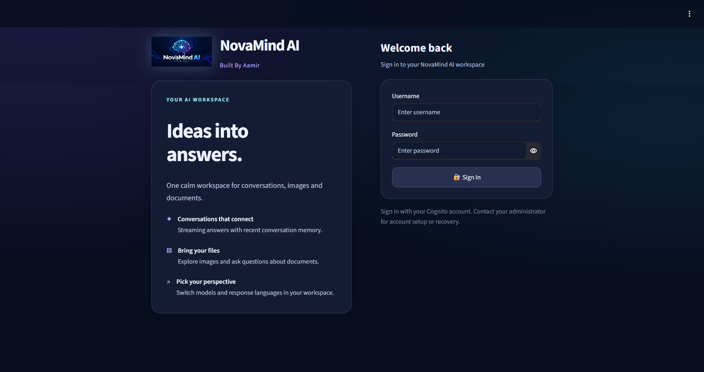</td>
    <td width="50%">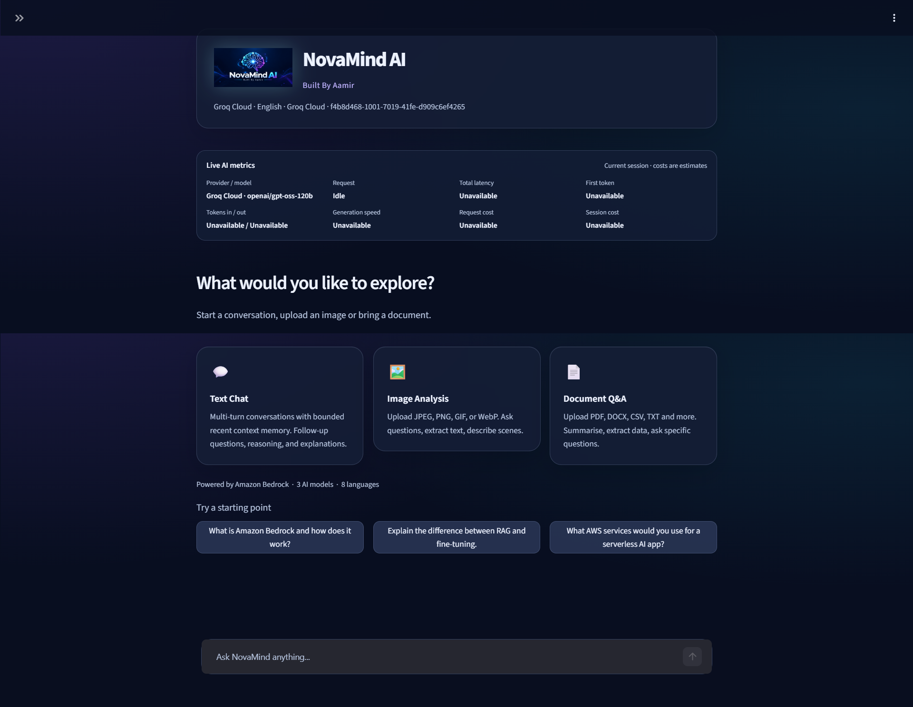</td>
  </tr>
  <tr>
    <td align="center"><sub>Cognito-gated sign-in experience</sub></td>
    <td align="center"><sub>Authenticated workspace, use-case cards, and live metrics</sub></td>
  </tr>
  <tr>
    <td width="50%">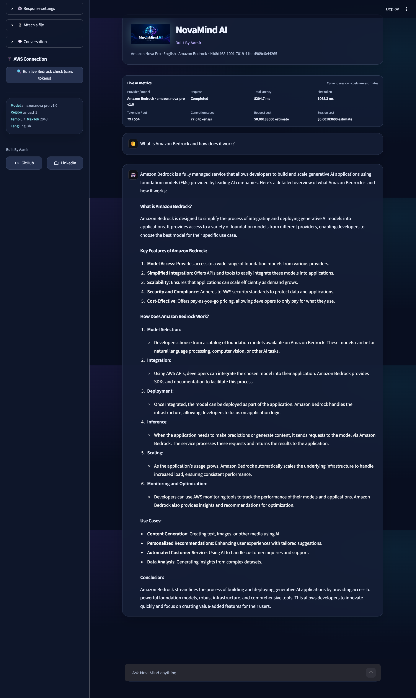</td>
    <td width="50%">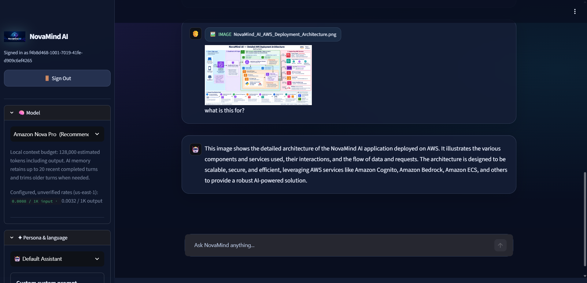</td>
  </tr>
  <tr>
    <td align="center"><sub>Streaming Bedrock response and session usage panel</sub></td>
    <td align="center"><sub>Validated image upload and multimodal Q&amp;A</sub></td>
  </tr>
</table>

<details>
<summary><strong>Long-form response example</strong></summary>

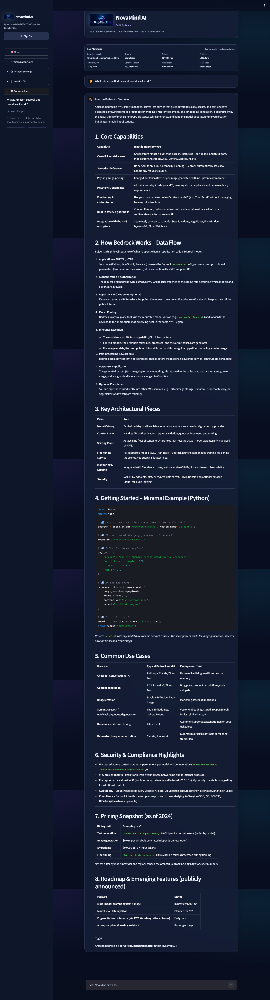

The interface renders long Markdown responses, keeps the chat input available, and exposes model, persona, response, attachment, and conversation controls in the sidebar.
</details>

<a id="technology-stack"></a>
## Technology stack

| Layer | Technology | Why it is used here |
|---|---|---|
| Language | Python 3.14.6 | One language across UI, validation, AWS integration, tests, and container runtime |
| Application UI | Streamlit 1.61.1 | Stateful chat widgets, streaming placeholders, uploads, sidebar controls, and rapid delivery of an interactive Python app |
| AWS AI | Amazon Bedrock Runtime Converse API | Managed access to approved foundation models through a common text/multimodal request contract |
| External AI | Groq OpenAI-compatible chat-completions endpoint | Optional low-latency text streaming without adding a third-party SDK |
| AWS SDK | boto3 / botocore | Explicit Cognito, Bedrock, DynamoDB, and S3 clients with controlled credential selection and timeouts |
| Validation | Pillow, pypdf, isolated parsers | Full image decoding, bounded previews, and fail-closed document structure checks |
| Edge and networking | CloudFront VPC origin, VPC, internal ALB, target group, security groups | HTTPS edge access and a private origin path to the Streamlit workload |
| Compute | Amazon ECS on AWS Fargate | Runs the long-lived, WebSocket-capable Streamlit container without managing EC2 hosts |
| Registry | Amazon ECR | Stores the deployment image consumed by the ECS task definition |
| Identity and secrets | Cognito, IAM roles, GitHub OIDC, Secrets Manager | End-user identity, least-privilege workload/deployment identity, and runtime secret injection |
| State | Streamlit session state; optional DynamoDB + S3 | Fast in-session conversations, with explicit owner-scoped persistence when existing stores are configured |
| Monitoring | JSON application events and CloudWatch Logs | Centralized ECS logs and safe failure classification; no tracing or alarm configuration is versioned here |
| Delivery | GitHub Actions, Docker, AWS CLI, `jq` | Offline verification, image build/push, task-definition revisioning, and ECS rollout validation |
| Testing | `unittest`, Streamlit `AppTest`, mocks, network/AWS guards | Deterministic regression checks without credentials, network access, or billable inference |

<a id="architecture-without-cicd"></a>
## AWS architecture — application path without CI/CD


### Request path

1. **User → CloudFront:** the browser opens the CloudFront HTTPS endpoint on port 443. Streamlit uses normal HTTP requests plus a persistent WebSocket connection.
2. **CloudFront → VPC origin:** CloudFront terminates viewer TLS and sends dynamic application traffic through a CloudFront VPC origin. The diagram records an origin request policy that preserves the headers, cookies, and query strings required by Streamlit.
3. **VPC origin → internal ALB:** deployment screenshots confirm the Application Load Balancer uses the **internal** scheme, spans two Availability Zones, and listens on HTTP port 80. It is not an internet-facing ALB.
4. **ALB → target group → Fargate:** the target group forwards to the Streamlit container on port **8501** and checks `/_stcore/health`. The Docker image exposes the same port and defines the same health endpoint.
5. **Streamlit → identity/model/storage services:** the application authenticates against Cognito, uses the ECS task role for AWS service calls, optionally retrieves a Groq key injected from Secrets Manager, and invokes Bedrock or the external Groq endpoint.
6. **Streaming return path:** generated text travels back through the same target group, ALB, VPC origin, and CloudFront connection to the browser. Application JSON events go to the configured ECS CloudWatch log group.

### Network placement and trust boundaries

The architecture artifact records a `10.20.0.0/16` VPC across `us-east-1a` and `us-east-1b`, with `10.20.1.0/24` and `10.20.2.0/24` labeled public and `10.20.11.0/24` and `10.20.12.0/24` labeled private. It places the internal ALB in the first pair and the ECS workload in the private tier. The ALB screenshot independently confirms two subnets and an internal scheme; the repository does **not** include ECS network configuration or route tables, so task-subnet assignment, public-IP settings, NAT gateways, and VPC endpoints cannot be re-verified from source.

The diagram specifies an ALB security group that accepts port 80 only from the CloudFront VPC-origin service security group, and an ECS security group that accepts port 8501 only from the ALB security group. Those are the intended least-privilege hops. Outbound connectivity is still required for Cognito, Bedrock, Secrets Manager, ECR/logging during task operation, and for Groq when selected. The precise egress mechanism is not captured in this repository and must be checked in the live VPC.

<a id="architecture-with-cicd"></a>
## AWS architecture — application and delivery pipeline


The runtime path remains CloudFront → VPC origin → internal ALB → ECS/Fargate. The delivery path is deliberately separate:

1. A push or pull request targeting `main` runs CI.
2. CI installs the Windows dependency lock, runs the guarded offline suite, and then builds the Linux Docker image on Ubuntu.
3. CD starts **only when manually dispatched**. It refuses non-`main` refs and queries GitHub for a successful push-triggered CI run for the exact commit.
4. GitHub exchanges its OIDC token for an AWS deployment role; no long-lived AWS access keys are stored in the workflow.
5. The job reuses an existing commit-tagged ECR image when its digest is valid, or builds and pushes `<repository>:<git-sha>` when absent.
6. It copies the active ECS task definition, changes only the `novamind-chatbot` container image, validates that no other configuration changed, and registers a new revision.
7. ECS receives the new task definition, performs the service rollout, and the workflow waits for service stability before confirming the primary rollout, task-definition ARN, and deployed image.

> [!NOTE]
> The diagram records an ECS rolling deployment with circuit breaker and automatic rollback. `cd.yml` does not enable or change that setting; it relies on the existing ECS service configuration. Because that service definition is not versioned in this repository, the circuit-breaker/rollback setting must be verified in ECS before each production rollout.

<a id="aws-services"></a>
## AWS services and responsibilities

| Service | Role in NovaMind AI | Connections and responsibility |
|---|---|---|
| **Amazon CloudFront** | Public HTTPS entry point and edge delivery | Uses a VPC origin to reach the private ALB and must preserve Streamlit WebSocket/session traffic. The screenshot shows standard logging off; access-log retention is therefore not evidenced. |
| **Amazon VPC** | Network isolation boundary | Separates the diagrammed edge-facing load-balancer tier from private application subnets. Routes, NAT, and endpoints are operator-managed and not stored as IaC here. |
| **Application Load Balancer** | Internal layer-7 router | Listens on HTTP/80, forwards to the ECS target group on 8501, and performs health checks. Only CloudFront should reach its security group. |
| **Amazon ECS / Fargate** | Managed container execution | Runs the non-root Streamlit image and service. ECS owns task lifecycle and rolling replacement; Fargate avoids host management. WebSocket/session behavior must be considered before scaling beyond one task. |
| **Amazon ECR** | Private image registry | Receives immutable Git-SHA tags from CD and supplies the image to the ECS execution path. Lifecycle policy and scanning policy are not defined in this repository. |
| **IAM** | Workload and delivery authorization | The ECS execution role pulls ECR images and writes logs; the application task role is for runtime AWS calls; the GitHub OIDC role deploys. These roles should remain separate and least-privileged. |
| **AWS Secrets Manager** | Runtime secret source | Deployment evidence shows Groq credentials stored outside the image. ECS should inject the secret through a task-definition secret reference; the application reads `GROQ_API_KEY` without calling Secrets Manager directly. |
| **Amazon Cognito** | End-user authentication | The app calls public Cognito user APIs for sign-in, MFA, online token verification, and sign-out. A public app client without a client secret is expected. |
| **Amazon Bedrock** | Primary model inference | The task role authorizes `bedrock-runtime` Converse streaming for approved model resources. The application fixes AWS operation to `us-east-1` and validates model capabilities before invocation. |
| **Amazon CloudWatch Logs** | Central runtime logs | Receives container/application output. The screenshot shows `/ecs/novamind-chatbot` with one-week retention at capture time; alarms, dashboards, and tracing are not versioned here. |
| **Amazon DynamoDB** *(optional)* | Owner-scoped conversation metadata and snapshots | Enabled only when a pre-existing table is named. Uses conditional versioning, strongly consistent reads, bounded payloads, and tombstones for deletion. |
| **Amazon S3** *(optional)* | Private saved-attachment bytes | Enabled alongside DynamoDB when a pre-existing bucket is named. Objects use content-addressed owner/conversation prefixes and explicit AES-256 server-side encryption requests. Bucket policy, Block Public Access, and lifecycle remain operator duties. |

<details>
<summary><strong>AWS deployment evidence</strong></summary>

#### CloudFront distribution

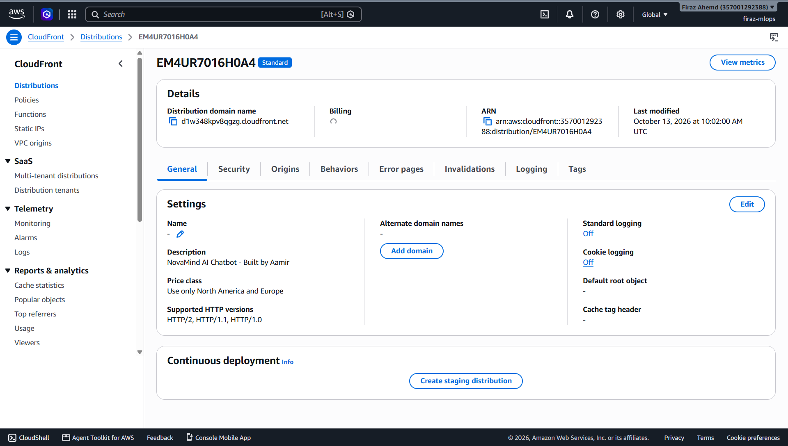

#### Internal Application Load Balancer

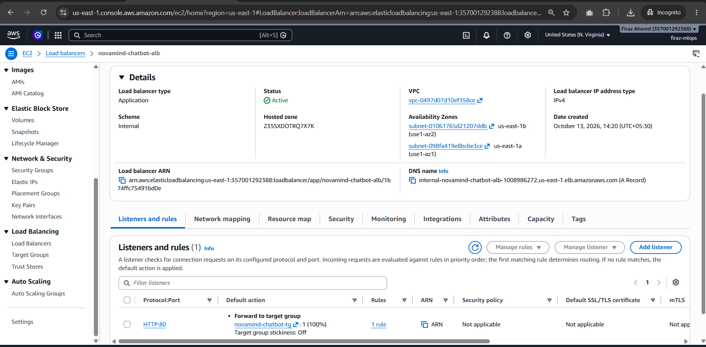

#### ECS cluster and service

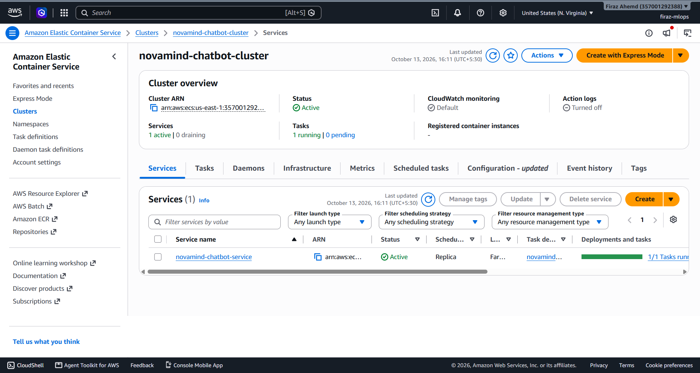

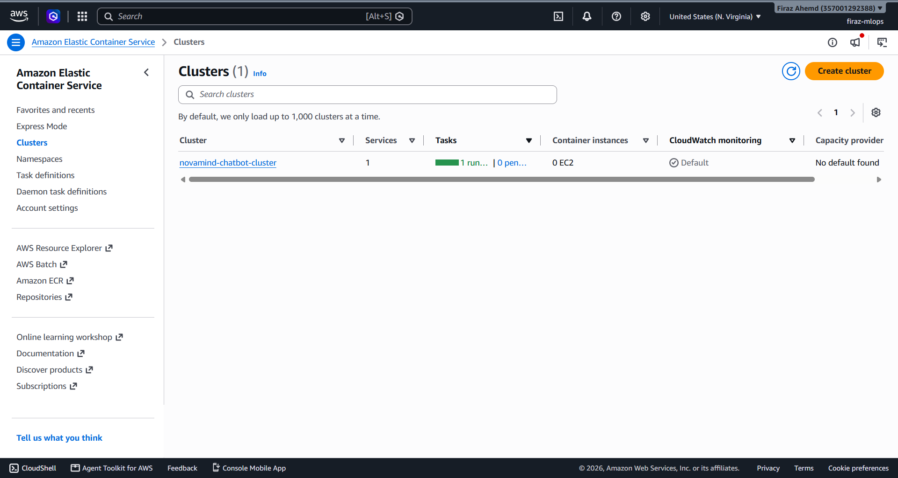

#### ECR image repository

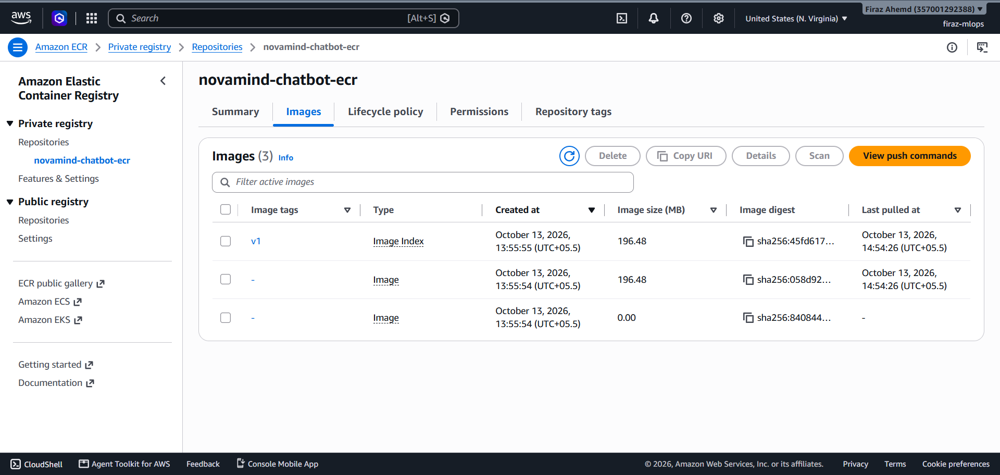

#### Cognito user pool

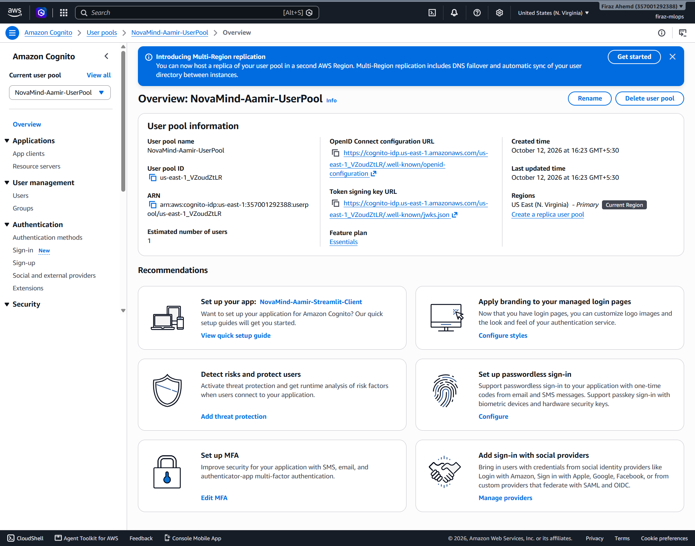

#### Secrets Manager

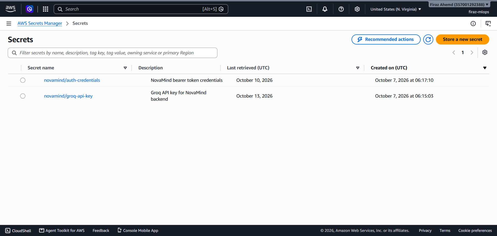

#### CloudWatch Logs

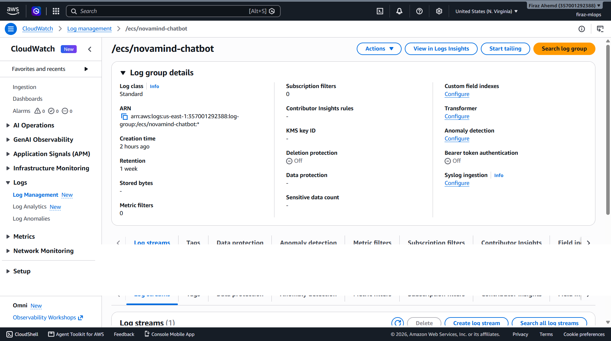

</details>

<a id="end-to-end-flow"></a>
## End-to-end application flow

1. **Open the app.** CloudFront serves the Streamlit application through the private origin path.
2. **Authenticate.** Cognito is the default. The app uses `USER_PASSWORD_AUTH`, handles SMS/TOTP MFA when challenged, rejects malformed/wrong-context access-token claims, and requires Cognito `GetUser` to verify the exact token and identity. Demo mode is explicit, local-only, and blocked in deployed environments.
3. **Establish a scoped session.** The verified Cognito subject owns an in-memory authorization scope. A 30-second watchdog checks active sessions; the defaults are a 15-minute idle limit and one-hour absolute limit, bounded by token expiry.
4. **Choose behavior.** The user selects a model, persona/system prompt, language, temperature, and maximum output length. Changing models recreates the provider service and checks retained-context compatibility.
5. **Validate input.** Text is normalized and bounded. An attachment is validated before it becomes pending state. The request admission layer re-checks message structure, attachment capability/count/size, serialized payload, temperature, output budget, and estimated context budget.
6. **Prepare context.** The application takes completed recent turns only. It trims older complete pairs when required by the 40-message memory window or model context policy; it never silently mutates the persisted display transcript.
7. **Invoke a provider.** Bedrock receives Converse content blocks and inference configuration. Groq receives a text-only OpenAI-compatible message array. Authorization is checked before invocation and while streaming.
8. **Stream and display.** Text deltas update the current assistant message and live metrics. Bedrock accepts only successful `end_turn` or `stop_sequence` completion; Groq requires non-empty streamed output.
9. **Commit or isolate failure.** A completed turn is appended to AI context and the visible transcript. On timeout, invalid stream sequence, cancellation, provider error, auth expiry, or other failure, partial text is marked incomplete and excluded from later model context.
10. **Continue, summarize, export, or save.** The user can ask follow-ups, request an AI summary, copy a gated transcript, or explicitly save to configured DynamoDB/S3 storage.

<a id="ai-integrations"></a>
## AI model integrations

### Supported selections

| UI selection | Model ID | Provider | Text | Images | Documents | Notes |
|---|---|---|:---:|:---:|:---:|---|
| Amazon Nova Pro | `amazon.nova-pro-v1:0` | Bedrock | ✓ | ✓ | ✓ | Recommended; one bounded access-denied fallback to `us.amazon.nova-pro-v1:0` |
| Amazon Nova Lite | `amazon.nova-lite-v1:0` | Bedrock | ✓ | ✓ | ✓ | Lower-cost/faster Nova option in the UI |
| Amazon Nova Micro | `amazon.nova-micro-v1:0` | Bedrock | ✓ | — | — | Capability policy rejects attachments |
| Claude 3.5 Sonnet | `anthropic.claude-3-5-sonnet-20241022-v2:0` | Bedrock | ✓ | ✓ | ✓ | No automatic cross-model fallback |
| Groq Cloud — Llama 3.3 70B | `llama-3.3-70b-versatile` | Groq | ✓ | — | — | Default configured Groq option |
| Groq Cloud — GPT-OSS 120B | `openai/gpt-oss-120b` | Groq | ✓ | — | — | Available by setting `GROQ_MODEL` before startup |

Model availability still depends on the AWS account/region or Groq account. A model appearing in the UI is not proof of entitlement.

### Bedrock request contract

- API: boto3 `bedrock-runtime.converse_stream`.
- System input: selected persona or custom prompt, plus the chosen language instruction.
- User content order: optional image, optional document, then text.
- Inference parameters: `maxTokens` from 1–8192 subject to the model policy, and `temperature` from 0–1.
- Streaming: text deltas are yielded immediately; unsupported tool/reasoning blocks fail closed because the UI implements text answers, not tool execution.
- Reliability: SDK replay is disabled at the client boundary, streams have finite timeouts, and Nova Pro fallback is bounded and only allowed before output.

### Groq request contract

- Endpoint: Groq's HTTPS OpenAI-compatible chat-completions API using the Python standard library.
- Authentication: `GROQ_API_KEY` read at runtime; in ECS it should be injected from Secrets Manager.
- Payload: system + text-only conversation messages, temperature, maximum completion tokens, streaming enabled, and usage requested.
- Streaming: SSE deltas are emitted to the same UI contract used by Bedrock; HTTP/network failures are converted to safe categories.
- Boundary: image and document blocks are rejected locally for Groq models. Groq has no configured per-token pricing in this project, so cost remains unknown rather than being shown as zero.

<a id="security"></a>
## Authentication and security

### End-user identity

- Cognito is fail-closed by default; missing pool/client settings do not fall back to demo mode.
- The public app client is expected to have no client secret and to support `USER_PASSWORD_AUTH`.
- Access-token decoding is only a rejection filter. Successful Cognito `GetUser` verification for the exact token is authoritative.
- ID and refresh tokens are not retained. Access tokens stay in server-side session memory and are omitted from object representations.
- SMS and authenticator-app MFA challenges are supported. Sign-up, account confirmation/recovery, new-password completion, federation, and MFA enrollment are external administration flows.
- Sign-out clears local state first, then attempts Cognito global sign-out.

### AWS and application controls

- Local AWS calls require the explicit `novamind` profile; deployed calls require `NOVAMIND_AWS_MODE=task-role` and the ECS container-role provider.
- Static AWS access-key environment variables, default-profile drift, conflicting regions, and local profiles in task-role mode are rejected.
- The ECS **execution role**, application **task role**, and GitHub **deployment role** have distinct responsibilities.
- CD uses GitHub OIDC (`id-token: write`) instead of stored AWS keys. The AWS-side trust policy is not present here and must restrict repository, branch, and audience claims.
- CloudFront provides the public HTTPS boundary. The internal ALB uses HTTP inside the VPC-origin path; origin and task security groups should permit only the immediately preceding hop.
- Streamlit CORS and XSRF protections remain enabled. Uploaded previews are inline private data rather than public media URLs.
- Error messages are sanitized before display, and structured logs omit prompts, credentials, tokens, provider bodies, and raw SDK errors.
- Secrets must be injected at runtime. They do not belong in `.env`, the image, GitHub variables printed to logs, task-definition plaintext, or this README.

### Upload and persistence controls

- Images: maximum 3.75 MiB, 8,000 px per side, 16 million pixels, with animation frame/pixel ceilings.
- Documents: maximum 4.5 MiB; PDFs and Office archives receive bounded structural validation in an isolated subprocess. DOC/XLS support needs the optional legacy dependency set.
- Total model request: maximum 20 MiB serialized payload, 20 images, five documents, and 200 messages, with tighter conversation-memory and model-context limits in normal use.
- Optional DynamoDB reads/writes are derived from the verified identity, conditionally versioned, and bounded to 200 KB snapshots.
- Optional S3 objects are owner/conversation scoped, hash-checked on restore, requested with AES-256 encryption, and designed for a 30-day lifecycle. Bucket enforcement and lifecycle configuration are not created by the app.

<a id="continuous-integration"></a>
## GitHub Actions — continuous integration

The workflow in `.github/workflows/ci.yml` runs on:

- pushes to `main`; and
- pull requests targeting `main`.

The `Python Tests` job uses `windows-latest`, Python **3.14.6**, a 15-minute timeout, `pip install -r requirements.txt`, `pip check`, and `python -B -m tests.run_offline`. The canonical runner creates deterministic local/demo configuration before discovery and patches DNS, sockets, boto/botocore client creation, credential resolution, and API calls. A caught forbidden operation still fails the suite.

Only after tests pass does the `Docker Build` job run on `ubuntu-latest`. It builds `novamind-ai:ci` from the Dockerfile, exercising the separate Linux lock and the image's import-time validation. Any non-zero install, `pip check`, test, or Docker build result fails its job and blocks the dependent stage. The current workflow does **not** contain a dedicated linter, SAST scanner, coverage gate, registry push, or live cloud test.

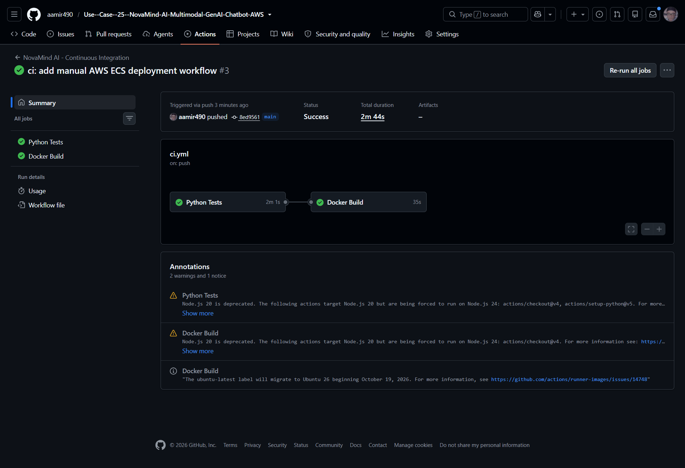

<a id="continuous-deployment"></a>
## GitHub Actions — continuous deployment

The workflow in `.github/workflows/cd.yml` is **manual** (`workflow_dispatch`). It is not triggered automatically when CI completes.

Its single Ubuntu deployment job:

1. checks out the selected commit and rejects any ref other than `main`;
2. queries GitHub Actions and requires a successful, push-triggered CI run for that exact SHA;
3. assumes the deployment role with GitHub OIDC in `us-east-1`;
4. logs in to ECR;
5. uses the full Git commit SHA as an immutable image tag, reusing a valid existing digest or building and pushing the missing image;
6. fetches the current ECS task definition, replaces only the named application container image, and verifies the rest of the definition is unchanged;
7. registers a new task-definition revision and updates the ECS service;
8. waits for service stability and emits service diagnostics if stabilization fails; and
9. verifies the primary rollout is `COMPLETED` and that ECS is running the exact registered revision and image URI.

If the ECS service's deployment circuit breaker with rollback is enabled—as recorded in the architecture diagram—ECS can roll back a failed deployment. The workflow itself does not configure or independently verify that flag, so this is a live-service prerequisite rather than a repository-enforced guarantee.

<table>
  <tr>
    <td width="50%">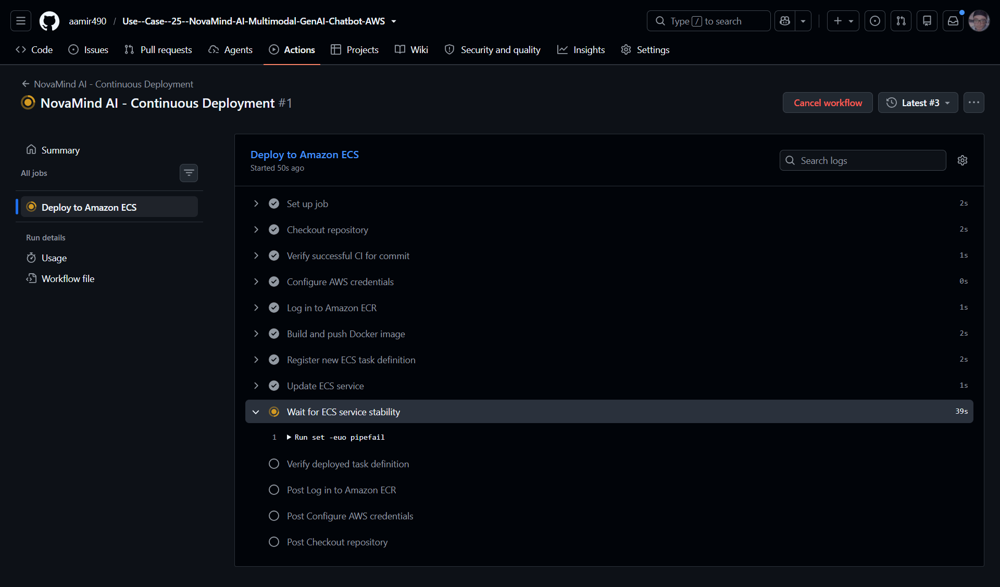</td>
    <td width="50%">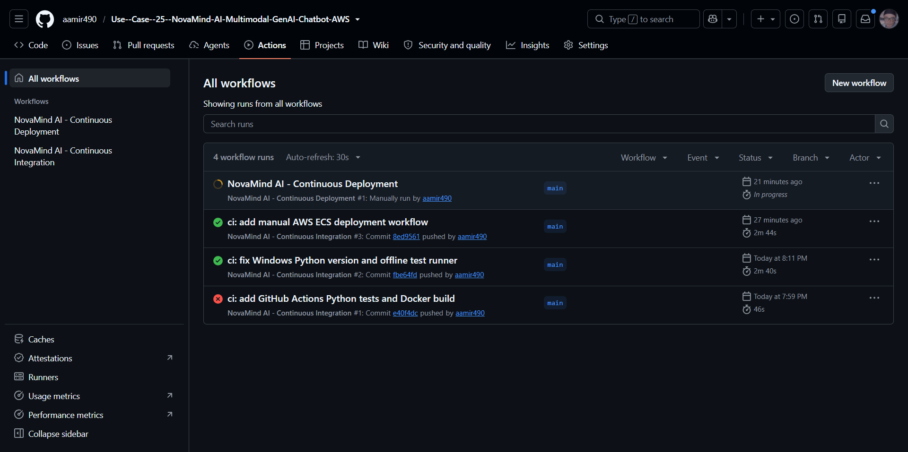</td>
  </tr>
  <tr>
    <td align="center"><sub>Manual deployment progressing toward ECS stability</sub></td>
    <td align="center"><sub>Separate CI and manually dispatched CD workflows</sub></td>
  </tr>
  <tr>
    <td width="50%">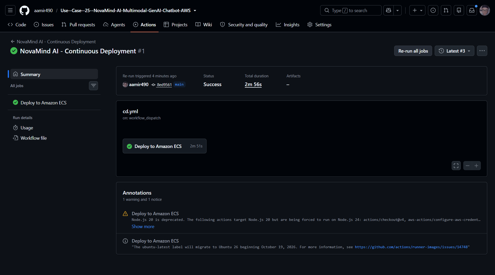</td>
    <td width="50%">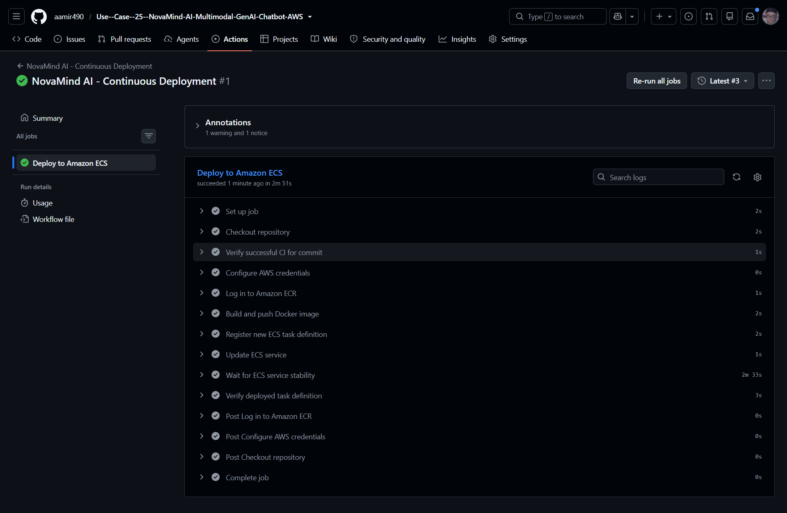</td>
  </tr>
  <tr>
    <td align="center"><sub>Successful manual CD run</sub></td>
    <td align="center"><sub>Commit CI gate, OIDC, image, task revision, stability, and deployment verification</sub></td>
  </tr>
</table>

<a id="local-setup"></a>
## Local setup and installation

### Prerequisites

- Git
- standard CPython **3.14.6** on Windows x64 for the pinned local environment
- an approved AWS named profile called `novamind` for Bedrock operations, or explicit local demo auth for UI-only development
- optional Docker Desktop for the Linux container path

> [!CAUTION]
> `.env.example` is a reference only; the application does not auto-load `.env`. Never put AWS access keys, Cognito passwords/tokens, or a real Groq key in the repository. Local mode uses a named AWS profile; ECS uses a task role.

### 1. Clone and create the environment

```powershell
git clone https://github.com/aamir490/Use--Case--25--NovaMind-AI-Multimodal-GenAI-Chatbot-AWS.git
Set-Location Use--Case--25--NovaMind-AI-Multimodal-GenAI-Chatbot-AWS

py -3.14 -m venv .venv
.\.venv\Scripts\Activate.ps1
python -m pip install --upgrade pip
python -m pip install -r requirements.txt
python -m pip check
```

`requirements.txt` is the exact Windows x64/CPython 3.14.6 lock recorded by the project. `requirements-linux.txt` is installed by the Dockerfile. Optional legacy `.doc`/`.xls` parsing uses `requirements-legacy.txt`; DOCX/XLSX do not require it.

### 2. Choose authentication

For the safest local UI walkthrough, explicitly enable demo authentication and bind Streamlit to loopback:

```powershell
$env:NOVAMIND_AWS_MODE = 'local'
$env:NOVAMIND_AUTH_MODE = 'demo'
$env:AWS_PROFILE = 'novamind'
$env:AWS_DEFAULT_REGION = 'us-east-1'
```

Use the documented demo account shown in `novamind/config/settings.py`. Demo mode authenticates the local UI but does not grant Bedrock access; a configured `novamind` AWS profile is still required before sending a Bedrock request.

For Cognito, use identifiers for an existing `us-east-1` pool and public app client:

```powershell
$env:NOVAMIND_AWS_MODE = 'local'
$env:NOVAMIND_AUTH_MODE = 'cognito'
$env:AWS_PROFILE = 'novamind'
$env:AWS_DEFAULT_REGION = 'us-east-1'
$env:COGNITO_USER_POOL_ID = '<existing-user-pool-id>'
$env:COGNITO_APP_CLIENT_ID = '<existing-public-app-client-id>'
```

### 3. Configure a provider

Bedrock is the default:

```powershell
$env:NOVAMIND_AI_PROVIDER = 'bedrock'
$env:BEDROCK_MODEL_ID = 'amazon.nova-pro-v1:0'
$env:BEDROCK_MAX_TOKENS = '2048'
$env:BEDROCK_TEMPERATURE = '0.7'
```

Groq is optional and text-only. Set the secret only in the launching process or an approved secret manager:

```powershell
$env:NOVAMIND_AI_PROVIDER = 'groq'
$env:GROQ_MODEL = 'llama-3.3-70b-versatile'  # or openai/gpt-oss-120b
$env:GROQ_API_KEY = '<retrieve-securely-at-runtime>'
```

Optional persistence requires existing resources; the app does not create them:

```powershell
$env:NOVAMIND_DYNAMODB_TABLE = '<existing-table-name>'
$env:NOVAMIND_S3_BUCKET = '<existing-private-bucket-name>'
```

### 4. Run tests and start Streamlit

```powershell
powershell -NoProfile -ExecutionPolicy Bypass -File .\scripts\run_offline_tests.ps1
python -m streamlit run mod_chatbot_frontend.py --server.address 127.0.0.1
```

Open `http://localhost:8501`. Sending chat, requesting a summary, or pressing the labeled live provider check can call a paid external service; the regression suite does not.

### Docker build

```powershell
docker build --tag novamind-ai:local .
docker run --rm --entrypoint python novamind-ai:local -c "import utils.validators; import novamind.ui.app; import services.attachment_store"
```

The image runs as UID/GID `10001`, exposes port 8501, and defines a health check against `http://127.0.0.1:8501/_stcore/health`. Supply runtime configuration through your approved local or ECS mechanism; do not bake credentials into build arguments or layers.

<a id="testing"></a>
## Testing and quality assurance

The suite uses Python `unittest` and Streamlit `AppTest`. It covers HTML escaping, upload/document/image validation, model fallback, stream integrity, usage accounting, context trimming, request limits, AWS configuration, modularity, real widget reruns, Cognito flows, authorization boundaries, DynamoDB/S3 persistence behavior, UI/session behavior, security hardening, retries, observability, provider support, and deployment readiness.

The offline runner:

- installs deterministic process-local configuration before test discovery;
- discovers every `test_*.py` module once and rejects duplicate test IDs;
- blocks network resolution/connections/sends, boto/botocore client creation, AWS credential resolution, and API calls;
- uses mocks at service boundaries instead of credentials or live inference; and
- returns a non-zero process exit when any assertion or forbidden operation occurs.

**Verified in this workspace on 13 October 2026:** `500` tests ran successfully in `16.545s` using `python -B -m tests.run_offline`. This is a functional regression result, not a coverage percentage, load test, browser-visual test, or live AWS/Groq validation.

CI additionally performs `pip check` and a clean Docker build. The Dockerfile performs another `pip check` and imports critical runtime modules during image construction.

<a id="deployment-monitoring"></a>
## Deployment and monitoring

### Container-to-service release

```text
Docker build → commit-SHA tag → Amazon ECR → new ECS task-definition revision
             → ECS service update → target health → service stability → image/revision verification
```

- The runtime image is based on `python:3.14.6-slim-bookworm`, runs as a non-root user, and contains only application/runtime files selected by the Dockerfile.
- The ECS execution role handles image pull and log delivery. The task role supplies runtime permissions; application code deliberately excludes shared profiles, environment keys, and instance metadata in task-role mode.
- Container and target-group health should agree on `/_stcore/health` and port 8501.
- ECS task replacements lose unsaved in-memory sessions. Optional persistence can restore explicitly saved conversations, but it does not make Streamlit's live WebSocket state distributed.

### What to monitor

- ECS desired/running/pending counts, rollout state, task exits, and recent service events;
- ALB healthy/unhealthy targets, response codes, target latency, idle timeout, and WebSocket disconnects;
- container health, memory/CPU pressure, parser subprocess failures, and restarts;
- CloudWatch JSON events grouped by provider, operation, status, error category, and request ID;
- Bedrock/Groq throttling, timeouts, first-token time, completion status, and unknown usage metadata;
- Cognito sign-in/verification failures without logging tokens or full provider responses; and
- ECR scan/lifecycle status and log retention.

For a failed rollout, inspect the GitHub job's emitted ECS service diagnostics, then the ECS deployment/events, stopped-task reason, target health, and CloudWatch stream. A healthy Streamlit endpoint proves process readiness—not model entitlement, egress, Cognito configuration, or successful inference.

<a id="cost-scalability"></a>
## Cost optimization and scalability

No fixed monthly cost is claimed because traffic, task size/count, model choice, token volume, ALB capacity, edge transfer, log ingestion, and optional storage are not captured as a stable workload profile.

Primary cost drivers are Fargate vCPU/memory runtime, ALB hours/LCUs, CloudFront requests/transfer, Bedrock inference, optional Groq usage, CloudWatch ingestion/retention, ECR storage, Cognito active users, Secrets Manager, and optional DynamoDB/S3. NAT gateway processing would also matter if the private-task design uses NAT; the repository does not establish whether NAT or VPC endpoints provide egress.

Practical optimization options:

- right-size task CPU/memory from observed utilization and parser peaks;
- use Nova Lite or Micro for compatible text workloads and reserve Pro/Claude for harder or multimodal requests;
- cap response length and conversation context, already supported in the UI and admission policy;
- apply ECR lifecycle/scan policies and deliberate CloudWatch retention;
- use VPC endpoints where technically and economically appropriate, while retaining required external Groq egress if enabled;
- add ECS target-tracking autoscaling only after validating WebSocket drain, reconnect, and session-affinity behavior; and
- move more live state out of a single Streamlit process before treating horizontal replicas as transparent.

Current production limitations include in-memory active sessions, no IaC in this repository, no versioned alarm/dashboard configuration, no documented load test, no WAF/rate-limiting layer, and no distributed tracing.

<a id="troubleshooting"></a>
## Troubleshooting and engineering challenges

| Challenge | Likely root cause | Implemented/design response | Engineering lesson |
|---|---|---|---|
| Streamlit loads but disconnects or loses state | WebSocket upgrade, forwarding, idle timeout, cookies, or session routing is wrong | Architecture uses CloudFront VPC origin + ALB and calls out forwarded headers/cookies/query strings; the exact policies must be checked live | Health checks and page loads do not validate a long-lived WebSocket path |
| Internal ALB cannot be used as a normal public CloudFront origin | The origin is deliberately private | CloudFront VPC origin provides the private edge-to-VPC path; ALB is confirmed internal | Ingress design and ALB scheme must be decided together |
| GitHub deployment cannot assume AWS role | OIDC trust, audience, repository/ref condition, or `id-token` permission is wrong | Workflow requests `id-token: write` and uses `configure-aws-credentials`; AWS trust policy remains an external prerequisite | Replace static CI keys with federation, but test both workflow permissions and trust conditions |
| ECS task starts but AI calls fail | Execution-role/task-role responsibilities confused, model resource not allowed, secret missing, or private-subnet egress absent | Code uses container task credentials only, safe errors, and a labeled live check; Groq secret is runtime-only | A successful image pull proves the execution role, not application authorization |
| Deployment job finishes update but service is unhealthy | Wrong image/config, port/health mismatch, missing runtime settings, or failed target registration | Workflow waits for stability, prints service diagnostics on failure, and verifies the exact task revision/image | A deployment is complete only after runtime state matches the intended artifact |
| File is small but rejected | Corruption, wrong magic bytes, decompression ratio, parser time/memory, page/object, image dimension, or animation limit | Validation is fail-closed and bounded; re-export or simplify the file | Byte size alone is not a safe upload policy |
| Partial response appears after an error | Provider/connection failed after output started or stream ended without a valid stop | UI marks it incomplete and excludes it from future context; fallback is never attempted after output | Displaying partial progress must not silently corrupt conversation state |
| Cost shows “Unavailable” | Provider omitted/inconsistently reported usage, or no project rate is configured | Unknown stays unknown rather than becoming zero; estimates are frozen per attempt | Observability should preserve uncertainty |

Operational first checks:

```powershell
# Offline configuration/import/model-policy diagnostic; no AWS call
.\.venv\Scripts\python.exe -B scripts/bedrock_model_access_check.py

# Guarded regression suite
powershell -NoProfile -ExecutionPolicy Bypass -File .\scripts\run_offline_tests.ps1
```

Use live diagnostic flags only with explicit authorization because they resolve identity, query Bedrock, and—in inference mode—consume model capacity.

<a id="interview-guide"></a>
## How to explain this project in an interview

### 30-second version

> “NovaMind AI is a secure multimodal Streamlit chatbot deployed on AWS. Users authenticate with Cognito, access the app through CloudFront and a private VPC origin, and send text, images, or validated documents to Amazon Bedrock. The app streams responses, protects per-user session state, and runs on ECS Fargate behind an internal ALB. GitHub Actions tests it offline, builds the container, and performs a manually approved OIDC-based deployment with immutable ECR tags and ECS rollout verification.”

### 60-second version

> “I built NovaMind AI to demonstrate the complete path around a generative-AI call, not just prompt and response. The Streamlit application supports multi-turn chat, image understanding, direct document Q&A, model selection, prompt personas, multilingual instructions, and live usage/latency metrics. Bedrock uses the Converse streaming API; Groq is an optional text-only provider. Cognito is the default auth system, and conversation/upload state is bound to the verified subject. Uploads and requests are validated against size, format, parser, capability, and context budgets. In AWS, CloudFront reaches an internal ALB through a VPC origin, which routes to a non-root Fargate container on port 8501. CI runs 500 guarded offline tests and a Docker build. CD is intentionally manual: it verifies CI for the exact commit, assumes AWS through OIDC, publishes a Git-SHA image to ECR, registers a task revision, updates ECS, waits for stability, and verifies the artifact actually deployed.”

<details>
<summary><strong>2–3 minute technical explanation</strong></summary>

“I separated the system into UI, orchestration, domain/session, and service boundaries. Streamlit owns interaction and reruns, while the provider services own request formatting and stream correctness. Before inference, the application validates the selected model's capabilities, the complete retained history, attachment counts and sizes, serialized payload size, context estimate, temperature, and output reservation. Bedrock requests use image/document/text Converse blocks. A completed stream must have a valid terminal reason and non-empty text; otherwise any partial output is visible but never committed to model memory. Nova Pro has one tightly scoped fallback to its US inference profile only on a pre-output access-denied response.

Authentication defaults to Cognito. A locally decoded token never establishes trust by itself—the application verifies it with Cognito `GetUser`, binds data to the verified subject, applies idle and absolute expiry, and re-checks authorization around provider and persistence boundaries. Local demo auth is explicitly blocked in deployed environments. AWS credentials also fail closed: local development selects one named profile, while ECS mode accepts only container task-role credentials and rejects static keys.

The runtime is a non-root Docker container on Fargate. The public boundary is CloudFront HTTPS; a CloudFront VPC origin reaches an internal ALB, which routes to the Streamlit target on 8501 and checks `/_stcore/health`. Bedrock, Cognito, logs, image pull, and secrets each have separate operational/IAM responsibilities. Optional DynamoDB and S3 modules provide explicit, owner-scoped saved conversations, but active Streamlit/WebSocket state is still in memory, so horizontal scaling needs session-aware design.

For delivery, CI runs on every main push and PR. A Windows job installs the pinned environment, performs `pip check`, and executes the suite with socket, DNS, AWS client, API, and credential-resolution guards. A dependent Ubuntu job builds the Linux image. CD is a separate manual approval boundary. It requires successful CI for the exact SHA, federates through GitHub OIDC, uses a Git-SHA ECR tag, changes only the task-definition image, waits for ECS stability, and verifies the final revision and image. I deliberately distinguish that workflow guarantee from the ECS circuit breaker, which must already be configured on the service.”

</details>

### AWS architecture walkthrough

- Start at the trust boundary: browser HTTPS terminates at CloudFront.
- Explain why VPC origin is required: the ALB is internal, not publicly addressable.
- Follow port/protocol changes: 443 at the edge, HTTP/80 on the internal listener, TCP/HTTP 8501 to Streamlit.
- Separate security groups: CloudFront-origin identity to ALB; ALB identity to ECS task.
- Separate IAM roles: ECS execution, application task, and GitHub deployment.
- Finish with outbound services: Cognito identity, Bedrock inference, optional Groq secret/egress, ECR image pull, and CloudWatch logs.
- State the evidence boundary: diagrams/screenshots exist, but routes, security-group rules, and ECS network assignment are not committed as IaC.

### CI/CD explanation

- CI is automatic on `main` push/PR and has two gates: guarded tests, then Docker build.
- CD is manual, main-only, and commit-specific; it does not deploy merely because some earlier CI run passed.
- GitHub OIDC removes long-lived AWS keys from GitHub.
- Git-SHA tags create traceability; an existing valid immutable image is reused.
- Task-definition validation prevents accidental drift: only the application image may change.
- Stability and deployed-image checks turn “API accepted the update” into “the expected release is running.”
- Circuit-breaker rollback is an ECS service setting, not something this workflow creates.

### Important engineering decisions

1. **Direct document input instead of RAG:** simpler and appropriate for one document within Bedrock limits; RAG becomes valuable for a large corpus or retrieval across documents.
2. **Fargate instead of Lambda:** Streamlit is a long-running, stateful, WebSocket application, while Lambda is optimized for short-lived stateless handlers.
3. **Strict stream commit semantics:** incomplete output must not poison later context.
4. **Capability-aware model switching:** changing providers cannot silently replay unsupported attachments.
5. **Explicit credentials:** named profile locally, task role in ECS, OIDC in GitHub—no ambiguous default chains or static keys.
6. **Manual CD:** provides a deployment approval boundary while retaining repeatability and exact-commit verification.
7. **Optional persistence:** keeps the core chat deployable while allowing owner-scoped durability when existing DynamoDB/S3 resources and policies are intentionally configured.

### Likely follow-up questions

| Interviewer question | Suggested discussion point |
|---|---|
| Why no RAG? | Current scope is direct Q&A for one bounded document. Add embeddings/vector retrieval when corpus size or cross-document search justifies it. |
| How would you scale it? | Externalize active session/conversation state, validate WebSocket reconnect and draining, then add ECS autoscaling and intentional stickiness only where needed. |
| How are secrets protected? | GitHub OIDC for deployment, ECS task roles for AWS calls, Secrets Manager injection for Groq, and no static keys accepted by application config. |
| What happens on partial generation? | Partial text is visibly marked incomplete, accounted for, and excluded from future AI context; no post-output fallback occurs. |
| What does CI prove? | Deterministic application behavior, dependency consistency, prohibited-network/AWS isolation, and that the Linux image builds. It does not prove live entitlement, network routes, visual layout, or load capacity. |
| How do you know deployment succeeded? | CD waits for ECS stability and verifies primary rollout state, exact task revision, and exact commit-tagged image. Target/application monitoring remains necessary afterward. |
| What would you improve first? | Commit infrastructure as code, add alarms and smoke tests, then externalize active session state before horizontal scaling. |

<a id="future-enhancements"></a>
## Future enhancements

The following are proposals, not current capabilities:

- model the VPC, CloudFront VPC origin, ALB, security groups, ECS service, roles, logs, and storage as reviewed Terraform/CDK/CloudFormation;
- add post-deployment authenticated smoke tests and explicit verification of the ECS deployment circuit breaker;
- add CloudWatch alarms/dashboards, distributed tracing, and service-level objectives;
- add WAF/rate controls and an abuse/quota strategy at the public boundary;
- externalize active session state and validate multi-task WebSocket draining/reconnection before autoscaling;
- add RAG with encrypted document storage, chunking, embeddings, retrieval evaluation, and citation UX for multi-document corpora;
- add managed secret rotation and a documented egress/VPC-endpoint architecture;
- add ECR enhanced scanning, image signing/provenance, SBOM generation, SAST, and dependency vulnerability gates;
- add browser-level visual/accessibility tests, live staging acceptance tests, load tests, and disaster-recovery exercises; and
- add tool-calling/agent workflows only with explicit tool authorization, audit, sandboxing, and prompt-injection controls.

<a id="repository-layout"></a>
## Repository layout

```text
.
├── mod_chatbot_frontend.py       # Streamlit compatibility launcher
├── novamind/                     # UI, domain state, configuration, orchestration
├── services/                     # Providers, auth, persistence, validation, observability
├── utils/validators.py           # Shared upload/input/export validation
├── tests/                        # 500-test offline regression suite
├── scripts/                      # Guarded test runner and opt-in Bedrock diagnostic
├── .github/workflows/            # Automatic CI and manual CD
├── .streamlit/config.toml        # Server port, upload, CORS/XSRF settings
├── Dockerfile                    # Non-root Python 3.14.6 Streamlit image
├── requirements*.txt             # Windows, Linux, and optional legacy locks
├── docs/                         # Focused engineering notes and task records
└── project-pic/                  # Architecture, application, CI/CD, and AWS evidence
```

<a id="author"></a>
## Author and repository

**Built by Aamir**

- GitHub: [github.com/aamir490](https://github.com/aamir490)
- Repository: [Use--Case--25--NovaMind-AI-Multimodal-GenAI-Chatbot-AWS](https://github.com/aamir490/Use--Case--25--NovaMind-AI-Multimodal-GenAI-Chatbot-AWS)

> This repository currently contains no license file. Review the repository's terms before reuse or redistribution.

---

<div align="center">
  <strong>NovaMind AI</strong> · Multimodal Generative AI on AWS<br>
  Designed and built by <a href="https://github.com/aamir490">Aamir</a>
</div>
