# NovaMind AI — Complete AWS Deployment Runbook & Interview Handbook

> **Version:** 14 October 2026  
> **Application:** NovaMind AI Multimodal Generative AI Chatbot (Python + Streamlit)  
> **Windows project:** `E:\codex-projetc\Chatbot_text_image`  
> **CLI profile:** `novamind` · **Region:** `us-east-1` · **AWS account:** `357001292388`  
> **Verified identity on 14 October 2026:** `arn:aws:iam::357001292388:user/firaz-mlops` (STS succeeded after Windows clock correction)  
> **Status:** Prior deployment and cleanup are historical. This guide **does not deploy anything**.

**What this book is for:** To understand, reproduce *after review*, verify, troubleshoot and explain the path from laptop to AWS public HTTPS and GitHub CI/CD. It is not a recovered transcript of every previously executed AWS CLI command. Commands that reconstruct missing historical choices are clearly marked **EXAMPLE**. Resource creation can cost money. Do not paste all commands at once: work step by step and examine the result.

## How to study this handbook

1. Read the **picture** and **why it matters** at the start of a step.
2. Read its **one-line `#` command comments** and run a command only if you intentionally want to rebuild.
3. Run the **verification** command before continuing; inspect the expected result.
4. Practice saying the **interview explanation** in your own words.
5. When you need advanced detail or full policy examples, use the **Deep Technical Reference** appended below.

**Legend:** **[READ-ONLY]** shows/checks; **[LOCAL]** acts on your laptop; **[CREATE/BILLABLE]** creates/changes AWS and may incur charges; **[DESTRUCTIVE]** deletes resources; **[EXAMPLE]** reconstructed, must be reviewed and filled in. Never display or commit secret values.

## Table of contents

- [A. Architecture at a glance](#a-architecture-at-a-glance)
- [B. Verified identity and safety](#b-verified-identity-and-safety)
- [C. Step-by-step practical deployment](#c-step-by-step-practical-deployment)
  - [01 — Project and localhost](#step-01--project-and-localhost)
  - [02 — Docker Desktop](#step-02--docker-desktop)
  - [03 — VPC, routes and subnets](#step-03--vpc-routes-and-subnets)
  - [04 — IAM roles](#step-04--iam-roles)
  - [05 — ECR image registry](#step-05--ecr-image-registry)
  - [06 — ECS task definition](#step-06--ecs-task-definition)
  - [07 — Internal ALB and target group](#step-07--internal-alb-and-target-group)
  - [08 — ECS Fargate service](#step-08--ecs-fargate-service)
  - [09 — CloudFront VPC origin and public URL](#step-09--cloudfront-vpc-origin-and-public-url)
  - [10 — Cognito, Bedrock, Groq and secrets](#step-10--cognito-bedrock-groq-and-secrets)
  - [11 — GitHub Actions CI/CD](#step-11--github-actions-cicd)
  - [12 — Final verification and troubleshooting](#step-12--final-verification-and-troubleshooting)
- [D. Important connection diagrams](#d-important-connection-diagrams)
- [E. Technical interview practice](#e-technical-interview-practice)
- [F. Deep Technical Reference](#f-deep-technical-reference)

---

# A. Architecture at a glance

### Three different flows: do not mix them up

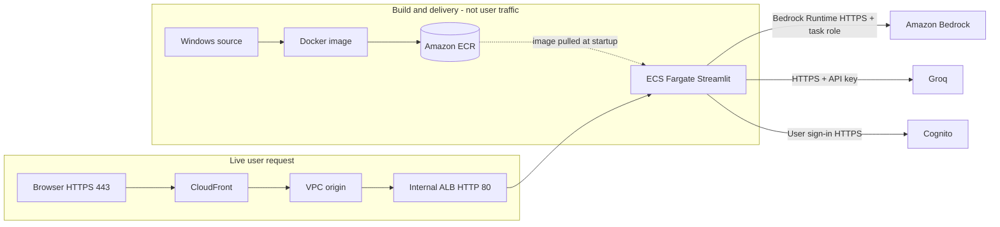

**Read it aloud:** “ECR stores my Docker image; ECS runs the container. CloudFront is the public entry point, while the internal ALB routes to ECS. Cognito authenticates the human. Bedrock or Groq generates the answer. IAM roles grant AWS API permissions; VPC routes and security groups allow network packets.”

> **Historical evidence vs example network layout:** The earlier source guide confirms the internal ALB, CloudFront VPC origin and Fargate design from documentation/screenshots. It flags **uncertain actual subnet placement**. The deployment examples below choose *internal ALB in private subnets, Fargate tasks in public subnets*, following the user's historical description, but this precise arrangement was **not independently recovered**. Do not claim it was verified. More private production designs can use private ECS subnets with NAT/endpoints.

### What AWS service physically connects to what?

| From → To | Mechanism | Why it works | How you verify |
|---|---|---|---|
| Docker Desktop → ECR | Docker registry HTTPS after `aws ecr get-login-password` | Local AWS identity can upload images | `aws ecr describe-images` |
| ECS → ECR | Image URI in task definition; **execution role** + task network | Fargate can pull image at task startup | ECS task events/stopped reasons |
| CloudFront → internal ALB | **CloudFront VPC origin**, origin configuration, managed SG ingress | Private origin reachability without exposing ALB publicly | `cloudfront get-vpc-origin`, target health |
| ALB → ECS | HTTP listener → IP target group → task ENI on `8501` | ECS registers private task IPs; SG permits ALB | `elbv2 describe-target-health` |
| Task → Bedrock | boto3 SigV4-signed HTTPS using **task role** | IAM authorizes model invocation; network reaches endpoint | App log category and permitted smoke test |
| Task → Cognito | Cognito user-auth HTTPS API using user credentials/tokens | App validates human authentication | Test sign-in/MFA and identity |
| ECS startup → Secrets Manager | Task definition secret reference, **execution role** | Injects Groq key at startup | Task definition and ECS initialization events |
| Task → Groq | Outbound HTTPS with injected bearer key | Task egress and Groq API authorization | Approved text-only inference test |
| GitHub Actions → AWS | OIDC token to AWS STS + scoped role | Temporary deploy credentials | CI/CD logs and ECS deployed SHA |

---

# B. Verified identity and safety

## What has actually been checked

Your latest successful PowerShell `sts get-caller-identity` output identified **AWS account `357001292388` and IAM user `firaz-mlops`**. A prior `SignatureDoesNotMatch` was resolved by correcting the laptop clock. **Identity is verified, but deploy permissions and current resource inventory are not.** Your old chatbot's AWS resources were subsequently removed as described in the prior cleanup conversation; do not presume they are still there.

### Verify the account before any future deployment [READ-ONLY]

```powershell
# Go to the NovaMind chatbot repository on your Windows laptop
Set-Location 'E:\codex-projetc\Chatbot_text_image'

# Verify the caller and AWS account; compare Account with 357001292388
aws sts get-caller-identity --profile novamind --region us-east-1

# Show which credential source is selected without printing secret credentials
aws configure list --profile novamind

# Show your local clock if signing fails due to timestamp mismatch
Get-Date; Get-TimeZone

# Set session variables used only by example commands in this guide
$p = 'novamind'; $r = 'us-east-1'; $account = '357001292388'

# Compare the authenticated account to the expected account before proceeding
$actual = aws sts get-caller-identity --profile $p --region $r --query Account --output text; if ($actual -ne $account) { throw "Wrong AWS account: $actual" }
```

**Expected:** `Account` equals `357001292388`; the ARN identifies the intended user/role. **Interview:** “I verify account, identity, profile and region before any billable CLI operation.”

---

# C. Step-by-step practical deployment

## Step 01 — Project and localhost

**Why:** Prove Python/Streamlit works before Docker and AWS. `localhost` is your own computer, not a public URL.

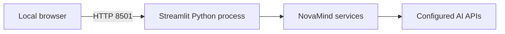

```powershell
# Enter the repository before inspecting or starting the app
Set-Location 'E:\codex-projetc\Chatbot_text_image'

# Verify Git working-tree status and confirm your project source is present
 git status --short

# Confirm the Streamlit launcher exists
Test-Path .\mod_chatbot_frontend.py

# Check the configured Python interpreter in the project virtual environment
& .\.venv\Scripts\python.exe --version

# Start local Streamlit on loopback port 8501 (local action; requires configured environment)
& .\.venv\Scripts\python.exe -m streamlit run mod_chatbot_frontend.py --server.address 127.0.0.1 --server.port 8501
```

**Verify in a second terminal:**

```powershell
# Verify Streamlit responds locally, even before testing actual user authentication
Invoke-WebRequest 'http://127.0.0.1:8501/_stcore/health'

# Confirm something is listening on local TCP port 8501
Get-NetTCPConnection -LocalPort 8501 -State Listen -ErrorAction SilentlyContinue
```

**Expected:** Health route returns HTTP 200 and a listener exists. **Limitation:** This does *not* prove Cognito/Bedrock calls work. **Interview:** “My Streamlit launcher ran Python locally on port 8501, and I tested its health path before packaging.”

## Step 02 — Docker Desktop

**Why:** ECS Fargate runs Linux container images, not your source folder. Docker Desktop builds that runtime image locally.

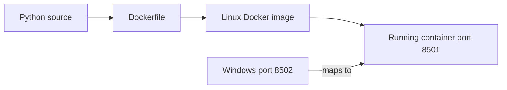

**[LOCAL] Only run if you choose to rebuild; you previously cleaned Docker Desktop.**

```powershell
# Verify Docker Desktop is running and can contact its Linux engine
 docker info --format '{{.ServerVersion}}'

# Build the project's Linux image from its Dockerfile
 docker build -t novamind-ai:local .

# Verify the image exists after the build
 docker images novamind-ai

# Start a local container mapping Windows port 8502 to Streamlit port 8501
 docker run -d --name novamind-ai-local -p 8502:8501 novamind-ai:local

# Inspect running containers and their published ports
 docker ps

# Read startup logs without entering the container
 docker logs novamind-ai-local

# Verify the containerized app responds through host port 8502
Invoke-WebRequest 'http://localhost:8502/_stcore/health'

# Inspect health status, not just running status
 docker inspect novamind-ai-local --format '{{json .State.Health}}'
```

**Expected:** Local app responds through `localhost:8502`, while its container listens on `8501`. For real chat/auth, configure runtime environment and secrets securely (do not bake them into the image). **Interview:** “I tested the same Linux container that Fargate would run.”

## Step 03 — VPC, routes and subnets

**Why:** AWS compute and ALB require network placement, routes and permitted ports. A public subnet has an IGW default route; an internal ALB is private-facing because its **scheme** is internal.

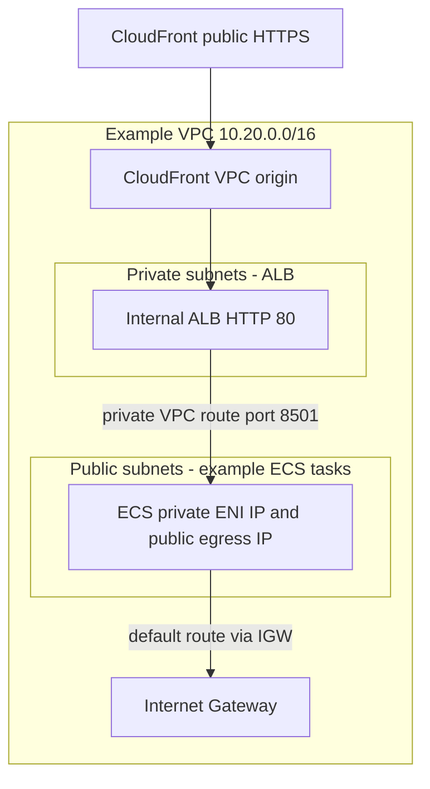

**[CREATE/BILLABLE][EXAMPLE] Review CIDRs, quotas, AZs and cost first. The following variables are needed by later sections.**

```powershell
# Create a new VPC to isolate the chatbot infrastructure
$vpc = aws ec2 create-vpc --cidr-block 10.20.0.0/16 --profile $p --region $r --query 'Vpc.VpcId' --output text

# Enable DNS resolution inside the VPC
aws ec2 modify-vpc-attribute --vpc-id $vpc --enable-dns-support Value=true --profile $p --region $r

# Enable DNS hostnames for supported VPC resources
aws ec2 modify-vpc-attribute --vpc-id $vpc --enable-dns-hostnames Value=true --profile $p --region $r

# Create the first public task subnet in AZ a
$pubA = aws ec2 create-subnet --vpc-id $vpc --availability-zone us-east-1a --cidr-block 10.20.1.0/24 --profile $p --region $r --query 'Subnet.SubnetId' --output text

# Create the second public task subnet in AZ b
$pubB = aws ec2 create-subnet --vpc-id $vpc --availability-zone us-east-1b --cidr-block 10.20.2.0/24 --profile $p --region $r --query 'Subnet.SubnetId' --output text

# Create the first private ALB subnet in AZ a
$privA = aws ec2 create-subnet --vpc-id $vpc --availability-zone us-east-1a --cidr-block 10.20.11.0/24 --profile $p --region $r --query 'Subnet.SubnetId' --output text

# Create the second private ALB subnet in AZ b
$privB = aws ec2 create-subnet --vpc-id $vpc --availability-zone us-east-1b --cidr-block 10.20.12.0/24 --profile $p --region $r --query 'Subnet.SubnetId' --output text

# Create an Internet Gateway for the VPC's public route
$igw = aws ec2 create-internet-gateway --profile $p --region $r --query 'InternetGateway.InternetGatewayId' --output text

# Attach the Internet Gateway to the VPC
aws ec2 attach-internet-gateway --vpc-id $vpc --internet-gateway-id $igw --profile $p --region $r

# Create one route table for public subnets
$publicRT = aws ec2 create-route-table --vpc-id $vpc --profile $p --region $r --query 'RouteTable.RouteTableId' --output text

# Add the public 0.0.0.0/0 internet route through the Internet Gateway
aws ec2 create-route --route-table-id $publicRT --destination-cidr-block 0.0.0.0/0 --gateway-id $igw --profile $p --region $r

# Attach the first public subnet to the internet-routed table
aws ec2 associate-route-table --route-table-id $publicRT --subnet-id $pubA --profile $p --region $r

# Attach the second public subnet to the internet-routed table
aws ec2 associate-route-table --route-table-id $publicRT --subnet-id $pubB --profile $p --region $r

# Create a separate private route table with local VPC routes only
$privateRT = aws ec2 create-route-table --vpc-id $vpc --profile $p --region $r --query 'RouteTable.RouteTableId' --output text

# Associate the first private ALB subnet with the private route table
aws ec2 associate-route-table --route-table-id $privateRT --subnet-id $privA --profile $p --region $r

# Associate the second private ALB subnet with the private route table
aws ec2 associate-route-table --route-table-id $privateRT --subnet-id $privB --profile $p --region $r
```

**Verify [READ-ONLY]:**

```powershell
# Verify VPC identity, CIDR and state
aws ec2 describe-vpcs --vpc-ids $vpc --profile $p --region $r --query 'Vpcs[].{Id:VpcId,State:State,Cidr:CidrBlock}'

# Verify each subnet CIDR and Availability Zone
aws ec2 describe-subnets --filters "Name=vpc-id,Values=$vpc" --profile $p --region $r --query 'Subnets[].{Id:SubnetId,AZ:AvailabilityZone,CIDR:CidrBlock}'

# Verify the actual public and private route table associations
aws ec2 describe-route-tables --filters "Name=vpc-id,Values=$vpc" --profile $p --region $r --query 'RouteTables[].{Id:RouteTableId,Routes:Routes,Associations:Associations}'
```

**Expected:** Four nonoverlapping subnets; public routes show IGW destination; private ALB table has only local routing. **Failure:** If a task can't reach ECR/Groq, check the task's public IP plus IGW route and SG egress. **Interview:** “The ALB forwards using the task's private VPC IP; public IP is only for outbound task traffic in this reconstructed configuration.”

## Step 04 — IAM roles

**Why:** IAM is *permission to call AWS APIs*, not network connectivity. Fargate has two distinct identities:

- **Task execution role:** ECR image pull, CloudWatch log driver and ECS-injected secrets.
- **Application task role:** Python/boto3 calls to Bedrock and any deliberately enabled data stores.

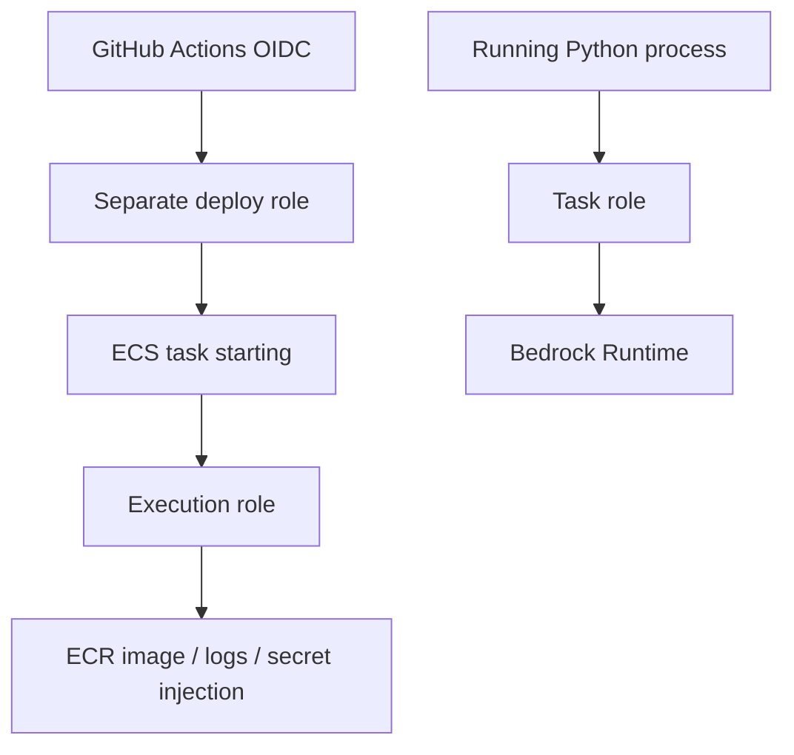

**[CREATE/BILLABLE INDIRECT][EXAMPLE]** The original guide includes trust-policy and least-privilege policy JSON examples; create these *reviewed files* only during a future authorized deployment. Do **not** print or place secret values in role policies.

```powershell
# Create ECS task execution role from a reviewed ecs-task-trust.json file
aws iam create-role --role-name novamind-ecs-execution-role --assume-role-policy-document file://ecs-task-trust.json --profile $p

# Attach baseline ECR-pull and CloudWatch-log execution permissions
aws iam attach-role-policy --role-name novamind-ecs-execution-role --policy-arn arn:aws:iam::aws:policy/service-role/AmazonECSTaskExecutionRolePolicy --profile $p

# Create a separate ECS application task role using the same ECS tasks trust principal
aws iam create-role --role-name novamind-ecs-task-role --assume-role-policy-document file://ecs-task-trust.json --profile $p

# Attach only the reviewed secret-read permissions to the execution role, if using ECS secret injection
aws iam put-role-policy --role-name novamind-ecs-execution-role --policy-name NovaMindSecretRead --policy-document file://execution-secret-policy.json --profile $p

# Attach the reviewed Bedrock model invocation permissions to the app task role
aws iam put-role-policy --role-name novamind-ecs-task-role --policy-name NovaMindBedrockInvoke --policy-document file://task-bedrock-policy.json --profile $p
```

**Verify [READ-ONLY]:**

```powershell
# Verify that the execution role exists and review its trust relationship
aws iam get-role --role-name novamind-ecs-execution-role --profile $p

# Verify which managed policies are attached to the execution role
aws iam list-attached-role-policies --role-name novamind-ecs-execution-role --profile $p

# Verify the separate application role exists
aws iam get-role --role-name novamind-ecs-task-role --profile $p
```

**Expected:** Separate role ARNs and reviewed trust/permission policies. `ecs-tasks.amazonaws.com` is the ECS task role trust principal. **Important:** This command section depends on JSON examples in the reference and is deliberately **not a blind one-shot script**. **Interview:** “Execution role is for Fargate bootstrapping; task role is for my application's AWS API calls.”

## Step 05 — ECR image registry

**Why:** ECR is a private *repository for images*; it does **not** run containers. A SHA tag links code to deployment.

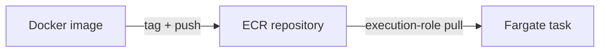

**[CREATE/BILLABLE][EXAMPLE]**

```powershell
# Create a private repository for NovaMind application images
$repo = 'novamind-chatbot-ecr'; aws ecr create-repository --repository-name $repo --image-tag-mutability IMMUTABLE --profile $p --region $r

# Construct this account's ECR registry URL
$registry = "$account.dkr.ecr.$r.amazonaws.com"

# Exchange AWS CLI credentials for a temporary Docker registry login
aws ecr get-login-password --profile $p --region $r | docker login --username AWS --password-stdin $registry

# Set the image tag to the current full Git commit SHA
$sha = git rev-parse HEAD

# Build the Linux image for this source version
 docker build -t "novamind-ai:$sha" .

# Tag the image with its target ECR URI and commit SHA
$imageUri = "${registry}/${repo}:${sha}"; docker tag "novamind-ai:$sha" $imageUri

# Upload the tagged image to Amazon ECR
 docker push $imageUri
```

**Verify [READ-ONLY]:**

```powershell
# Verify that the ECR repository exists and inspect its URI
aws ecr describe-repositories --repository-names $repo --profile $p --region $r --query 'repositories[].{Name:repositoryName,URI:repositoryUri}'

# Verify the exact SHA tag was uploaded and retrieve its digest
aws ecr describe-images --repository-name $repo --image-ids "imageTag=$sha" --profile $p --region $r --query 'imageDetails[].{Digest:imageDigest,Tags:imageTags}'
```

**Expected:** A digest beginning with `sha256:` and the expected tag. **Failure:** Check AWS account/region, image name, registry login expiry and ECR push permissions. **Interview:** “I build once, identify by SHA/digest and push the artifact that ECS will pull.”

## Step 06 — ECS task definition

**Why:** A task definition is a *versioned recipe*, not a running server. It points to image, ports, task roles, CPU/memory, env, secrets and logs.

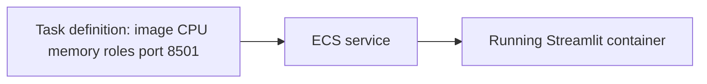

**[CREATE/BILLABLE][EXAMPLE]** First build a reviewed `task-definition.json` from the reference section. It must refer to the **exact pushed image URI**, have `networkMode=awsvpc`, Fargate-compatible CPU/memory and container port `8501`; use task/execution role ARNs. Do not insert AWS access keys.

```powershell
# Create an ECS cluster as a logical container deployment namespace
aws ecs create-cluster --cluster-name novamind-chatbot-cluster --profile $p --region $r

# Create the CloudWatch log group expected by the task definition
aws logs create-log-group --log-group-name /ecs/novamind-chatbot --profile $p --region $r

# Set seven-day retention to limit indefinite log storage
aws logs put-retention-policy --log-group-name /ecs/novamind-chatbot --retention-in-days 7 --profile $p --region $r

# Register a task-definition revision from a reviewed JSON configuration file
$taskArn = aws ecs register-task-definition --cli-input-json file://task-definition.json --profile $p --region $r --query 'taskDefinition.taskDefinitionArn' --output text
```

**Verify [READ-ONLY]:**

```powershell
# Check ECS cluster state
aws ecs describe-clusters --clusters novamind-chatbot-cluster --profile $p --region $r

# Inspect the registered task definition image, roles and container port
aws ecs describe-task-definition --task-definition $taskArn --profile $p --region $r --query 'taskDefinition.{Arn:taskDefinitionArn,TaskRole:taskRoleArn,ExecutionRole:executionRoleArn,Containers:containerDefinitions[].{Image:image,Ports:portMappings}}'

# Verify the CloudWatch log group and retention policy
aws logs describe-log-groups --log-group-name-prefix /ecs/novamind-chatbot --profile $p --region $r
```

**Expected:** `taskArn` is a versioned ARN and references the intended ECR image. **Failure:** If IAM `PassRole` denied or task JSON malformed, verify role ARNs/JSON and principal permission. **Interview:** “The task definition tells Fargate precisely which image, port and IAM identities to use.”

## Step 07 — Internal ALB and target group

**Why:** Tasks have changing IPs. The ALB forwards each HTTP request to a healthy IP target and exposes a stable private origin.

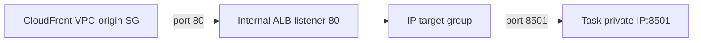

**[CREATE/BILLABLE][EXAMPLE]** The CloudFront managed SG is not known until the VPC origin exists, so apply that particular ALB inbound rule later in Step 09.

```powershell
# Create an ALB security group in the chatbot VPC
$albSG = aws ec2 create-security-group --group-name novamind-alb-sg --description 'CloudFront to internal ALB' --vpc-id $vpc --profile $p --region $r --query GroupId --output text

# Create a separate security group for ECS task network interfaces
$taskSG = aws ec2 create-security-group --group-name novamind-task-sg --description 'Internal ALB to Streamlit' --vpc-id $vpc --profile $p --region $r --query GroupId --output text

# Permit ECS task port 8501 only when the source is the ALB security group
aws ec2 authorize-security-group-ingress --group-id $taskSG --protocol tcp --port 8501 --source-group $albSG --profile $p --region $r

# Create an INTERNAL application load balancer across two example private subnets
$albArn = aws elbv2 create-load-balancer --name novamind-chatbot-alb --type application --scheme internal --subnets $privA $privB --security-groups $albSG --profile $p --region $r --query 'LoadBalancers[0].LoadBalancerArn' --output text

# Create an IP target group that forwards to Streamlit port 8501 and checks the health path
$tgArn = aws elbv2 create-target-group --name novamind-chatbot-tg --protocol HTTP --port 8501 --target-type ip --vpc-id $vpc --health-check-path '/_stcore/health' --profile $p --region $r --query 'TargetGroups[0].TargetGroupArn' --output text

# Create the ALB HTTP listener that forwards requests to the IP target group
aws elbv2 create-listener --load-balancer-arn $albArn --protocol HTTP --port 80 --default-actions "Type=forward,TargetGroupArn=$tgArn" --profile $p --region $r
```

**Verify [READ-ONLY]:**

```powershell
# Confirm the ALB scheme is internal, not internet-facing
aws elbv2 describe-load-balancers --load-balancer-arns $albArn --profile $p --region $r --query 'LoadBalancers[].{Scheme:Scheme,State:State,Subnets:AvailabilityZones[].SubnetId}'

# Confirm the listener forwards traffic to the expected target group
aws elbv2 describe-listeners --load-balancer-arn $albArn --profile $p --region $r

# Check target group properties (it has no registered ECS targets until Step 08)
aws elbv2 describe-target-groups --target-group-arns $tgArn --profile $p --region $r --query 'TargetGroups[].{Type:TargetType,Port:Port,Vpc:VpcId}'
```

**Expected:** Internal ALB, HTTP listener, target type `ip`. **Interview:** “The ALB chooses healthy task private IPs; it is not public.”

## Step 08 — ECS Fargate service

**Why:** The ECS service launches/replaces tasks and registers their ENI private addresses with the target group.

**[CREATE/BILLABLE][EXAMPLE]** Use a reviewed `ecs-service.json` configuration in the reference section. Its `loadBalancers` links `targetGroupArn`, `containerName` and `containerPort`. The reconstructed public-subnet layout requires `assignPublicIp: ENABLED` for outbound internet; production private-task placement needs a different egress design.

```powershell
# Create the ECS service using the reviewed task, subnets, security group and target group
aws ecs create-service --cli-input-json file://ecs-service.json --profile $p --region $r

# Wait until the ECS service reaches stable desired-versus-running state
aws ecs wait services-stable --cluster novamind-chatbot-cluster --services novamind-chatbot-service --profile $p --region $r
```

**Verify [READ-ONLY]:**

```powershell
# Verify desired and running task counts and inspect recent ECS service events
aws ecs describe-services --cluster novamind-chatbot-cluster --services novamind-chatbot-service --profile $p --region $r --query 'services[0].{Desired:desiredCount,Running:runningCount,Events:events[:5].message}'

# Verify ECS has registered healthy IP targets with the ALB target group
aws elbv2 describe-target-health --target-group-arn $tgArn --profile $p --region $r

# Enumerate the running ECS tasks for additional task-level inspection
aws ecs list-tasks --cluster novamind-chatbot-cluster --service-name novamind-chatbot-service --profile $p --region $r

# Read recent container logs without connecting to the container shell
aws logs tail /ecs/novamind-chatbot --since 1h --profile $p --region $r
```

**Expected:** `runningCount == desiredCount`; target health is `healthy`. **Failure:** `ResourceInitializationError` often concerns image pull, secret injection, logging permissions or network connectivity. **Interview:** “ECS manages task lifecycle and automatically registers task IPs for ALB routing.”

## Step 09 — CloudFront VPC origin and public URL

**Why:** CloudFront gives a public HTTPS hostname while the ALB remains internal. CloudFront VPC origin supplies private network access to the ALB.

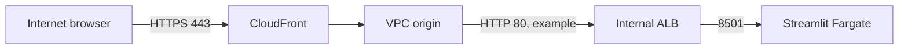

**[CREATE/BILLABLE][EXAMPLE]** You must wait until the ALB is active and the VPC origin is deployed; CloudFront takes time to propagate. For a true end-to-end encrypted design, use a reviewed HTTPS origin listener/certificate and origin protocol, instead of the HTTP private hop used in this example.

```powershell
# Read the private ALB DNS name required for the CloudFront origin configuration
$albDns = aws elbv2 describe-load-balancers --load-balancer-arns $albArn --profile $p --region $r --query 'LoadBalancers[0].DNSName' --output text

# Create a VPC origin linked to the internal ALB ARN (CloudFront is a global service)
$vpcOrigin = aws cloudfront create-vpc-origin --vpc-origin-endpoint-config "Name=novamind-alb-origin,Arn=$albArn,HTTPPort=80,HTTPSPort=443,OriginProtocolPolicy=http-only" --profile $p --query 'VpcOrigin.Id' --output text

# Check the VPC origin status until it becomes Deployed
aws cloudfront get-vpc-origin --id $vpcOrigin --profile $p --query 'VpcOrigin.Status' --output text

# Find CloudFront's service-managed security group in our VPC
aws ec2 describe-security-groups --filters "Name=vpc-id,Values=$vpc" 'Name=group-name,Values=CloudFront-VPCOrigins-Service-SG*' --profile $p --region $r --query 'SecurityGroups[].{ID:GroupId,Name:GroupName}'

# Enter the verified service-managed SG ID returned above (do not guess an SG ID)
$cfServiceSG = '<verified-cloudfront-vpc-origin-security-group-id>'

# Permit CloudFront VPC-origin network interfaces to reach the internal ALB on HTTP 80
aws ec2 authorize-security-group-ingress --group-id $albSG --protocol tcp --port 80 --source-group $cfServiceSG --profile $p --region $r

# Create a CloudFront distribution from a reviewed config referencing the VPC Origin ID
aws cloudfront create-distribution --distribution-config file://cloudfront-distribution.json --profile $p
```

**Verify [READ-ONLY]:**

```powershell
# Confirm the VPC origin has finished deployment
aws cloudfront get-vpc-origin --id $vpcOrigin --profile $p --query 'VpcOrigin.{Id:Id,Status:Status}'

# List distributions and copy the newly created cloudfront.net domain
aws cloudfront list-distributions --profile $p --query 'DistributionList.Items[].{Id:Id,Domain:DomainName,Status:Status}'

# Check HTTP health through the public CloudFront URL after propagation, replacing the domain
Invoke-WebRequest 'https://<your-distribution-domain>/_stcore/health'
```

**Expected:** Deployed distribution with a public HTTPS hostname; initial `502` can mean ALB SG, origin protocol or target health failure. Streamlit requires cookies/headers/WebSocket upgrade; do not cache private user-specific UI. **Interview:** “CloudFront is public, but it reaches my ALB through private VPC-origin networking.”

## Step 10 — Cognito, Bedrock, Groq and secrets

**Why:** These are *application dependencies*, not hops between browser and ALB. Configure Cognito pool/client, approved Bedrock model access and optional Groq secret before claiming a working authenticated chatbot. Bedrock invocation uses `task-role` mode and `boto3`. Cognito user-auth API uses user credentials/access tokens, not the Bedrock IAM identity.

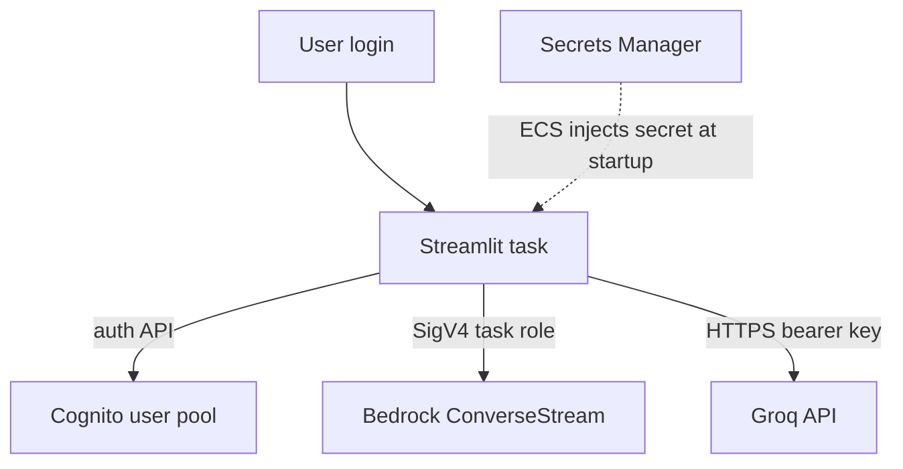

**[CREATE/BILLABLE][EXAMPLE]** An actual Cognito pool/client must be created and matching IDs inserted in task configuration. Do not use `GetSecretValue` to print the secret. The reference includes reconstructed Cognito CLI commands. The Bedrock model ID, access and pricing must be rechecked before live testing.

```powershell
# Inspect supported Bedrock catalog identifiers in the region; this does NOT grant invoke permission
aws bedrock list-foundation-models --profile $p --region $r --query 'modelSummaries[].modelId'

# Verify a configured Cognito user pool by ID without retrieving user passwords
aws cognito-idp describe-user-pool --user-pool-id '<verified-user-pool-id>' --profile $p --region $r

# Verify the public app client and enabled auth flows
aws cognito-idp describe-user-pool-client --user-pool-id '<verified-user-pool-id>' --client-id '<verified-app-client-id>' --profile $p --region $r

# Inspect the named Groq secret metadata only; do not print secret values
aws secretsmanager describe-secret --secret-id 'novamind/groq-api-key' --profile $p --region $r

# Verify the task definition references Cognito, the task role and Secrets Manager as intended
aws ecs describe-task-definition --task-definition $taskArn --profile $p --region $r --query 'taskDefinition.{Role:taskRoleArn,Containers:containerDefinitions[].{Env:environment[].name,Secrets:secrets[].name}}'
```

**Expected:** Metadata/identifiers match the task configuration. If Cognito/model/secret configuration is added *after* starting ECS, register a new task definition and update the service. **Important:** `novamind/groq-api-key` and `novamind/auth-credentials` were explicitly preserved at cleanup; do not delete or overwrite them just because this project may use one. **Interview:** “Cognito signs in users; task IAM authorizes Bedrock; Groq uses an injected runtime key.”

## Step 11 — GitHub Actions CI/CD

**Why:** CI catches regressions when code changes; CD promotes an approved version to AWS. Your chatbot repository already contains `ci.yml` and `cd.yml` from the earlier deployment. CI is automatic on push/PR, CD is **manual** via `workflow_dispatch`.

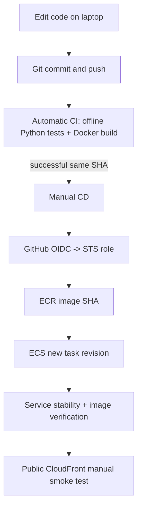

**[LOCAL / EXTERNAL ACTION]** Pushing to GitHub triggers CI; dispatching CD may incur AWS charges and **will fail if the deleted infrastructure has not been rebuilt**. The workflow contains account-specific role/ECR references that must be reviewed before using a different account.

```powershell
# Inspect which files are modified before committing
 git status --short

# Verify the GitHub remote points to the intended NovaMind chatbot repository
 git remote -v

# See the existing CI and CD workflow files; these commands do not trigger workflows
Get-ChildItem .\.github\workflows\ci.yml, .\.github\workflows\cd.yml

# Stage only the reviewed application file changed for a demo release
 git add novamind/ui/auth.py

# Commit the staged change locally with a clear release description
 git commit -m 'demo: verify NovaMind CI and CD release'

# Push the reviewed commit to GitHub (triggers CI on main)
 git push origin main

# Inspect CI runs before allowing any deployment
 gh run list --workflow ci.yml --branch main --limit 10

# Manually start CD only after matching SHA CI succeeds and AWS infra exists
 gh workflow run cd.yml --ref main

# Inspect CD status without starting another deployment
 gh run list --workflow cd.yml --branch main --limit 10
```

**Verify [READ-ONLY]:**

```powershell
# Check service deployments and the task-definition revision after CD
aws ecs describe-services --cluster novamind-chatbot-cluster --services novamind-chatbot-service --profile $p --region $r --query 'services[0].deployments'

# Verify the deployed task definition references the intended Git SHA image
aws ecs describe-task-definition --task-definition novamind-chatbot-task --profile $p --region $r --query 'taskDefinition.containerDefinitions[].image'

# View the latest CI and CD runs and confirm successful completion
 gh run list --workflow ci.yml --branch main --limit 5; gh run list --workflow cd.yml --branch main --limit 5
```

**Historical demonstrated test:** Changing **“Welcome back” → “Welcome back folk”**, pushing code, getting successful CI, manually triggering CD and viewing the new CloudFront UI showed that the end-to-end release path worked. **Do not repeat an old commit command blindly**; in a fresh deployment, change one intentional file and check `git diff` first. **Interview:** “A manual gate and OIDC prevent every source push from directly deploying with permanent AWS keys.”

## Step 12 — Final verification and troubleshooting

**Why:** A `RUNNING` ECS task isn't proof the user can log in, upgrade a WebSocket or invoke Bedrock. Verify from inside-out and outside-in.

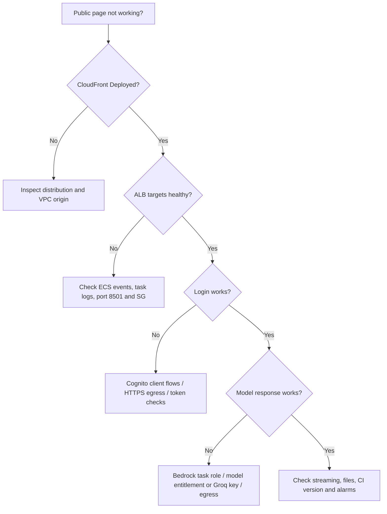

**Use read-only checks first:**

```powershell
# Check actual ECS service events and desired versus running task counts
aws ecs describe-services --cluster novamind-chatbot-cluster --services novamind-chatbot-service --profile $p --region $r --query 'services[0].{Desired:desiredCount,Running:runningCount,Events:events[:8].message}'

# Check load balancer target states and any unhealthy reason codes
aws elbv2 describe-target-health --target-group-arn $tgArn --profile $p --region $r

# View application errors after container startup
aws logs tail /ecs/novamind-chatbot --since 1h --profile $p --region $r

# Inspect CloudFront origin readiness
aws cloudfront get-vpc-origin --id $vpcOrigin --profile $p --query 'VpcOrigin.Status'

# Check recent GitHub CI/CD attempts
 gh run list --workflow ci.yml --limit 5; gh run list --workflow cd.yml --limit 5
```

**Final manual smoke test:** Open public URL → check login UI → complete Cognito authentication → send approved Bedrock text prompt → verify streaming → try image/document against a supported model → check optional Groq **text-only** path → verify CloudWatch logs do not contain prompts or secrets → check ECS task image SHA. If one step fails, fix that hop only.

### Cost and cleanup guardrails

- Recurring/usage costs may come from Fargate runtime, ALB, CloudFront, ECR storage, logs, Secrets Manager and Bedrock; a NAT gateway or public IPv4 can add costs in other network designs.
- **The prior deployment's infrastructure was already deleted.** Never delete other NovaMind resources or the two preserved secrets.
- Cleanup requires identifying project-owned resources and following dependency order: CloudFront distribution → VPC origin → ECS → ALB/target groups → registry/log group → dedicated IAM/VPC components. **Deletion commands are in the technical reference and are [DESTRUCTIVE]; do not run them just to read the guide.**

---

# D. Important connection diagrams

## User request vs Docker image delivery

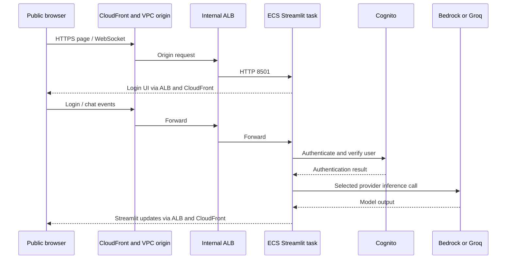

## AWS service authorization is not routing

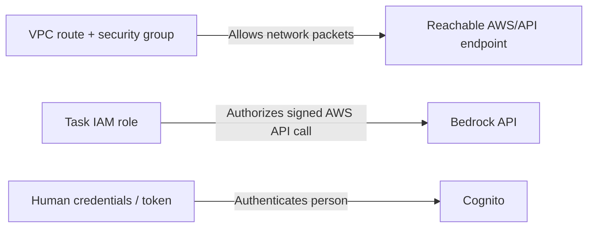

**Interview pitfall:** ECR doesn't sit in the browser request flow; Cognito doesn't proxy HTTP from CloudFront to the ALB; task execution role doesn't authorize Python's Bedrock inference. State each connection's **initiator**, **protocol**, **authorization mechanism**, and **verification**.

---

# E. Technical interview practice

**Interviewer: “Explain how you deployed this application from localhost to AWS.”**

> “I developed NovaMind AI as a Python Streamlit application, first testing its health and user flows locally. I packaged it as a Linux Docker image and verified the container on port 8501 using Docker Desktop. I used a named AWS CLI profile in `us-east-1` and checked the account before provisioning a VPC, IAM roles and security groups. I pushed a versioned image to ECR and registered an ECS Fargate task definition to run it. ECS registered the tasks with an IP target group behind an internal ALB. CloudFront connected to the internal ALB using a VPC origin and provided the public HTTPS URL. Cognito authenticated users; my application task role allowed Bedrock streaming; and the optional Groq key was injected from Secrets Manager. GitHub Actions CI tested commits, while an OIDC-authenticated manual CD workflow published the release and updated ECS. I verified the deployment by changing a visible heading and confirming the new page through CloudFront. After testing, I removed project-owned cloud resources to control charges.”

**Five interview questions you should master before the longer bank:**

1. **Why ECR and ECS?** ECR stores versioned images, ECS/Fargate starts and runs them.
2. **Why an internal ALB?** It routes requests to healthy task private IPs without exposing the ALB as a direct public origin.
3. **How does CloudFront reach it?** A CloudFront VPC origin supplies private connectivity; the origin SG and ALB listener must permit traffic.
4. **Which IAM role pulls the image?** The **execution role**. Python uses the **task role** for Bedrock calls.
5. **What does GitHub Actions CD change?** It updates the ECS service to a new task definition/image revision; it does not recreate the VPC and ALB on every release.

**More detailed project-specific interview questions and 1/3/5-minute spoken answers are preserved in the appendix below.**

---

# F. Deep Technical Reference

This part preserves the **full original evidence-led learning guide**, including longer JSON samples (task definition, ECS service, CloudFront distribution, IAM trust and policies), reconstructed creation/deletion commands, advanced troubleshooting and **30 interview Q&A**. The practical steps above provide the streamlined, commented command path; this reference supplies the missing detail needed to rebuild carefully.

**Source qualification:** The appended guide was produced from the chatbot repository and historical documentation, not a live AWS inventory. All uncertainty labels such as **Not verified**, **reconstructed** and **screenshot-evidenced** remain in force. Where an example above uses a session variable, be sure earlier steps ran in the **same PowerShell session** or restore the variables from read-only AWS lookups. JSON `file://...` examples require creating and reviewing the specified local JSON file in a future authorized rebuild. These are **not** runnable placeholders as written.

---


**Learning guide and reconstruction, 14 October 2026.** Region: `us-east-1`; laptop AWS CLI profile: `novamind`. This document was written from the repository without running Docker, tests, AWS, GitHub deployments, or deletion commands. The user reports a successful historical deployment and subsequent cleanup. Do not infer that resources exist now.

**Evidence labels:** **Source-verified** = current code, tracked workflow, or Git history; **screenshot-evidenced** = historical console screenshot; **reconstructed** = a plausible future command, not a recovered command transcript; **Not verified** = unavailable configuration or live state. Every provisioning block marked **[BILLABLE]** may create charges. Every cleanup block marked **[DESTRUCTIVE]** removes resources. All commands are examples only.

## Evidence ledger and the network-placement discrepancy

| Topic | What the repository establishes |
|---|---|
| Application | [`mod_chatbot_frontend.py`](mod_chatbot_frontend.py) calls `novamind.ui.app.main()`. [`Dockerfile`](Dockerfile) starts Streamlit on `0.0.0.0:8501`, as UID/GID 10001, with `/_stcore/health`. [`.streamlit/config.toml`](.streamlit/config.toml) enables CORS and XSRF checks. |
| Dependencies | Windows [`requirements.txt`](requirements.txt) is used in CI; Linux [`requirements-linux.txt`](requirements-linux.txt) is used in Docker. [`.env.example`](.env.example) is a reference; code does not auto-load it. |
| AWS identity | [`services/aws_config.py`](services/aws_config.py) fixes region `us-east-1`: local boto3 uses the explicit `novamind` profile; ECS `task-role` mode uses only container-role credentials, rejecting static AWS keys and profile selectors. |
| AI and auth | [`services/auth_service.py`](services/auth_service.py) defaults to Cognito, uses `USER_PASSWORD_AUTH`, handles SMS/TOTP challenges and verifies access tokens through Cognito `GetUser`. [`services/bedrock_service.py`](services/bedrock_service.py) calls Bedrock `converse_stream`. [`services/groq_service.py`](services/groq_service.py) calls Groq's HTTPS chat-completions endpoint for text only. |
| Historical cloud evidence | The [architecture image](project-pic/NovaMind-AI-AWS-Architecture-Blueprint-with-cicd.png) and [AWS screenshots](project-pic/aws-cloudfront.png) depict CloudFront/VPC origin, internal ALB, ECS/Fargate, ECR, Cognito, Secrets Manager and CloudWatch. They cannot prove routes, IAM policies, task networking, or present existence. |
| CI/CD | [CI](.github/workflows/ci.yml) runs offline Windows Python tests on push/PR to `main`, followed by Ubuntu Docker build. [CD](.github/workflows/cd.yml) is manual, checks successful push CI for the exact SHA, assumes an AWS OIDC role, publishes or reuses a SHA-tagged ECR image, changes only the task-definition image, waits for ECS stability, and verifies revision and image. |
| Demonstration | Commit `50a5d3f` changes the login heading in [`novamind/ui/auth.py`](novamind/ui/auth.py) from **Welcome back** to **Welcome back folk**. The user reports CI, CD and public URL verification; [CI/CD screenshots](project-pic/cicd-1.png) support historical workflow activity. The current endpoint is **Not verified**. |
| Optional persistence | [`services/conversation_store.py`](services/conversation_store.py) and [`services/attachment_store.py`](services/attachment_store.py) use DynamoDB/S3 only if existing table/bucket names are configured. Historical activation is **Not verified**. |

**Important correction.** The diagram labels `10.20.1.0/24` and `10.20.2.0/24` public, and `10.20.11.0/24` and `10.20.12.0/24` private. It visually places the ALB in the first tier and tasks in the private tier. Your requested design says **internal ALB in private subnets and ECS tasks in public subnets**. Neither the task subnet IDs/public-IP flag nor the route tables are exported in this repository. The deployment procedure below explicitly **reconstructs your requested placement**. An internal ALB can be internal even in a public-routed subnet because its scheme is `internal`; subnet routing and ALB scheme are separate properties. Do not present either placement as a recovered historical fact. The internal ALB itself is screenshot-evidenced.

## 1. Understanding the application on localhost

**What:** `localhost`/`127.0.0.1` means your own laptop. TCP port **8501** identifies the Streamlit server process; it is not an AWS port assignment. **Why:** local testing isolates application behavior before cloud packaging. **How:** Streamlit runs Python code that renders browser UI, receives widget/chat/upload events, reruns relevant code, and holds per-session state in server memory. There is no separately deployed frontend API service: `novamind/ui/` handles the UI, `novamind/orchestration/` coordinates requests, and `services/` handles auth, providers, validation and optional storage.

**Local PowerShell illustration (not executed):**

```powershell
Set-Location 'E:\codex-projetc\Chatbot_text_image'
& .\.venv\Scripts\python.exe --version
& .\.venv\Scripts\python.exe -m pip check
# Only for loopback development. Real deployments use Cognito.
$env:NOVAMIND_AUTH_MODE = 'demo'
$env:NOVAMIND_AWS_MODE = 'local'
$env:AWS_PROFILE = 'novamind'
$env:AWS_DEFAULT_REGION = 'us-east-1'
& .\.venv\Scripts\python.exe -m streamlit run mod_chatbot_frontend.py --server.address 127.0.0.1 --server.port 8501
# In another terminal:
Invoke-WebRequest 'http://localhost:8501/_stcore/health'
```

Open `http://localhost:8501`. HTTP 200 on the health path proves server responsiveness, not successful Cognito or inference. The app defaults to Cognito; demo mode requires explicit opt-in and is blocked in deployed environments. `requirements.txt` pins the Windows development environment; Docker installs the Linux lock. Environment variables are inherited from the launching process; merely copying `.env.example` to `.env` does not load it. Local AWS calls require the named profile, permission, regional endpoint and network access. Active Streamlit sessions are process-local; a restart loses them.

**Interview answer:** “I ran the Streamlit launcher locally on port 8501. Browser actions execute Python in the server process; I tested startup and the health endpoint before containerizing it.”

## 2. Docker Desktop and containerization

**What:** an *image* is a packaged filesystem/configuration; a *container* is its running process. **Why:** ECS Fargate needs a Linux image, not a Windows source directory. **How:** Docker Desktop runs a Linux container backend via WSL2/VM on Windows. [`Dockerfile`](Dockerfile) uses `python:3.14.6-slim-bookworm`, installs exact Linux dependencies, copies runtime modules/assets, checks imports, runs non-root as UID 10001, exposes 8501, and defines a health check. [`.dockerignore`](.dockerignore) excludes local credentials, `.venv`, uploads, tests and Git state from build context.

**Local PowerShell illustration (not executed):**

```powershell
docker build --tag novamind-ai:local .
docker images
docker run --detach --name novamind-local --publish 8502:8501 novamind-ai:local
docker ps
docker ps -a
docker logs novamind-local
Invoke-WebRequest 'http://localhost:8502/_stcore/health'
docker image inspect novamind-ai:local --format '{{.Id}} {{.Config.User}}'
docker inspect novamind-local --format '{{json .State.Health}}'
docker system df
docker stop novamind-local
docker rm novamind-local
```

`build` executes Dockerfile steps; `run` starts one container. `8502:8501` means **Windows host 8502 → container 8501**. `ps` shows running containers, `ps -a` also stopped ones, `images` lists local artifacts, `logs` shows stdout/stderr, `system df` shows disk use, and `tag` (next chapter) creates another name for an existing image. Startup/health testing alone does not authenticate to Cognito or Bedrock. Runtime configuration must be injected without baking credentials into image layers. The image, tagged by SHA, is the artifact later pushed to ECR.

**Interview answer:** “I used Docker Desktop to build the Linux runtime. The container still listened on 8501, while my laptop used 8502 for the local mapping. I pushed the built image to a registry for Fargate to pull.”

## 3. AWS CLI configuration and authentication

**What:** AWS CLI sends HTTPS API requests signed with credentials. **Why:** it can provision and inspect infrastructure from PowerShell. **How:** `--profile novamind` chooses the local credential source and `--region us-east-1` selects regional endpoints. A long-lived IAM *user* may have access keys; an IAM *role* is assumed for temporary credentials. Prefer approved SSO/federation for human access; never put access keys in this guide, Docker image, GitHub workflow or task definition. The laptop profile, ECS execution role, ECS task role and GitHub OIDC role are different identities.

**Read-only/setup illustration (not executed):**

```powershell
aws --version
aws configure --profile novamind  # Interactive only if your organization permits this credential method.
aws configure list --profile novamind
aws sts get-caller-identity --profile novamind --region us-east-1
aws ec2 describe-regions --profile novamind --region us-east-1 --query 'Regions[].RegionName'
```

`sts get-caller-identity` tells which principal you are, not what it may do. `--query` filters the CLI response; `--output text/json` controls its format. The app's local boto3 session explicitly selects `novamind`; deployed `task-role` mode filters botocore credential providers to `container-role` only. GitHub's runner obtains short-lived AWS credentials from OIDC `AssumeRoleWithWebIdentity`, separate from the local profile.

**Interview answer:** “My local CLI profile signed provisioning requests. The running task had a separate task role, and GitHub Actions federated into a deployment role. I checked the caller identity before operating in the intended account and region.”

## 4. Building AWS networking from scratch

**What:** a VPC is private address space; subnets live in one Availability Zone; route tables forward packets; security groups protect ENIs. **Why:** CloudFront must reach a private ALB, the ALB must reach tasks, and tasks must reach AWS APIs and optionally Groq. **How in this reconstruction:** VPC `10.20.0.0/16`; public task subnets `10.20.1.0/24` (`us-east-1a`) and `10.20.2.0/24` (`us-east-1b`); private ALB subnets `10.20.11.0/24` and `10.20.12.0/24`. Public subnets have `0.0.0.0/0 → Internet Gateway`; private ALB subnets do not. All four retain the VPC's local route. Task ENIs receive private IPs plus assigned public IPs in this example; public IP + IGW route enables outbound internet. ALB-to-task traffic still uses the task's **private** IP through the local route. The task SG accepts inbound 8501 only from the ALB SG. DNS resolves the internal ALB name privately. A route enables network traffic; it never grants IAM API authorization.

CloudFront VPC origins require an attached IGW and available IPv4 addresses in private subnet(s), although the CloudFront-to-origin path does **not** traverse that IGW. CloudFront creates a service-managed ENI and SG. [AWS prerequisites](https://docs.aws.amazon.com/AmazonCloudFront/latest/DeveloperGuide/private-content-vpc-origins.html).

**Reconstructed provisioning [BILLABLE], not executed:**

```powershell
$p = 'novamind'; $r = 'us-east-1'
$vpc = aws ec2 create-vpc --cidr-block 10.20.0.0/16 --profile $p --region $r --query 'Vpc.VpcId' --output text
aws ec2 modify-vpc-attribute --vpc-id $vpc --enable-dns-support Value=true --profile $p --region $r
aws ec2 modify-vpc-attribute --vpc-id $vpc --enable-dns-hostnames Value=true --profile $p --region $r
$pubA = aws ec2 create-subnet --vpc-id $vpc --availability-zone us-east-1a --cidr-block 10.20.1.0/24 --profile $p --region $r --query 'Subnet.SubnetId' --output text
$pubB = aws ec2 create-subnet --vpc-id $vpc --availability-zone us-east-1b --cidr-block 10.20.2.0/24 --profile $p --region $r --query 'Subnet.SubnetId' --output text
$privA = aws ec2 create-subnet --vpc-id $vpc --availability-zone us-east-1a --cidr-block 10.20.11.0/24 --profile $p --region $r --query 'Subnet.SubnetId' --output text
$privB = aws ec2 create-subnet --vpc-id $vpc --availability-zone us-east-1b --cidr-block 10.20.12.0/24 --profile $p --region $r --query 'Subnet.SubnetId' --output text
$igw = aws ec2 create-internet-gateway --profile $p --region $r --query 'InternetGateway.InternetGatewayId' --output text
aws ec2 attach-internet-gateway --vpc-id $vpc --internet-gateway-id $igw --profile $p --region $r
$publicRT = aws ec2 create-route-table --vpc-id $vpc --profile $p --region $r --query 'RouteTable.RouteTableId' --output text
$privateRT = aws ec2 create-route-table --vpc-id $vpc --profile $p --region $r --query 'RouteTable.RouteTableId' --output text
aws ec2 create-route --route-table-id $publicRT --destination-cidr-block 0.0.0.0/0 --gateway-id $igw --profile $p --region $r
aws ec2 associate-route-table --route-table-id $publicRT --subnet-id $pubA --profile $p --region $r
aws ec2 associate-route-table --route-table-id $publicRT --subnet-id $pubB --profile $p --region $r
aws ec2 associate-route-table --route-table-id $privateRT --subnet-id $privA --profile $p --region $r
aws ec2 associate-route-table --route-table-id $privateRT --subnet-id $privB --profile $p --region $r
```

`create-vpc` allocates CIDR; `create-subnet` places each /24; `attach-internet-gateway` adds the VPC internet boundary; `create-route` supplies public default egress; associations select each subnet's route table. A subnet name or picture is not proof that it is public. Inspect route associations and task `assignPublicIp` in a live deployment. If image pull or Groq fails, check DNS, task ENI/IP, routes, SG egress and NACLs before changing IAM. A stronger production layout moves tasks to private subnets with controlled NAT for external calls and suitable VPC endpoints for AWS services; validate costs and actual endpoints.

**Interview answer:** “The VPC local route lets a private ALB forward to a task's private ENI. In the reconstructed public-task layout, task egress uses its assigned public IP and IGW, while its SG accepts app traffic only from the ALB.”

## 5. Docker image deployment to Amazon ECR

**What:** ECR is a private OCI image registry. **Why:** ECS pulls a release image from it. **How:** source → `docker build` → registry login → remote image tag → `docker push`. The repository URI names a registry/repository; `:<tag>` is a pointer (the real CD uses Git SHA); `@sha256:<digest>` identifies actual content. ECR tag immutability below is a **reconstructed recommendation**, not a verified historical repository setting.

**Reconstructed [BILLABLE: ECR storage/transfer], not executed:**

```powershell
$p = 'novamind'; $r = 'us-east-1'
$account = aws sts get-caller-identity --profile $p --region $r --query Account --output text
$repo = 'novamind-chatbot-ecr'
aws ecr create-repository --repository-name $repo --image-tag-mutability IMMUTABLE --image-scanning-configuration scanOnPush=true --profile $p --region $r
$registry = "$account.dkr.ecr.$r.amazonaws.com"
$image = "$registry/$repo"
aws ecr get-login-password --profile $p --region $r | docker login --username AWS --password-stdin $registry
$sha = git rev-parse HEAD
docker build --tag "novamind-ai:$sha" .
docker tag "novamind-ai:$sha" "${image}:$sha"
docker push "${image}:$sha"
aws ecr describe-images --repository-name $repo --image-ids "imageTag=$sha" --profile $p --region $r --query 'imageDetails[0].{Digest:imageDigest,Tags:imageTags}'
```

`get-login-password` derives a temporary registry token from local AWS credentials; `--password-stdin` avoids a command-argument password. `docker tag` gives the existing image its ECR name; push uploads layers. The *publisher* needs ECR upload permission; the later ECS *execution role* needs separate pull permission. The actual CD workflow checks for a valid existing digest and reuses that SHA tag or builds/pushes it. It does not deploy `latest`.

**Interview answer:** “I tagged the Linux image with the Git SHA and ECR repository URI, authenticated Docker with a short-lived ECR token, and pushed it. ECS later pulled the referenced artifact using its execution role.”

## 6. Deploying the application on ECS Fargate

**What:** ECS stores the desired deployment; Fargate runs its tasks without EC2 host management. **Why:** Streamlit needs a long-running process and WebSocket connection. **How:** a cluster groups services; a task definition specifies image/CPU/memory/ports/roles/config/logs; a service maintains task count and ALB target registration. Each task has its own ENI. The **execution role** authorizes ECR pull, CloudWatch `awslogs`, and ECS secret injection. The **application task role** authorizes code's Bedrock and optional DynamoDB/S3 calls. The `task-role` SDK credential filter requires ECS container credentials. [AWS execution role guide](https://docs.aws.amazon.com/AmazonECS/latest/developerguide/task_execution_IAM_role.html).

**Reconstructed [BILLABLE: running tasks/logs], not executed:**

```powershell
aws ecs create-cluster --cluster-name novamind-chatbot-cluster --profile novamind --region us-east-1
aws logs create-log-group --log-group-name /ecs/novamind-chatbot --profile novamind --region us-east-1
aws logs put-retention-policy --log-group-name /ecs/novamind-chatbot --retention-in-days 7 --profile novamind --region us-east-1
aws ecs register-task-definition --cli-input-json file://task-definition.json --profile novamind --region us-east-1
aws ecs describe-task-definition --task-definition novamind-chatbot-task --profile novamind --region us-east-1 --query 'taskDefinition.{Arn:taskDefinitionArn,Image:containerDefinitions[0].image}'
```

For a later rebuild, place the following **illustrative** JSON in `task-definition.json` (outside this documentation task). Replace every `<...>`. CPU `1024` and memory `2048` are **example sizes**, not recovered historical values. The log group name and screenshot retention are historical evidence only.

```json
{
  "family":"novamind-chatbot-task", "requiresCompatibilities":["FARGATE"],
  "networkMode":"awsvpc", "cpu":"1024", "memory":"2048",
  "runtimePlatform":{"operatingSystemFamily":"LINUX","cpuArchitecture":"X86_64"},
  "executionRoleArn":"<execution-role-arn>", "taskRoleArn":"<application-task-role-arn>",
  "containerDefinitions":[{
    "name":"novamind-chatbot", "essential":true,
    "image":"<account>.dkr.ecr.us-east-1.amazonaws.com/novamind-chatbot-ecr:<git-sha>",
    "portMappings":[{"containerPort":8501,"hostPort":8501,"protocol":"tcp"}],
    "environment":[
      {"name":"NOVAMIND_AWS_MODE","value":"task-role"},
      {"name":"AWS_DEFAULT_REGION","value":"us-east-1"},
      {"name":"COGNITO_USER_POOL_ID","value":"<pool-id>"},
      {"name":"COGNITO_APP_CLIENT_ID","value":"<public-client-id>"},
      {"name":"NOVAMIND_AI_PROVIDER","value":"bedrock"},
      {"name":"BEDROCK_MODEL_ID","value":"amazon.nova-pro-v1:0"}
    ],
    "secrets":[{"name":"GROQ_API_KEY","valueFrom":"<secret-arn>"}],
    "logConfiguration":{"logDriver":"awslogs","options":{
      "awslogs-group":"/ecs/novamind-chatbot","awslogs-region":"us-east-1","awslogs-stream-prefix":"ecs"
    }}
  }]
}
```

Omit `secrets` if Groq is not configured. The public Cognito client ID and pool ID are identifiers; do not place user passwords or Groq key values in plaintext task environment. Do **not** set AWS profile or static access-key variables on the task. Fargate first allocates an ENI; the execution identity authenticates to ECR and downloads layers (which also requires working network/S3 layer access), retrieves any ECS-injected secret, and configures logging. Then the non-root container starts and Python obtains temporary **task-role** credentials for runtime SDK requests. Image pull occurs before Python can run. [Fargate networking](https://docs.aws.amazon.com/AmazonECS/latest/developerguide/fargate-task-networking.html).

After target-group creation (§7), `create-service` binds it to the service (§13). For a later release, register a new task-definition revision and run `aws ecs update-service --task-definition <new-arn>`; ECS starts new tasks, waits for health, and drains old targets. A healthy process is not proof of model access or authenticated UI behavior.

**Interview answer:** “The ECS service kept my Fargate tasks running. Fargate's execution role pulled the ECR image and set up logs/secrets; my app's distinct task role authorized Bedrock calls. ECS registered each task's private IP with the load balancer.”

## 7. Application Load Balancer integration

**What:** ALB is HTTP layer-7 routing and health checking. **Why:** it gives changing Fargate task IPs a stable internal front door. **How:** `Scheme=internal` gives private-facing ALB addresses. In the reconstructed layout it spans private subnets in two AZs, listens HTTP/80, forwards to an IP-type target group on 8501, and checks `/_stcore/health`. Fargate `awsvpc` targets are **IP** targets, not instance targets. ECS registers/deregisters task IPs. An unhealthy target stops receiving new requests and ECS may replace the task; inspect target reason codes and ECS events.

**Reconstructed [BILLABLE: ALB], not executed:**

```powershell
$albSG = aws ec2 create-security-group --group-name novamind-alb-sg --description 'VPC origin to ALB' --vpc-id $vpc --profile $p --region $r --query GroupId --output text
$taskSG = aws ec2 create-security-group --group-name novamind-task-sg --description 'ALB to Streamlit' --vpc-id $vpc --profile $p --region $r --query GroupId --output text
aws ec2 authorize-security-group-ingress --group-id $taskSG --protocol tcp --port 8501 --source-group $albSG --profile $p --region $r
$albArn = aws elbv2 create-load-balancer --name novamind-chatbot-alb --type application --scheme internal --subnets $privA $privB --security-groups $albSG --profile $p --region $r --query 'LoadBalancers[0].LoadBalancerArn' --output text
$tgArn = aws elbv2 create-target-group --name novamind-chatbot-tg --protocol HTTP --port 8501 --target-type ip --vpc-id $vpc --health-check-path '/_stcore/health' --health-check-protocol HTTP --matcher HttpCode=200 --profile $p --region $r --query 'TargetGroups[0].TargetGroupArn' --output text
aws elbv2 create-listener --load-balancer-arn $albArn --protocol HTTP --port 80 --default-actions "Type=forward,TargetGroupArn=$tgArn" --profile $p --region $r
aws elbv2 describe-target-health --target-group-arn $tgArn --profile $p --region $r
```

The ALB SG's inbound HTTP/80 rule from CloudFront's **service-managed** VPC-origin SG is added only after that SG exists (§8). The task SG rule allows ALB→task/8501 only; restrict task outbound to needed destinations after validating egress. SGs are stateful, while custom NACLs require attention to return/ephemeral ports. Check ALB idle timeout and target stickiness if Streamlit WebSocket sessions disconnect or hit different replicas. The screenshot confirms internal ALB and HTTP/80, but target health policy, SG rules and listener settings must be verified in a live resource.

**Interview answer:** “CloudFront reaches the internal ALB. Its listener forwards to healthy private task IPs on 8501; ECS updates those IP registrations as tasks roll.”

## 8. CloudFront and public HTTPS access

**What:** a CloudFront distribution publishes a public HTTPS hostname. **Why:** the ALB stays internal. **How:** CloudFront VPC origin references the ALB ARN and creates managed private network interfaces/security group. A distribution origin references that VPC-origin ID and ALB DNS; a cache behavior forwards dynamic Streamlit traffic. Viewer TLS terminates at CloudFront. In the reconstructed example, CloudFront then uses HTTP/80 to the ALB inside the VPC-origin path. End-to-end TLS would require a certificate/HTTPS listener and `https-only` origin policy. CloudFront is delivery, not Cognito authentication.

**Reconstructed [BILLABLE: distribution traffic], not executed:**

```powershell
$albDns = aws elbv2 describe-load-balancers --load-balancer-arns $albArn --profile $p --region $r --query 'LoadBalancers[0].DNSName' --output text
$vpcOrigin = aws cloudfront create-vpc-origin --vpc-origin-endpoint-config "Name=novamind-alb-origin,Arn=$albArn,HTTPPort=80,HTTPSPort=443,OriginProtocolPolicy=http-only" --profile $p --query 'VpcOrigin.Id' --output text
aws cloudfront get-vpc-origin --id $vpcOrigin --profile $p --query 'VpcOrigin.{Status:Status,Arn:Arn}'
# After VPC origin reports Deployed and the ALB SG is allowed to receive from its managed SG:
aws cloudfront create-distribution --distribution-config file://cloudfront-distribution.json --profile $p
aws cloudfront list-distributions --profile $p --query 'DistributionList.Items[].{Id:Id,Domain:DomainName,Status:Status}'
```

Place this **illustrative** config in `cloudfront-distribution.json` only when rebuilding; replace placeholders. The policy IDs are AWS-managed. CachingDisabled protects dynamic/user-specific content; AllViewer forwards headers/cookies/query strings and enables the WebSocket handshake. Review the accepted CLI schema at deployment time.

```json
{
  "CallerReference":"novamind-unique-release-001", "Comment":"NovaMind AI reconstructed distribution", "Enabled":true,
  "Origins":{"Quantity":1,"Items":[{"Id":"novamind-private-alb","DomainName":"<internal-alb-dns-name>","VpcOriginConfig":{"VpcOriginId":"<vpc-origin-id>"}}]},
  "DefaultCacheBehavior":{
    "TargetOriginId":"novamind-private-alb","ViewerProtocolPolicy":"redirect-to-https",
    "AllowedMethods":{"Quantity":7,"Items":["GET","HEAD","OPTIONS","PUT","POST","PATCH","DELETE"],"CachedMethods":{"Quantity":2,"Items":["GET","HEAD"]}},
    "CachePolicyId":"4135ea2d-6df8-44a3-9df3-4b5a84be39ad",
    "OriginRequestPolicyId":"216adef6-5c7f-47e4-b989-5492eafa07d3"
  },
  "Restrictions":{"GeoRestriction":{"RestrictionType":"none","Quantity":0}},
  "ViewerCertificate":{"CloudFrontDefaultCertificate":true}
}
```

Discover the VPC-origin service SG after origin creation (it has a `CloudFront-VPCOrigins-Service-SG` naming pattern), then allow it into the ALB SG on 80; never edit that managed SG. AWS documents [VPC origins](https://docs.aws.amazon.com/AmazonCloudFront/latest/DeveloperGuide/private-content-vpc-origins.html), [CachingDisabled](https://docs.aws.amazon.com/AmazonCloudFront/latest/DeveloperGuide/using-managed-cache-policies.html), [AllViewer](https://docs.aws.amazon.com/AmazonCloudFront/latest/DeveloperGuide/using-managed-origin-request-policies.html) and [WebSockets](https://docs.aws.amazon.com/AmazonCloudFront/latest/DeveloperGuide/distribution-working-with.websockets.html). Test WebSocket upgrade, cookies, query strings and Streamlit `Origin`/XSRF behavior through the public hostname. `GET /` returning 200 does not prove interaction works. Avoid caching authenticated pages.

**Traffic:** browser HTTPS/443 → CloudFront → VPC-origin private connection → internal ALB HTTP/80 → healthy task private IP:8501 → Streamlit. HTML and WebSocket updates return through the same chain in reverse. Bedrock/Groq responses first arrive at Python in the task; the browser does not call those providers directly.

**Interview answer:** “CloudFront was my public HTTPS boundary. A VPC origin let it reach the internal ALB; the ALB forwarded to Streamlit. I preserved WebSocket/session traffic and disabled dynamic caching.”

## 9. How every AWS service connects to NovaMind AI

The three gates are different: **network connectivity** asks whether a TCP/HTTPS packet can reach an endpoint; **IAM authorization** asks whether an AWS principal may call an AWS API; **application authentication** asks whether a human user may access a chat session. A successful `curl`/DNS lookup does not grant `bedrock:InvokeModelWithResponseStream`; an IAM allow cannot repair a missing IGW route; a valid task role does not sign in a Cognito user. Resource wiring is established by IDs/ARNs in task definitions, services, listeners, origin configs, security groups and environment variables—not by services magically “finding” one another.

For each service below: **what/why → configuration → caller/mechanism → CLI → security → interview phrasing**. Creation commands are reconstructed; historical CLI transcripts are **Not verified**.

### Amazon ECR

**What/why:** private image repository for versioned releases. **Configuration:** repo `novamind-chatbot-ecr` is named in `cd.yml`; SHA tag and digest identify release; immutability/scanning settings are **Not verified**. **Caller/mechanism:** GitHub runner uses an OIDC-assumed IAM role plus Docker registry HTTPS to push; Fargate's execution identity later fetches the image. ECR does not call Streamlit. **CLI:** `aws ecr describe-repositories --repository-names novamind-chatbot-ecr` and `aws ecr describe-images --repository-name novamind-chatbot-ecr`; create/push commands in §5. **Security:** separate push/pull permissions, private repo, image scanning/lifecycle as future hardening. **Interview:** “ECR stores the exact image Fargate starts; the application code does not run inside ECR.”

### Amazon ECS Fargate

**What/why:** managed long-running container compute. **Configuration:** task family `novamind-chatbot-task`, container `novamind-chatbot`, cluster/service names from `cd.yml`; actual historical CPU, memory, subnet and roles are **Not verified**. **Caller/mechanism:** ECS service scheduler launches task ENIs, uses execution role to pull image/inject secret/write logs, registers task IPs with target group. Python uses the task role separately. **CLI:** `aws ecs describe-services --cluster novamind-chatbot-cluster --services novamind-chatbot-service`; §6/§13 creation. **Security:** distinct least-privilege roles, task SG, no static keys, non-root image. **Interview:** “Fargate runs the container; ECS maintains count and handles rollout.”

### Application Load Balancer

**What/why:** internal HTTP listener and health-based routing. **Configuration:** screenshot shows internal scheme and HTTP/80; reconstructed target group uses IP/8501/`/_stcore/health`. **Caller/mechanism:** CloudFront VPC origin sends HTTP to ALB; ALB picks a healthy private task IP registered by ECS. **CLI:** `aws elbv2 describe-load-balancers`, `describe-listeners`, `describe-target-health`; §7. **Security:** origin-managed SG → ALB/80; ALB SG → task/8501. **Interview:** “The ALB routes an incoming request to a healthy Fargate task without exposing a task's changing IP as the public URL.”

### Amazon CloudFront

**What/why:** public HTTPS edge and VPC-origin bridge. **Configuration:** VPC-origin ID points to internal ALB; distribution behavior should forward Streamlit headers/cookies/query strings and avoid dynamic caching. Exact historic policy IDs are **Not verified**. **Caller/mechanism:** browser HTTPS DNS resolves distribution name; CloudFront uses service-managed private ENIs to reach ALB. **CLI:** `aws cloudfront list-distributions`, `get-vpc-origin`, `get-distribution`; §8. **Security:** HTTPS viewer policy, restricted ALB SG, consider WAF and logs; public URL alone does not authenticate users. **Interview:** “CloudFront is the public door; VPC origin gives it a private path to the ALB.”

### Amazon VPC

**What/why:** IP space, subnet placement, routing and SG boundaries. **Configuration:** diagram's `10.20.0.0/16` and four /24 CIDRs; exact live route tables/ENIs are **Not verified**. **Caller/mechanism:** packet routing, VPC DNS and SG checks enable each hop; IAM is unrelated to packet forwarding. **CLI:** `aws ec2 describe-vpcs`, `describe-subnets`, `describe-route-tables`, `describe-network-interfaces`, `describe-security-groups`; §4. **Security:** minimize exposed ports, review egress and NACL return traffic. **Interview:** “I can trace every packet: CloudFront-managed ENI to ALB, then ALB to private task IP, with distinct outbound path from task to service APIs.”

### IAM roles and policies

**What/why:** service API authorization. **Configuration:** execution role trusts `ecs-tasks.amazonaws.com` for bootstrap; task role trusts the same principal but grants runtime Bedrock and optional storage; GitHub deployment role trusts the GitHub OIDC issuer with repo/ref conditions. Actual historical policy JSON is **Not verified**. **Caller/mechanism:** AWS STS supplies temporary credentials; SigV4 signs AWS SDK/CLI calls. Cognito public user APIs in this code are explicitly unsigned and use user credentials/tokens, not task IAM. **CLI:** `aws iam get-role --role-name <name>` and `list-attached-role-policies`; §13 examples. **Security:** resource-scoped permissions, separate trust/permission policies, no long-lived CI keys. **Interview:** “An IAM trust policy says who may assume a role; an identity policy says what that role may do.”

### Amazon Cognito

**What/why:** user pool authenticates people. **Configuration:** app reads `COGNITO_USER_POOL_ID` and `COGNITO_APP_CLIENT_ID`; a public client without client secret must permit `USER_PASSWORD_AUTH` and relevant user scope. **Caller/mechanism:** the Streamlit server makes HTTPS calls to `cognito-idp.us-east-1.amazonaws.com` for `InitiateAuth`, `RespondToAuthChallenge`, `GetUser` and `GlobalSignOut`; bearer access token is checked online. It is **not** an ALB/CloudFront auth integration. **CLI:** `aws cognito-idp describe-user-pool --user-pool-id <id>` and `describe-user-pool-client`; §13. **Security:** TLS, MFA where configured, token expiry/idle checks, no client secret in public app. **Interview:** “The app itself asks Cognito to authenticate and verify the human; network access to Cognito is needed, but the user-token APIs do not use the ECS task role.”

### Amazon Bedrock

**What/why:** managed foundation-model inference. **Configuration:** code fixes region and defaults to Nova Pro, while UI supports additional configured models; live model entitlement is **Not verified**. **Caller/mechanism:** after auth/request validation, Python's boto3 `bedrock-runtime` client signs HTTPS `ConverseStream` using ECS task-role credentials. **CLI:** `aws bedrock list-foundation-models --region us-east-1` can inspect catalog; permission to invoke a model is a separate check. **Security:** scoped `bedrock:InvokeModelWithResponseStream` on approved model or inference-profile resources; capability/input limits and safe logs. **Interview:** “Bedrock is the inference API, not my hosting layer. The task calls it with its IAM role, then streams result chunks back through Streamlit.”

### AWS Secrets Manager

**What/why:** stores the external Groq API key outside code/image. **Configuration:** screenshots show a historical secret entry; exact current ARN/key value is **Not verified**. Reconstructed task definition references its ARN under `secrets`. **Caller/mechanism:** ECS/Fargate retrieves the secret with the **execution role** before starting the container, then exposes `GROQ_API_KEY` as an environment variable. The Python Groq adapter reads that variable; it does **not** call Secrets Manager directly. **CLI:** `aws secretsmanager describe-secret --secret-id <name-or-arn>`; avoid `get-secret-value` in documentation or diagnostics. **Security:** execution-role `GetSecretValue` scoped to ARN, KMS permission if using customer-managed key, rotation/redeployment planning; environment variables can still be read by code in the task. **Interview:** “ECS injects the key at startup from Secrets Manager. My app reads only its runtime variable.”

### Amazon CloudWatch

**What/why:** central ECS container logs and operational metrics. **Configuration:** `awslogs` task-definition driver writes to `/ecs/novamind-chatbot`; screenshot shows one-week retention at capture time. Alarms/dashboards are **Not verified**. **Caller/mechanism:** Fargate log driver sends container stdout/stderr via execution role; [`services/observability.py`](services/observability.py) writes sanitized JSON events to stderr. **CLI:** `aws logs describe-log-groups --log-group-name-prefix /ecs/novamind-chatbot` and `aws logs tail /ecs/novamind-chatbot --since 1h`. **Security:** avoid prompts/tokens/secrets in logs, limit retention/readers, use alarms for availability. **Interview:** “CloudWatch lets me correlate ECS task failures and application error categories without logging user content.”

### External Groq API

**What/why:** optional text-only inference provider; it is **not** an AWS service. **Configuration:** `NOVAMIND_AI_PROVIDER`, configured Groq model, and `GROQ_API_KEY` at runtime. **Caller/mechanism:** Python `urllib.request` sends a bearer-authenticated HTTPS POST to `https://api.groq.com/openai/v1/chat/completions` and parses event-stream chunks. This is an alternative to Bedrock for one request, not a sequential Bedrock→Groq hop. **CLI:** no AWS CLI creates Groq; AWS CLI only configures secret/network resources supporting it. **Security:** controlled outbound HTTPS/DNS, keep key outside image, enforce text-only model policy. **Interview:** “Selecting Groq switches the provider adapter; the container calls Groq directly over HTTPS, using a key injected by ECS.”

### GitHub Actions OIDC

**What/why:** short-lived deployment identity without repository AWS access keys. **Configuration:** `cd.yml` requests `id-token: write` and assumes `novamind-chatbot-github-actions-role`; actual role trust document is **Not verified**. **Caller/mechanism:** GitHub issues an OIDC token; AWS STS validates issuer/audience/subject and returns temporary role credentials to `configure-aws-credentials@v4`; the runner then calls ECR/ECS APIs. **CLI:** `aws iam get-open-id-connect-provider --open-id-connect-provider-arn <arn>` and `aws iam get-role --role-name novamind-chatbot-github-actions-role`; §13. **Security:** trust condition restricted to exact repository and `refs/heads/main`, least-privilege ECR/ECS/`iam:PassRole`. **Interview:** “GitHub never stores a permanent AWS key; each approved CD run exchanges its OIDC token for a temporary deployment role.”

### Optional DynamoDB and Amazon S3

**What/why:** DynamoDB can hold owner-scoped saved conversation snapshots; S3 can hold saved attachment bytes. These are **optional code paths**, not verified historical deployed resources. **Configuration:** `NOVAMIND_DYNAMODB_TABLE` and `NOVAMIND_S3_BUCKET` must name existing resources; no auto-provisioning in Python. **Caller/mechanism:** the authenticated task calls regional DynamoDB/S3 APIs over HTTPS using its task role; saving/loading is independent of CloudFront ingress and Bedrock inference. **CLI:** read-only `aws dynamodb describe-table --table-name <name>` and `aws s3api head-bucket --bucket <name>`; do not create them merely because modules exist. **Security:** task-role permissions restricted to the table/bucket and owner-scoped object keys; private bucket, encryption and lifecycle. **Interview:** “Optional saved history is separate from live Streamlit session memory and was not proved active by source alone.”

## 10. Cognito, Bedrock, Secrets Manager and Groq in a request

**Cognito:** A user enters credentials into the Streamlit form. The server calls `InitiateAuth` with `USER_PASSWORD_AUTH` and its app client ID. If Cognito asks for SMS/TOTP MFA, the server calls `RespondToAuthChallenge`. It checks access-token context/expiry locally as a rejection filter, then calls `GetUser` with the exact token to verify identity online. [`AuthSession`](services/auth_service.py) holds the token, subject and timestamps in server session state; inactivity/absolute limits and the UI watchdog clear it. This is not a Cognito Hosted UI redirect or ALB authentication. The task must reach Cognito's public HTTPS endpoint in this reconstructed network. No user password or token should be logged.

**Bedrock:** An authenticated session selects a model in the UI. The app validates text, file type/size and model capability, builds content blocks and a bounded history, then `bedrock-runtime.converse_stream` sends a SigV4-signed HTTPS request. Stream events yield text chunks to Streamlit. [`novamind/ui/chat.py`](novamind/ui/chat.py) displays partial output but commits a turn to AI history only after successful completion. Nova Micro is text-only in local policy; Groq is text-only. A visible model option does not prove the AWS account has current model access. `bedrock:InvokeModelWithResponseStream` must cover the actual model/inference-profile resource being invoked.

[`novamind/config/settings.py`](novamind/config/settings.py) offers Nova Pro, Nova Lite, Nova Micro, Claude 3.5 Sonnet, and one configured Groq model in the UI. [`services/provider_config.py`](services/provider_config.py) restricts that Groq choice to the configured Llama 3.3 70B or GPT-OSS 120B identifier. Availability, model access, pricing and provider support can change; verify them in the intended account before a new deployment.

**Secrets Manager and Groq:** The secret is fetched at task startup by ECS using the execution role, not during each chat turn. If a user selects the configured Groq option, `services/groq_service.py` reads the injected key, sends text-only messages to Groq over HTTPS/443, and yields streamed chunks. It does not send image/document blocks to Groq. Groq requires outbound internet/DNS in the task network. Bedrock and Groq are alternative provider branches; Cognito is the prior user-auth gate and Secrets Manager is a startup dependency. Optional saved conversations use DynamoDB/S3 as another independent path only when configured.

**Practical checks (read-only; do not retrieve secret values):**

```powershell
aws cognito-idp describe-user-pool-client --user-pool-id <pool-id> --client-id <client-id> --profile novamind --region us-east-1
aws iam get-role --role-name <application-task-role-name> --profile novamind
aws secretsmanager describe-secret --secret-id <groq-secret-name-or-arn> --profile novamind --region us-east-1
aws logs tail /ecs/novamind-chatbot --since 1h --profile novamind --region us-east-1
```

**Interview answer:** “Cognito verifies the human user. For an authenticated chat, the task chooses either the AWS-authorized Bedrock streaming API or bearer-authenticated Groq HTTPS API. ECS gets the Groq key from Secrets Manager at startup; the browser never receives that key.”

## 11. GitHub Actions CI/CD and the real heading demonstration

**Original provisioning vs later deployment:** The historical VPC, ALB, CloudFront, IAM, Cognito, ECR and ECS service had to be created first by CLI/console or another method; the exact provisioning transcript is **Not verified**. [`cd.yml`](.github/workflows/cd.yml) assumes those resources already exist and only publishes an image, registers a task revision and updates an ECS service. Running CD against a cleaned-up account will fail until infrastructure is rebuilt.

**Automatic CI:** On pushes to `main` and PRs targeting `main`, a `windows-latest` job installs Python `3.14.6`, `requirements.txt`, runs `pip check` and `python -B -m tests.run_offline`. The suite guards against network/AWS calls. A dependent Ubuntu job runs `docker build -t novamind-ai:ci .`. This proves a controlled offline code check and Linux image build on GitHub runners; it does not prove real AWS credentials, live Bedrock/Cognito, a browser/WebSocket path, or deployability of missing infrastructure.

**Manual CD:** `workflow_dispatch` only. It refuses non-`main` refs, queries the GitHub API for a successful **push-triggered** CI run for the exact `github.sha` (the workflow uses the currently hard-coded CI workflow ID `383313071`), then federates via `aws-actions/configure-aws-credentials@v4`. It logs in to ECR, reuses an existing valid SHA-tag digest or builds/pushes the image, copies the active ECS task definition, changes only the `novamind-chatbot` image, registers a revision, updates `novamind-chatbot-service`, waits for `services-stable`, and verifies primary rollout `COMPLETED`, task ARN and image URI. Concurrency serializes deployment jobs. Manual dispatch is a deliberate human promotion step after CI; fully automatic CD would start after every eligible push.

**The demonstrated chain:** commit `50a5d3f` changed `Welcome back` → `Welcome back folk` in the login renderer → push to GitHub → automatic CI success → manual CD success → user verified updated text at public CloudFront URL. Source/Git prove the line change; the user report and screenshots support the historical live verification. Current public URL/resources are **Not verified**.

**Local command examples only, not executed here:**

```powershell
git status --short
git add novamind/ui/auth.py
git commit -m 'demo: update welcome message for CI CD testing'
git push origin main
gh run list --workflow ci.yml --branch main --limit 10
gh workflow run cd.yml --ref main
gh run list --workflow cd.yml --branch main --limit 10
aws ecs describe-services --cluster novamind-chatbot-cluster --services novamind-chatbot-service --profile novamind --region us-east-1 --query 'services[0].{Task:taskDefinition,Deployments:deployments}'
aws ecs describe-task-definition --task-definition novamind-chatbot-task --profile novamind --region us-east-1 --query 'taskDefinition.containerDefinitions[?name==`novamind-chatbot`].image'
```

The `gh workflow run` and `git push` examples would trigger external work; they are here to explain history, **not instructions to run now**. The CD workflow does not create or verify an ECS deployment circuit breaker. If the service was created with circuit breaker + rollback, ECS can revert a failed rolling deployment; that historical setting is **Not verified**. `services-stable` and revision checks verify ECS state, not an authenticated CloudFront smoke test. A true live verification opens the URL, signs in, tests WebSocket/chat, and checks the expected heading and deployed SHA.

**Interview answer:** “CI runs automatically on main and PRs. CD is a separate manual promotion: it insists on successful CI for that exact SHA, assumes AWS through OIDC, deploys a SHA-tagged image, and checks the ECS rollout. I demonstrated it with the login-heading change.”

## 12. Complete end-to-end request flow

1. Browser resolves the CloudFront distribution DNS and connects over HTTPS/443. CloudFront forwards the initial GET and later Streamlit WebSocket upgrade through the VPC origin; its managed ENI reaches the internal ALB. ALB SG allows the CloudFront-managed SG; listener HTTP/80 forwards to a healthy private task IP:8501. The task SG accepts only the ALB SG.
2. Streamlit returns the login UI. The browser enters credentials into the app; the server calls Cognito HTTPS. Cognito may challenge for MFA, then returns user tokens. The app verifies the access token with `GetUser` and stores a bounded authenticated session server-side. CloudFront/ALB merely transport this traffic; they do not make the Cognito decision.
3. For a text prompt, the app checks the session and request budget. The selected provider decides the branch: task-role-signed Bedrock `ConverseStream`, or Groq HTTPS with runtime API key. The selected model receives bounded conversation history. Output chunks return to Streamlit and travel back over the existing browser connection.
4. For an image/document upload, bytes travel browser → CloudFront → ALB → Streamlit task. Code validates extension, size and actual content (`services/image_service.py`, `services/document_service.py`), then checks selected model capability. Supported images include JPEG/PNG/GIF/WebP (max 3.75 MiB); supported docs include PDF/TXT/MD/HTML/CSV/DOC/DOCX/XLS/XLSX (max 4.5 MiB). Bedrock receives compatible content blocks; Groq is text-only. Optional persistence may write owner-scoped snapshots/attachments to configured DynamoDB/S3, but is not required for a live response.
5. Logs go to CloudWatch independently. ECR is not involved in each user request: it supplied the image at task start. Secrets Manager is not called by the Python Groq adapter per request: ECS injected the key at start. Responses return model → task → ALB → VPC origin → CloudFront → browser. Auth failures stop before inference.

### Infrastructure architecture

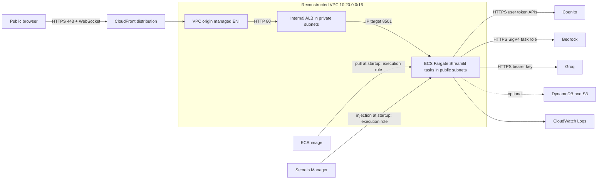

### Network topology and trust boundaries

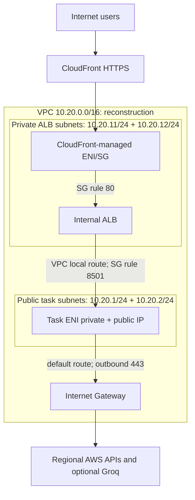

### Service integration and deployment pipeline

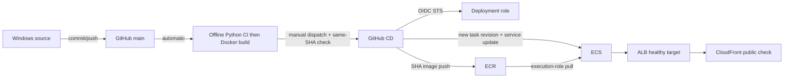

### One authenticated chat request

```mermaid
sequenceDiagram
  participant User as Browser
  participant Edge as CloudFront/VPC origin
  participant ALB as Internal ALB
  participant App as Streamlit task
  participant Auth as Cognito
  participant AI as Bedrock or Groq
  User->>Edge: HTTPS page + WebSocket
  Edge->>ALB: Private HTTP/80
  ALB->>App: Healthy IP target:8501
  App-->>User: Login UI via same path
  User->>App: Credentials through edge/ALB
  App->>Auth: InitiateAuth; optional MFA; GetUser
  Auth-->>App: Tokens + verified user
  User->>App: Prompt / validated upload through edge/ALB
  App->>AI: Selected provider HTTPS request
  AI-->>App: Stream or response
  App-->>User: Streamlit chunks through ALB/edge
```

These diagrams show the **reconstructed private-ALB/public-task placement**. The committed architecture picture has different visual tier placement; neither proves the actual deleted service's `awsvpcConfiguration`.

## 13. Complete AWS CLI deployment procedure, in dependency order

This is a **reconstructed example from an empty account**, not the historical command transcript. Run only after selecting the correct AWS account, checking service quotas/model access and accepting charges. `<...>` means an actual ID/ARN/value obtained from an earlier response; do not copy it literally. PowerShell variables are session-local. AWS CLI v2 may change input schemas; use `aws <service> <operation> help` at execution time. The account/region/profile must be checked at each new terminal session. Steps 4–11 can incur ongoing charges. For each step, the expected result and troubleshooting cue are given so the command is teachable rather than a spell to memorize.

### Step 1 — Local project preparation

**Purpose/prerequisite:** establish the correct source, entry point and working tree before packaging; no AWS resource yet. **Command (read-only example):**

```powershell
Set-Location 'E:\codex-projetc\Chatbot_text_image'
git status --short
git rev-parse HEAD
Get-Content .\Dockerfile -TotalCount 12
Get-Content .\.github\workflows\ci.yml -TotalCount 20
```

**Parameters/output/connection:** `git rev-parse HEAD` prints the commit whose SHA will become the image tag. A clean tree makes that tag traceable; uncommitted source can otherwise produce an image different from the named commit. **Common error:** wrong directory or dirty tree. **Interview line:** “I identify the exact source revision before building.”

### Step 2 — Docker build and local test

**Purpose/prerequisite:** Docker Desktop Linux engine available. **Command (local, not AWS-billable; not executed):**

```powershell
docker build --tag novamind-ai:local .
docker run --detach --name novamind-local --publish 8502:8501 novamind-ai:local
Invoke-WebRequest 'http://localhost:8502/_stcore/health'
docker logs novamind-local
```

**Parameters/output/connection:** `.` is build context; `--publish` maps host 8502 to container 8501; expect a built image and health HTTP 200. This proves image startup before ECR upload. **Errors:** missing Linux wheel/import, Docker engine stopped, occupied 8502, Cognito config absent for login. **Interview line:** “I validated the exact Linux container independently of AWS.”

### Step 3 — AWS CLI authentication

**Purpose/prerequisite:** approved human credentials/profile. **Read-only command:**

```powershell
$p = 'novamind'; $r = 'us-east-1'
aws sts get-caller-identity --profile $p --region $r
$account = aws sts get-caller-identity --profile $p --region $r --query Account --output text
```

**Parameters/output/connection:** account and principal ARN identify where later API calls would go. `--profile` does not become task runtime auth. **Errors:** expired SSO/session, wrong profile, no AWS CLI. **Interview line:** “I checked who my CLI was before creating resources.”

### Step 4 — VPC and networking **[BILLABLE for related IP/traffic; commands not executed]**

**Purpose/prerequisite:** account/region checked; two supported AZs. **Command:** run the explicit `create-vpc`, four `create-subnet`, IGW, route-table and association sequence in §4; verify with:

```powershell
aws ec2 describe-vpcs --vpc-ids $vpc --profile $p --region $r --query 'Vpcs[0].{Id:VpcId,Cidr:CidrBlock}'
aws ec2 describe-subnets --filters "Name=vpc-id,Values=$vpc" --profile $p --region $r --query 'Subnets[].{Id:SubnetId,AZ:AvailabilityZone,Cidr:CidrBlock}'
aws ec2 describe-route-tables --filters "Name=vpc-id,Values=$vpc" --profile $p --region $r --query 'RouteTables[].{Id:RouteTableId,Routes:Routes,Associations:Associations}'
```

**Parameters/output/connection:** IDs from creation become ALB/task subnet and SG inputs; public route table must show IGW default route and private ALB route table must not. **Errors:** CIDR overlap, AZ unavailable, quota, no available IPs. **Interview line:** “I created the address space and two-AZ routes before attaching compute.”

### Step 5 — Security groups and IAM **[BILLABLE only indirectly; commands not executed]**

**Purpose/prerequisite:** VPC exists. **Command:** create ALB/task SGs and task inbound 8501 rule in §7. Then create *separate* ECS execution/task roles. Save the following common ECS trust document as `ecs-task-trust.json` when provisioning (not during this documentation task):

```json
{"Version":"2012-10-17","Statement":[{"Effect":"Allow","Principal":{"Service":"ecs-tasks.amazonaws.com"},"Action":"sts:AssumeRole"}]}
```

```powershell
aws iam create-role --role-name novamind-ecs-execution-role --assume-role-policy-document file://ecs-task-trust.json --profile $p
aws iam create-role --role-name novamind-ecs-task-role --assume-role-policy-document file://ecs-task-trust.json --profile $p
aws iam attach-role-policy --role-name novamind-ecs-execution-role --policy-arn arn:aws:iam::aws:policy/service-role/AmazonECSTaskExecutionRolePolicy --profile $p
aws iam get-role --role-name novamind-ecs-task-role --profile $p --query 'Role.Arn' --output text
```

**Parameters/output/connection:** role ARN goes in `taskRoleArn` or `executionRoleArn` of the task definition. The AWS-managed execution policy covers baseline ECR pull/CloudWatch logging; add a *separate resource-scoped* execution-role inline policy for `secretsmanager:GetSecretValue` on the exact secret ARN and `kms:Decrypt` if its CMK requires it. Add a *separate* task-role policy for `bedrock:InvokeModelWithResponseStream` on approved foundation-model/inference-profile ARNs; optional DynamoDB/S3 permissions only if those stores are actually enabled. The deploy principal also needs constrained `iam:PassRole` for the two roles. Use `aws iam put-role-policy --role-name <role> --policy-name <name> --policy-document file://<reviewed-policy.json> --profile $p` after reviewing the JSON; no historical policy is available. IAM propagation may require waiting before registering the task. **Errors:** `AccessDenied`/`PassRole`, wrong trust principal, too-broad `Resource:*`, SG source points to wrong SG. **Interview line:** “The execution role boots the task; the task role authorizes my Python code; SGs control packets, not API permissions.”

For clarity, these **reconstructed** policy bodies show the boundary; replace ARNs and save each as a separate reviewed JSON file only for a future deployment. A customer-managed KMS key may require an additional scoped `kms:Decrypt` statement on the execution role. A selected Bedrock inference profile may require permission on additional underlying resources, so inspect the exact approved model/profile before finalizing the task policy.

```json
{"Version":"2012-10-17","Statement":[{"Effect":"Allow","Action":"secretsmanager:GetSecretValue","Resource":"<groq-secret-arn>"}]}
```

```json
{"Version":"2012-10-17","Statement":[{"Effect":"Allow","Action":"bedrock:InvokeModelWithResponseStream","Resource":"<approved-model-or-inference-profile-arn>"}]}
```

```powershell
aws iam put-role-policy --role-name novamind-ecs-execution-role --policy-name NovaMindSecretRead --policy-document file://execution-secret-policy.json --profile $p
aws iam put-role-policy --role-name novamind-ecs-task-role --policy-name NovaMindBedrockInvoke --policy-document file://task-bedrock-policy.json --profile $p
```

### Step 6 — Amazon ECR **[BILLABLE: storage/transfer; not executed]**

**Purpose/prerequisite:** Docker image and AWS publishing permission. **Command:** run the `create-repository`, `get-login-password`, `docker tag`, `docker push`, `describe-images` sequence in §5. **Parameters/output/connection:** `novamind-chatbot-ecr:<git-sha>` becomes task `image`; expect a `sha256:` digest. **Errors:** expired Docker registry token, wrong account/region, ECR push denied, immutable tag already exists, build architecture mismatch. **Interview line:** “ECR is the handoff between my image build and Fargate start.”

### Step 7 — ECS task definition **[BILLABLE once tasks run; not executed]**

**Purpose/prerequisite:** ECR image, roles, log group, Cognito IDs, and optional secret ARN. **Command:** save the reviewed JSON from §6 with real ARNs/IDs, then:

```powershell
$taskArn = aws ecs register-task-definition --cli-input-json file://task-definition.json --profile $p --region $r --query 'taskDefinition.taskDefinitionArn' --output text
aws ecs describe-task-definition --task-definition $taskArn --profile $p --region $r --query 'taskDefinition.{Family:family,Revision:revision,Image:containerDefinitions[0].image,Execution:executionRoleArn,Task:taskRoleArn}'
```

**Parameters/output/connection:** expect family revision/ARN; `image` must match uploaded SHA. CPU/memory must be a valid Fargate pair. Port 8501 must match Docker/target group. **Errors:** invalid Fargate CPU/memory combination, malformed ARN/JSON, missing `iam:PassRole`, inaccessible secret. **Interview line:** “The task definition is the versioned blueprint for the running container.”

### Step 8 — ALB and target group **[BILLABLE: ALB-hours/LCUs; not executed]**

**Purpose/prerequisite:** VPC/private subnets and SGs. **Command:** run `create-load-balancer`, `create-target-group --target-type ip`, and `create-listener` in §7. **Parameters/output/connection:** expect `albArn`, `tgArn`, ALB DNS; listener's forward action binds ALB → target group. Targets remain empty until ECS service registers tasks. **Errors:** ALB subnet IP shortage, duplicate name, target type `instance`, wrong VPC, SG/port mismatch. **Interview line:** “The listener routes HTTP/80 into an IP target group checking Streamlit on 8501.”

### Step 9 — ECS Fargate service **[BILLABLE: running Fargate; not executed]**

**Purpose/prerequisite:** task definition, target group, task public subnets/SG, execution/network egress. **PowerShell-compatible illustrative JSON:** save as `ecs-service.json` after replacing `<...>`; `desiredCount=1` is example capacity, not historic count.

```json
{
  "cluster":"novamind-chatbot-cluster", "serviceName":"novamind-chatbot-service",
  "taskDefinition":"<task-definition-arn>", "desiredCount":1, "launchType":"FARGATE",
  "deploymentController":{"type":"ECS"},
  "deploymentConfiguration":{"deploymentCircuitBreaker":{"enable":true,"rollback":true}},
  "networkConfiguration":{"awsvpcConfiguration":{
    "subnets":["<public-subnet-a>","<public-subnet-b>"],
    "securityGroups":["<task-sg>"], "assignPublicIp":"ENABLED"
  }},
  "loadBalancers":[{"targetGroupArn":"<target-group-arn>","containerName":"novamind-chatbot","containerPort":8501}],
  "healthCheckGracePeriodSeconds":60
}
```

```powershell
aws ecs create-service --cli-input-json file://ecs-service.json --profile $p --region $r
aws ecs wait services-stable --cluster novamind-chatbot-cluster --services novamind-chatbot-service --profile $p --region $r
aws ecs describe-services --cluster novamind-chatbot-cluster --services novamind-chatbot-service --profile $p --region $r --query 'services[0].{Desired:desiredCount,Running:runningCount,Events:events[:5].message,Deployment:deploymentConfiguration}'
aws elbv2 describe-target-health --target-group-arn $tgArn --profile $p --region $r
```

**Parameters/output/connection:** `awsvpcConfiguration` creates task ENIs in **public** subnets in this reconstruction; `assignPublicIp=ENABLED` plus IGW route enables outbound HTTPS. `loadBalancers` tells ECS which task IP/port to register. Expect `runningCount=desiredCount` and healthy targets. Circuit breaker/rollback is **enabled in this example**, but historical setting is **Not verified**. **Errors:** `ResourceInitializationError` (ECR/secret/log network or IAM), unhealthy targets, tasks stopped, denied task-role calls after startup. **Interview line:** “The service maintained my tasks and attached them to the target group; its ENI placement determined outbound connectivity.”

### Step 10 — CloudFront VPC Origin **[BILLABLE when used; not executed]**

**Purpose/prerequisite:** active internal ALB, attached IGW, private subnet free IPs, CloudFront service-linked role. **Command:** run §8 `create-vpc-origin`, wait for status `Deployed`, then discover its service-managed SG and allow it to ALB/80:

```powershell
aws cloudfront get-vpc-origin --id $vpcOrigin --profile $p --query 'VpcOrigin.Status' --output text
aws ec2 describe-security-groups --filters "Name=vpc-id,Values=$vpc" 'Name=group-name,Values=CloudFront-VPCOrigins-Service-SG*' --profile $p --region $r --query 'SecurityGroups[].{Id:GroupId,Name:GroupName}'
# Set $cfServiceSG to the verified GroupId from the response, then:
aws ec2 authorize-security-group-ingress --group-id $albSG --protocol tcp --port 80 --source-group $cfServiceSG --profile $p --region $r
```

**Parameters/output/connection:** VPC origin binds CloudFront-managed private networking to ALB ARN; the SG rule permits its traffic. Expect `Deployed` and one service SG in the VPC. **Errors:** origin still `InProgress`, no IGW/private IPs, insufficient CloudFront service-linked-role permissions, SG not yet created. **Interview line:** “CloudFront VPC origin is the private bridge to an internal ALB; I allowed its managed SG into the ALB.”

### Step 11 — Public CloudFront distribution **[BILLABLE: requests/transfer; not executed]**

**Purpose/prerequisite:** deployed VPC origin and working ALB target. **Command:** use the JSON/CLI in §8, then:

```powershell
aws cloudfront list-distributions --profile $p --query 'DistributionList.Items[].{Id:Id,Domain:DomainName,Status:Status}'
aws cloudfront get-distribution --id <distribution-id> --profile $p --query 'Distribution.{Status:Status,DomainName:DomainName}'
```

**Parameters/output/connection:** config `VpcOriginId` wires the origin; `TargetOriginId` wires the default behavior; viewer certificate gives a `cloudfront.net` HTTPS URL. Expect distribution `Deployed`; wait for propagation. **Errors:** invalid/missing origin ID or JSON, origin SG blocked, wrong Host/WebSocket behavior, 502/504 from unhealthy ALB target. **Interview line:** “The distribution exposed the private app publicly through CloudFront HTTPS, not through an internet-facing ALB.”

### Step 12 — Cognito and AI integrations **[BILLABLE for Cognito/secret/model use; not executed]**

**Purpose/prerequisite:** user pool/client and approved model; task network egress. Historical Cognito IDs/secret values are **Not verified** and must not be recovered by reading secrets. **Reconstructed commands:**

```powershell
$poolId = aws cognito-idp create-user-pool --pool-name NovaMind-Users --profile $p --region $r --query 'UserPool.Id' --output text
$clientId = aws cognito-idp create-user-pool-client --user-pool-id $poolId --client-name novamind-public-client --no-generate-secret --explicit-auth-flows ALLOW_USER_PASSWORD_AUTH ALLOW_REFRESH_TOKEN_AUTH --profile $p --region $r --query 'UserPoolClient.ClientId' --output text
aws cognito-idp describe-user-pool-client --user-pool-id $poolId --client-id $clientId --profile $p --region $r --query 'UserPoolClient.{Id:ClientId,Flows:ExplicitAuthFlows}'
aws bedrock list-foundation-models --profile $p --region $r --query 'modelSummaries[].modelId'
aws secretsmanager describe-secret --secret-id <groq-secret-name-or-arn> --profile $p --region $r
```

**Parameters/output/connection:** set pool/client IDs as ordinary task config. A pool does not contain a user automatically; approved account enrollment and MFA/recovery policy are separate tasks. Select a currently available model and scope the task role to its actual resources. A Groq secret must be created by an approved secure process; if using CLI, use `aws secretsmanager create-secret --name <name> --secret-string file://<approved-secure-local-path> --profile $p --region $r` and never paste the value in command history, logs or this guide. Reference its ARN in task `secrets`; create a new task revision/service deployment when these settings change because running tasks do not automatically reload injected secrets. **Errors:** Cognito client lacks `USER_PASSWORD_AUTH`, `GetUser` token scope/context mismatch, Bedrock model access/role denied, no outbound HTTPS, Groq key missing. **Interview line:** “Cognito authenticated users; my task role invoked Bedrock; ECS injected the optional external API secret before app startup.”

### Step 13 — GitHub Actions CI/CD **[BILLABLE on deployment; not executed]**

**Purpose/prerequisite:** base infrastructure exists; exact repo is `aamir490/Use--Case--25--NovaMind-AI-Multimodal-GenAI-Chatbot-AWS` from Git remote; CI workflow ID/trust subject should be rechecked. **Reconstructed IAM trust:** create an OIDC provider for `https://token.actions.githubusercontent.com` with audience `sts.amazonaws.com` if absent (verify current AWS IAM OIDC-provider setup); create a deployment role whose trust restricts `aud` and `sub` to `repo:aamir490/Use--Case--25--NovaMind-AI-Multimodal-GenAI-Chatbot-AWS:ref:refs/heads/main`:

If no suitable provider exists, an illustrative `github-oidc-provider.json` is `{"Url":"https://token.actions.githubusercontent.com","ClientIDList":["sts.amazonaws.com"]}`. AWS IAM retrieves a thumbprint when the optional `ThumbprintList` is omitted; confirm the current IAM requirements and do not duplicate a provider already shared by other repositories. Create it with `aws iam create-open-id-connect-provider --cli-input-json file://github-oidc-provider.json --profile $p`; the returned ARN becomes `<github-oidc-provider-arn>` below. This is **[MUTATING]** and was not executed.

```json
{
  "Version":"2012-10-17",
  "Statement":[{"Effect":"Allow","Principal":{"Federated":"<github-oidc-provider-arn>"},
    "Action":"sts:AssumeRoleWithWebIdentity",
    "Condition":{"StringEquals":{
      "token.actions.githubusercontent.com:aud":"sts.amazonaws.com",
      "token.actions.githubusercontent.com:sub":"repo:aamir490/Use--Case--25--NovaMind-AI-Multimodal-GenAI-Chatbot-AWS:ref:refs/heads/main"
    }}}]
}
```

```powershell
aws iam list-open-id-connect-providers --profile $p
aws iam create-role --role-name novamind-chatbot-github-actions-role --assume-role-policy-document file://github-oidc-trust.json --profile $p
aws iam get-role --role-name novamind-chatbot-github-actions-role --profile $p --query 'Role.Arn' --output text
gh run list --workflow ci.yml --branch main --limit 10
gh workflow run cd.yml --ref main
```

**Parameters/output/connection:** role ARN must match `cd.yml`; give only ECR repository publish, ECS describe/register/update, and constrained `iam:PassRole` permissions. The workflow obtains short-lived credentials; CI must succeed on the exact SHA before manual CD. `gh workflow run` would actually dispatch CD; **do not run for this documentation task**. **Errors:** OIDC `sub` mismatch, audience/trust denial, ECR push denied, `iam:PassRole` denied, hard-coded CI workflow ID changed, ECS service absent after cleanup. **Interview line:** “CI tests every push; I manually promote a tested commit through OIDC and verify ECS deployed its exact image.”

The checked-in `cd.yml` also hard-codes its original AWS role ARN and ECR repository URI. A rebuild in a different account must update those workflow values in a separately authorized code change before CD can run; the file is deliberately untouched in this documentation-only task. The original role trust and permissions are **Not verified** merely because the workflow names that role.

### Step 14 — Testing and verification

**Purpose/prerequisite:** distribution deployed; test user/model access approved; billable inference only with consent. **Read-only inspection commands:**

```powershell
aws ecs describe-services --cluster novamind-chatbot-cluster --services novamind-chatbot-service --profile $p --region $r --query 'services[0].{Desired:desiredCount,Running:runningCount,Events:events[:5].message}'
aws elbv2 describe-target-health --target-group-arn $tgArn --profile $p --region $r
aws logs tail /ecs/novamind-chatbot --since 1h --profile $p --region $r
aws cloudfront get-distribution --id <distribution-id> --profile $p --query 'Distribution.{Status:Status,Domain:DomainName}'
Invoke-WebRequest 'https://<distribution-domain>/_stcore/health'
```

**Expected/connection:** task count equals desired; targets healthy; distribution deployed; HTTPS health responds. Then **manually** load the login page, verify Cognito/MFA, inspect browser WebSocket status, send approved text and supported image/document prompts to an allowed model, and verify streamed chunks. Test a Groq text prompt only if configured. Compare ECS task image SHA and public heading. **Errors:** a healthy endpoint can coexist with broken auth, WebSocket, provider IAM, or secret egress. **Interview line:** “I verified from infrastructure inward and then exercised the public user path, not merely a green task count.”

## 14. Troubleshooting, monitoring, scaling and security

Start with the **failing hop**, not a broad permission change. The following checks are examples, not actions taken for this guide.

| Symptom | Project-specific likely cause | Check → repair |
|---|---|
| Docker fails to start | Linux dependency/import problem; wrong command; missing config; occupied host port | `docker logs novamind-local`, `docker inspect ... .State.Health`; rebuild from `requirements-linux.txt`, verify `8502:8501`. App login can fail while health stays green. |
| ECR push denied | Docker logged into wrong registry/region, expired token, IAM lacks upload, immutable tag exists | Recheck `sts get-caller-identity`, repository URI, `aws ecr describe-images`, rerun `get-login-password` through correct profile; never overwrite a SHA tag. |
| ECS cannot pull image | Wrong image URI/tag, execution role lacks ECR permission, task ENI lacks ECR/S3 route or DNS | `aws ecs describe-tasks` stopped reason/service events; inspect task ENI/public IP/routes, role, ECR image digest. Application task role does not fix image pull. |
| ECS task stops | Startup exception, CPU/memory pressure, invalid task config, secret/log setup failure | ECS `describe-tasks` `stoppedReason`, CloudWatch log stream, task definition image/env/secret ARNs; increase capacity only with evidence. |
| ALB target unhealthy | Container not listening on 0.0.0.0:8501; wrong target type/port/path; SG/NACL blocked | `describe-target-health`, task logs, `/_stcore/health`, SG source ALB→task; verify target type `ip` and task private IP. |
| CloudFront 403/502/504 | Distribution not deployed, VPC origin not deployed, origin SG/ALB blocked, unhealthy targets, wrong protocol/port | `get-distribution`, `get-vpc-origin`, `describe-target-health`; trace in that order. Distinguish CloudFront error from Cognito login rejection. |
| UI loads then disconnects | WebSocket upgrade headers/cookies/query strings, XSRF/Origin mismatch, ALB idle timeout or cross-replica state | Browser network tab for `101 Switching Protocols`, managed AllViewer policy, Streamlit logs, ALB timeout, sticky-session strategy; test via actual CloudFront URL. |
| Cognito sign-in fails | Pool/client IDs wrong, `USER_PASSWORD_AUTH` absent, user state/MFA issue, token context mismatch, no HTTPS egress | `describe-user-pool-client`, sanitized auth error category and network; do not dump password/token. Remember code calls Cognito unsigned user APIs. |
| Bedrock denied | Task role lacks streaming invocation on actual model/profile, model access unavailable, wrong region or network | Inspect task role, model ID, `us-east-1`, safe log category; a catalog listing alone does not prove invocation. Do not give wildcard permissions as first repair. |
| Secrets Manager/Groq fails | Secret ARN absent, execution role `GetSecretValue`/KMS denied, secret only injected on old task, Groq internet egress absent | ECS startup events for injection; task definition `secrets` reference; deploy a new task revision after secret change; check Groq HTTPS path separately. Never print key value. |
| CI fails | Windows Python/pinned package issue, offline regression, Docker build on Ubuntu | Inspect exact job/step in `gh run view <run-id> --log`; fix source/lock and rerun CI before CD. |
| CD fails | No successful push CI for exact SHA; non-main dispatch; OIDC trust/audience; ECR/ECS/PassRole denied; deleted infrastructure | Check CD step, `gh run view`, `sts` role identity, exact SHA, named ECS/ECR resources. The workflow's fixed CI ID is a maintenance risk. |
| Rollout does not stabilize | New task pull/start/health failure; no healthy baseline; circuit breaker not enabled | `describe-services` events/deployments and target health. Check actual `deploymentConfiguration`; the repository does not prove rollback was enabled. |

**Useful read-only commands:**

```powershell
aws ecs list-tasks --cluster novamind-chatbot-cluster --service-name novamind-chatbot-service --profile novamind --region us-east-1
aws ecs describe-services --cluster novamind-chatbot-cluster --services novamind-chatbot-service --profile novamind --region us-east-1
aws elbv2 describe-target-health --target-group-arn <target-group-arn> --profile novamind --region us-east-1
aws logs tail /ecs/novamind-chatbot --since 1h --profile novamind --region us-east-1
aws ec2 describe-route-tables --filters Name=vpc-id,Values=<vpc-id> --profile novamind --region us-east-1
aws ec2 describe-network-interfaces --filters Name=vpc-id,Values=<vpc-id> --profile novamind --region us-east-1
```

**Monitoring actually in source/evidence:** Docker/Streamlit health path; sanitized JSON application events with request ID, provider, duration, status and safe error category; ECS `awslogs` reference in the reconstructed task definition and CloudWatch screenshot; workflow ECS stability/revision/image checks. **Not verified historically:** CloudWatch alarms, Container Insights, CloudFront access logs, tracing, authenticated smoke tests, WAF, autoscaling rules, VPC flow logs and SLOs. Add alarms for ECS running count, ALB unhealthy targets/5xx/latency, CloudFront 5xx, application error categories and deployment failures; retain logs deliberately without prompt/credential contents.

**Scaling/availability:** two AZ subnets allow scheduling diversity, but `desiredCount=1` in the example still has one app task. Raise desired count or autoscale only after testing Streamlit WebSocket affinity and process-local session state. A reconnect to another replica can lose active chat/session state. Optional DynamoDB/S3 persistence saves selected conversations/attachments; it does not by itself externalize live Streamlit state. Test failure/reconnect behavior and request concurrency before claiming high availability. Fargate CPU/memory, ALB capacity, model throughput and CloudFront limits all need measurement.

**Security and cost:** already source-implemented controls include non-root container, `.dockerignore` secret exclusions, local/task-role credential separation, Cognito online token verification, upload/request validation, and sanitized logs. Reconstructed/recommended controls include least-privilege role policies, locked SG egress, private task subnets with NAT/endpoints, TLS to origin where required, WAF/rate limits, ECR scanning/retention, secret rotation, CloudWatch alarms, authenticated post-deploy checks, and IaC. Do not call those historical facts. Main cost drivers: Fargate runtime, ALB hours/LCUs, CloudFront requests/transfer, Bedrock inference, Groq usage, ECR storage, CloudWatch logs, Secrets Manager, Cognito users, optional S3/DynamoDB and possible NAT. `docker system df` is local disk, not AWS cost. The app's token-cost estimates are not an AWS bill.

**Rollback:** If the live ECS service has deployment circuit breaker `enable=true, rollback=true`, a failed rolling deployment can return to the last completed revision; historical setting is **Not verified**. Otherwise a reviewed manual rollback updates the service to a previously known-good task-definition ARN: `aws ecs update-service --cluster novamind-chatbot-cluster --service novamind-chatbot-service --task-definition <known-good-task-arn> --profile novamind --region us-east-1`. This is a **[BILLABLE/MUTATING] example only**. Rollback restores code, not in-memory sessions, already changed external data, or revoked credentials.

## 15. AWS resource cleanup using CLI

The user reports that the infrastructure was already deleted. These commands document **dependencies only** and must not be run for this task. First identify resources by actual IDs/tags and verify they belong to the intended account; never delete a similarly named shared resource. CloudFront distribution must release the VPC origin before the VPC origin/ALB can be removed. ECS service must release target registrations and task ENIs before target group, SG, subnet and VPC deletion. A referenced secret may be shared; inspect before scheduling deletion. CloudFront and IAM are global APIs; VPC/ECS/ECR/Cognito/Logs are regional.

**Read-only preflight (not executed):**

```powershell
$p = 'novamind'; $r = 'us-east-1'
aws sts get-caller-identity --profile $p --region $r
aws cloudfront list-distributions --profile $p
aws cloudfront list-vpc-origins --profile $p
aws ecs list-clusters --profile $p --region $r
aws elbv2 describe-load-balancers --profile $p --region $r
aws ecr describe-repositories --profile $p --region $r
aws cognito-idp list-user-pools --max-results 60 --profile $p --region $r
aws logs describe-log-groups --log-group-name-prefix /ecs/novamind-chatbot --profile $p --region $r
aws ec2 describe-vpcs --filters Name=cidr,Values=10.20.0.0/16 --profile $p --region $r
```

**Illustrative deletion order [DESTRUCTIVE], not executed:**

1. **CloudFront distribution:** fetch complete distribution config and ETag with `aws cloudfront get-distribution-config --id <distribution-id> --profile $p`. Save a copy, change only `Enabled` to `false`, then `aws cloudfront update-distribution --id <distribution-id> --if-match <etag> --distribution-config file://disabled-distribution.json --profile $p`; wait until status `Deployed`, get a **fresh ETag**, then `aws cloudfront delete-distribution --id <distribution-id> --if-match <fresh-etag> --profile $p`. A `PreconditionFailed` means your ETag is stale; a distribution in use cannot be deleted. Do not hand-edit a partial config; CloudFront update needs the full config.
2. **CloudFront VPC origin:** after the distribution no longer references it, `aws cloudfront get-vpc-origin --id <vpc-origin-id> --profile $p` to obtain its ETag, then `aws cloudfront delete-vpc-origin --id <vpc-origin-id> --if-match <etag> --profile $p`. Wait for CloudFront-managed ENIs/SG to disappear before VPC cleanup. `CannotDeleteEntityWhileInUse` means a distribution still references it.
3. **ECS:** `aws ecs update-service --cluster novamind-chatbot-cluster --service novamind-chatbot-service --desired-count 0 --profile $p --region $r`; wait for running count 0 and drained targets. Then `aws ecs delete-service --cluster novamind-chatbot-cluster --service novamind-chatbot-service --profile $p --region $r`; `aws ecs delete-cluster --cluster novamind-chatbot-cluster --profile $p --region $r`. Deregister every task-definition revision only if no other service needs it: `aws ecs deregister-task-definition --task-definition <family:revision> --profile $p --region $r` (newer ECS revisions may also have delete operations with separate conditions). Expect task ENIs to disappear asynchronously.
4. **ALB:** inspect listener ARNs and target health; `aws elbv2 delete-listener --listener-arn <listener-arn> --profile $p --region $r`; `aws elbv2 delete-load-balancer --load-balancer-arn <alb-arn> --profile $p --region $r`; wait until gone; `aws elbv2 delete-target-group --target-group-arn <target-group-arn> --profile $p --region $r`. If dependency errors occur, check whether listener/service still references target group.
5. **ECR and log group:** after retaining any required release evidence/log exports, `aws ecr delete-repository --repository-name novamind-chatbot-ecr --force --profile $p --region $r` and `aws logs delete-log-group --log-group-name /ecs/novamind-chatbot --profile $p --region $r`. `--force` deletes all images. Log deletion loses troubleshooting evidence.
6. **Cognito and secret:** only if project-owned and no users/other apps depend on them, `aws cognito-idp delete-user-pool --user-pool-id <pool-id> --profile $p --region $r` and `aws secretsmanager delete-secret --secret-id <secret-id> --recovery-window-in-days 7 --profile $p --region $r`. Secret deletion is scheduled and may still incur cost during recovery. Do not retrieve or expose secret values.
7. **IAM:** detach managed policies (`aws iam detach-role-policy --role-name <role> --policy-arn <arn> --profile $p`), list/delete each inline policy (`aws iam list-role-policies`, `aws iam delete-role-policy`), then `aws iam delete-role --role-name <role> --profile $p`. Apply to execution, task, and GitHub deployment roles only if dedicated to NovaMind. Delete the GitHub OIDC provider only if no other repository/role uses it; it is often shared.
8. **VPC networking:** list ENIs and SG references first. Remove ALB/task SG rules referencing one another (`aws ec2 revoke-security-group-ingress ...`), then `aws ec2 delete-security-group --group-id <sg-id> --profile $p --region $r`. Disassociate **non-main** route table associations (`aws ec2 disassociate-route-table --association-id <rtbassoc-id> ...`), delete custom route tables, detach/delete IGW, delete four subnets, then delete VPC. Example end commands: `aws ec2 detach-internet-gateway --internet-gateway-id <igw-id> --vpc-id <vpc-id> --profile $p --region $r`; `aws ec2 delete-internet-gateway --internet-gateway-id <igw-id> --profile $p --region $r`; `aws ec2 delete-subnet --subnet-id <subnet-id> --profile $p --region $r`; `aws ec2 delete-vpc --vpc-id <vpc-id> --profile $p --region $r`. If deletion reports `DependencyViolation`, inspect ENIs, endpoints, NAT, ALB, SG references, associations and allocated public IPs rather than forcing unrelated resources away.

**Read-only post-check/cost history:** repeat preflight listings until project resources are absent, then use Cost Explorer (which can lag) for historical service charges. Billing data is independent of current resource existence. Example read-only query (dates must be chosen for the actual deployment period):

```powershell
aws ce get-cost-and-usage --time-period Start=2026-10-01,End=2026-11-01 --granularity MONTHLY --metrics UnblendedCost --group-by Type=DIMENSION,Key=SERVICE --profile novamind --region us-east-1
```

Expect per-service charges, not proof that a particular NovaMind resource caused every charge. Reconcile tags, invoices, CloudTrail/resource records if needed. CloudFront, ALB, Fargate, logs, secrets and ECR can have different billing timing.

## 16. Interview preparation and project defense

Use these as *understanding prompts*, not lines to memorize. Each answer states what the repository proves and names uncertainty when needed. Spoken answers are written in a natural first-person style; pause and draw the relevant hop when asked. A 30–60 second answer can be shortened for a rapid interview.

### 1. What happens between typing `localhost:8501` and seeing the app?

**Testing:** client/server and port basics. **Concept:** `localhost` resolves to the laptop loopback address; TCP 8501 identifies the Streamlit process. **NovaMind:** `mod_chatbot_frontend.py` calls the UI app, which renders the login gate. **Spoken answer:** “When I open localhost on port 8501, my browser connects to the Streamlit Python server running on my own laptop. Streamlit sends the initial page and keeps an interactive connection for widget updates. The UI and request handling are both implemented in Python modules. This is local only: nobody on the internet reaches my loopback address, which is why I later needed container hosting and a public edge.” **Follow-up:** What changes when binding `0.0.0.0`?

### 2. Why use Docker here?

**Testing:** packaging versus hosting. **Concept:** image bundles runtime and app; container runs it. **NovaMind:** Linux Python 3.14.6 image with pinned runtime dependencies and Streamlit. **Spoken answer:** “Docker gave me a Linux artifact containing the exact Python runtime, dependencies and NovaMind code that Fargate could start. It reduced differences between local packaging and the cloud runtime. Docker itself did not make the app public or manage users; those required ECR, Fargate, networking and CloudFront. I used Docker Desktop on Windows to build and inspect the image before publishing it.” **Follow-up:** What is still injected at runtime?

### 3. Explain image versus container and `8502:8501`.

**Testing:** Docker fundamentals. **Concept:** image is a stored template; container is a process instance; port publish maps host to container. **NovaMind:** Dockerfile exposes 8501. **Spoken answer:** “The image is the packaged NovaMind filesystem and startup instruction. A container is one running copy of that image. For local testing, `-p 8502:8501` made my Windows port 8502 forward to Streamlit's port 8501 inside the container. Nothing about the application's listening port changed. In ECS, an ALB target group routed to the task's port 8501 instead of my laptop port.” **Follow-up:** Does `EXPOSE` publish a port?

### 4. What does the Dockerfile protect, and what can it not protect?

**Testing:** image security. **Concept:** build context and runtime permissions. **NovaMind:** `.dockerignore` excludes local secrets; image runs non-root UID 10001. **Spoken answer:** “The Dockerfile builds only the runtime files, runs an import check, and starts Streamlit as a non-root user. `.dockerignore` keeps local credentials, virtual environments and uploads out of the image context. That reduces accidental leakage and privilege, but it does not replace AWS IAM, network rules or secret management. Runtime credentials and configuration must be supplied to ECS, not copied into image layers.” **Follow-up:** Can an environment variable still leak through logs?

### 5. How did your laptop authenticate to AWS?

**Testing:** CLI identity. **Concept:** profile selects credentials; SigV4 signs API calls; STS confirms caller. **NovaMind:** profile `novamind`, region `us-east-1`. **Spoken answer:** “I used AWS CLI with a named local profile and specified `us-east-1`. Before provisioning, I checked `aws sts get-caller-identity` to verify the principal and account. That profile is only for my laptop's administrative calls. The deployed application was designed to use ECS task-role credentials, while GitHub CD used OIDC; neither needed my laptop's credential file inside Docker.” **Follow-up:** Why prefer temporary credentials?

### 6. What is the difference between an IAM user, role and policy?

**Testing:** IAM model. **Concept:** user is an identity, role is assumable temporary identity, policy grants actions/resources. **NovaMind:** human CLI, ECS roles, GitHub role. **Spoken answer:** “An IAM user can have long-lived credentials; a role is assumed by a trusted principal and supplies temporary credentials. The trust policy says who can assume the role, while permission policies say which API actions it may perform on which resources. NovaMind needed distinct roles for task bootstrap, application Bedrock calls and GitHub deployment. Keeping them separate means an image pull grant does not automatically grant model inference.” **Follow-up:** What is `iam:PassRole`?

### 7. What makes a subnet public?

**Testing:** routing, not labels. **Concept:** subnet route-table default path to IGW; public IP also needed for a task to use that path. **NovaMind:** reconstructed public task subnets in `10.20.1.0/24` and `.2.0/24`. **Spoken answer:** “A subnet is public when its associated route table can send internet-bound IPv4 traffic to an Internet Gateway. For a Fargate task to use that route directly, it also needs a public IP and outbound security-group permission. The repository diagram has public/private labels but no exported route tables, so I would inspect the live associations before claiming historical task placement.” **Follow-up:** Why is a public IP alone insufficient?

### 8. How can an internal ALB be reached by CloudFront?

**Testing:** private origin design. **Concept:** CloudFront VPC origin creates managed private connectivity/ENI. **NovaMind:** screenshots depict VPC origin and internal ALB. **Spoken answer:** “The ALB's internal scheme means it is not a normal public internet origin. CloudFront VPC origin is the bridge: it uses managed networking inside the VPC to send origin requests to the ALB. The ALB security group must allow the CloudFront VPC-origin service security group on its listener port. The browser only sees CloudFront's HTTPS hostname, not a public ALB address.” **Follow-up:** What VPC prerequisites does a VPC origin have?

### 9. Why can a private ALB reach public-subnet ECS tasks?

**Testing:** VPC local routing and ENIs. **Concept:** every subnet in the VPC has local CIDR route; task retains private IP even with public IP. **NovaMind:** reconstructed placement; historical assignment is **Not verified**. **Spoken answer:** “In my reconstructed layout, both ALB and tasks are inside `10.20.0.0/16`. Each task has a private ENI address, and the VPC local route lets the ALB contact that private address on 8501. The public IP is only for the task's outbound internet path; the ALB does not route through the internet to reach it. The task SG accepts only the ALB SG.” **Follow-up:** How would private tasks obtain external egress?

### 10. What are an Internet Gateway, NAT and VPC endpoint?

**Testing:** egress choices. **Concept:** IGW routes public-IP traffic; NAT provides private-subnet outbound internet; endpoint reaches supported AWS services privately. **NovaMind:** actual historical egress is **Not verified**. **Spoken answer:** “The IGW is the internet route for resources with public addresses. A NAT gateway can let private tasks make outbound internet calls without giving them public IPs. VPC endpoints can carry selected AWS API traffic without NAT, but they do not automatically reach an external service such as Groq. The repository does not contain routes or endpoint exports, so I distinguish a tested reconstruction from historical fact.” **Follow-up:** Which path would Cognito/Groq need in your design?

### 11. How is a Docker image pushed to ECR?

**Testing:** artifact path and auth. **Concept:** build/tag/login/push, ECR URI and digest. **NovaMind:** SHA tags in `cd.yml`. **Spoken answer:** “I build the image, give it the full ECR repository URI plus the Git commit SHA, get a temporary ECR login token through AWS credentials, and push the image layers. ECR returns a content digest, which I can inspect. The actual CD workflow checks for a valid image with that SHA and reuses it, otherwise builds and pushes. That keeps the deployment tied to a particular source revision.” **Follow-up:** Why is a digest stronger than a tag?

### 12. How does Fargate pull an ECR image?

**Testing:** task bootstrap and execution role. **Concept:** execution role authorizes ECR pull; task ENI provides network route. **NovaMind:** task definition points at ECR image. **Spoken answer:** “When ECS starts a task, Fargate allocates the task's network interface, uses the task execution role for ECR authorization, downloads the image, configures logging and any ECS-injected secrets, then starts the container. The image pull happens before my Python code executes. Both permission and connectivity must work: an execution-role policy cannot repair a missing route to ECR or its image layers.” **Follow-up:** Which role does Python use after startup?

### 13. What is the difference between ECS cluster, task definition and service?

**Testing:** ECS model. **Concept:** cluster groups capacity/workloads; task definition is versioned blueprint; service maintains desired running tasks. **NovaMind:** all three names appear in CD workflow. **Spoken answer:** “The cluster is the logical ECS workspace. The task definition records the container image, port 8501, CPU/memory, roles, environment, secrets and logs. The service chooses that revision, keeps a desired number of tasks running, and associates them with the ALB target group. Deploying a new version means registering a new task-definition revision and telling the service to roll to it.” **Follow-up:** What happens if a task exits?

### 14. Why is the ALB target type `ip`?

**Testing:** Fargate networking. **Concept:** `awsvpc` task gets ENI private IP; no customer EC2 instance target. **NovaMind:** target group forwards to Streamlit 8501. **Spoken answer:** “Fargate tasks use `awsvpc` networking, so each task has its own private IP. The ALB registers that IP and container port as a target. `instance` target type would be appropriate for routing to EC2 instances, not this Fargate service. ECS manages registration as tasks start, become healthy, drain and stop, so the ALB always routes to current healthy task IPs.” **Follow-up:** Who unregisters an old task during deployment?

### 15. What does an ALB health check prove?

**Testing:** health scope. **Concept:** path/status check is shallow readiness signal. **NovaMind:** `/_stcore/health` on 8501. **Spoken answer:** “The ALB periodically requests Streamlit's health path and considers a target routable when it returns the configured success status. This tells me the web process is answering on the expected port. It cannot prove a user can complete Cognito MFA, a WebSocket stays connected, or Bedrock inference is permitted. I therefore pair target health with public, authenticated functional checks and task logs.” **Follow-up:** What do you inspect if targets are unhealthy?

### 16. What does CloudFront do that the ALB does not?

**Testing:** edge versus origin routing. **Concept:** CloudFront publishes a global HTTPS endpoint; ALB routes within VPC. **NovaMind:** CloudFront VPC origin reaches internal ALB. **Spoken answer:** “CloudFront gives public users an HTTPS distribution URL and can apply edge policies. Its VPC origin carries those requests to my internal ALB. The ALB then performs application-layer target routing and health checks to Fargate tasks. CloudFront does not start containers or authenticate Cognito users in this architecture, and the internal ALB is not directly reachable as a public endpoint.” **Follow-up:** Where does viewer TLS terminate?

### 17. Why do Streamlit, WebSockets and cache policy matter?

**Testing:** stateful web delivery. **Concept:** Streamlit uses WebSocket; interactive/user-specific traffic should not be cached. **NovaMind:** CloudFront must forward upgrade headers, cookies and query strings. **Spoken answer:** “Streamlit renders an initial page but relies on a long-lived WebSocket for interaction and streamed updates. I therefore need CloudFront's behavior to preserve required headers and session information, and I should disable caching for dynamic authenticated responses. A 200 response for the home page is insufficient: I test the WebSocket upgrade, login, chat and reconnection through the public URL. ALB idle timeouts and multi-task session routing also matter.” **Follow-up:** What would a browser show if WebSocket upgrade failed?

### 18. How does Cognito authenticate users here?

**Testing:** authentication flow versus IAM. **Concept:** user pool/app client and token verification. **NovaMind:** server calls `USER_PASSWORD_AUTH`, MFA, `GetUser`. **Spoken answer:** “The user submits credentials to my Streamlit form. The server calls Cognito `InitiateAuth` with the configured public app client, handles SMS or authenticator challenges if required, and receives an access token. The code checks token context and expiration, then calls Cognito `GetUser` using that exact token before trusting the identity. This is application-level sign-in, separate from the ECS task role.” **Follow-up:** Why does local JWT decoding alone not authenticate?

### 19. Does Cognito use the ECS task IAM role in this code?

**Testing:** precise service-call mechanism. **Concept:** Cognito public user APIs accept user credentials/tokens, not AWS SigV4 on this path. **NovaMind:** `create_cognito_client` uses `UNSIGNED` and explicit regional endpoint. **Spoken answer:** “No. My code intentionally creates an unsigned Cognito IDP client for the user authentication APIs. It sends the user's credentials for `InitiateAuth` and the user's access token for `GetUser`. The task still needs network access to the Cognito HTTPS endpoint. Its IAM role is used for AWS-authorized calls such as Bedrock and optional storage, not as a substitute for the person's login.” **Follow-up:** Which Cognito operations might require IAM in an admin workflow?

### 20. How does Bedrock inference work?

**Testing:** SDK, model authorization and streaming. **Concept:** boto3 signs Bedrock Runtime HTTPS request with task credentials. **NovaMind:** `converse_stream`, model choice and content validation. **Spoken answer:** “After Cognito has verified the user and the app has validated the prompt/attachment, a boto3 Bedrock Runtime client sends a `ConverseStream` request in `us-east-1`. The task role signs it; the policy must cover the selected model or inference profile. The app receives events, renders text chunks in Streamlit, and only commits a successful turn to model history. Bedrock hosts inference; Fargate hosts my app.” **Follow-up:** Why might model catalog listing succeed while invocation fails?

### 21. How do image and document uploads reach the model?

**Testing:** multimodal path and validation. **Concept:** upload bytes first reach the app; provider request carries supported content blocks. **NovaMind:** image/document validators, limits and model policies. **Spoken answer:** “The browser uploads bytes through CloudFront and ALB to Streamlit. My Python code checks file name, extension, size and actual content, then checks whether the selected model accepts that content type. For compatible Bedrock models it creates image or document content blocks in the Converse request. Nova Micro and Groq are treated as text-only by the local policy. Optional S3 saving is a separate persistence action, not required for immediate analysis.” **Follow-up:** Why validate inside the app if Streamlit has a size limit?

### 22. How is the Groq API key handled?

**Testing:** secret boundary. **Concept:** ECS secret reference uses execution role; app gets runtime env var. **NovaMind:** `GROQ_API_KEY` is read by `groq_service.py`; no direct Secrets Manager SDK call. **Spoken answer:** “The deployment design stores the external key in Secrets Manager and references its ARN in the ECS task definition. Before the container starts, ECS uses the execution role to retrieve it and injects it as `GROQ_API_KEY`. The Groq adapter then sends a bearer-authenticated HTTPS request. The key is never part of source code, an image layer or a task plaintext environment value; after rotation I need a new task rollout to receive the updated injection.” **Follow-up:** Which role needs `secretsmanager:GetSecretValue`?

### 23. When does the app use Bedrock versus Groq?

**Testing:** provider branching. **Concept:** providers are alternatives, not sequential hops. **NovaMind:** UI model/provider mapping and text-only Groq adapter. **Spoken answer:** “The user's selected model determines the provider. For a Bedrock model, the task uses boto3 and its task IAM role to call AWS. For the configured Groq model, it sends text through a separate HTTPS adapter with a bearer API key. The prompt does not travel Bedrock then Groq. The app validates capabilities first, so image/document requests are not treated as Groq multimodal calls.” **Follow-up:** What network path is needed for Groq?

### 24. What is the difference between execution role and task role?

**Testing:** least-privilege boundary. **Concept:** bootstrap/agent versus application code. **NovaMind:** ECR/logs/secrets versus Bedrock/storage. **Spoken answer:** “Fargate uses the execution role before and around container startup to pull ECR images, set up CloudWatch logging and inject Secrets Manager references. My Python application receives separate task-role credentials from the container provider, which it uses for Bedrock and optionally DynamoDB or S3. If the image cannot pull, I inspect execution-role permissions and network. If model invocation is denied after startup, I inspect the task role and model access.” **Follow-up:** Does the container code normally receive execution-role credentials?

### 25. Explain the CI pipeline.

**Testing:** test/build gates. **Concept:** automatic checks on source changes. **NovaMind:** `ci.yml` Windows tests then Ubuntu Docker build. **Spoken answer:** “A push to main or a PR targeting main runs CI. The first job installs the pinned Windows Python environment, checks dependency consistency and runs the guarded offline suite, so tests cannot quietly call AWS or the network. Only after that passes does an Ubuntu job build the Linux Docker image. This checks source behavior and container build, but it is not a live deployment or real Cognito/Bedrock integration test.” **Follow-up:** Why build on Ubuntu after Windows tests?

### 26. Explain the manual CD pipeline and OIDC.

**Testing:** deployment trust and provenance. **Concept:** manual promotion, same-SHA gate, OIDC temporary role. **NovaMind:** `cd.yml` changes only task image. **Spoken answer:** “I manually dispatch CD after CI. The workflow allows only main and queries for a successful push-triggered CI run for its exact commit SHA. GitHub's OIDC token is exchanged for temporary AWS role credentials. The job publishes or reuses the SHA-tagged ECR image, registers a task revision changing only that image, updates ECS, waits for stability and verifies the deployed image. That is a deliberate promotion boundary, not automatic deployment after every push.” **Follow-up:** Which claims must the AWS trust policy restrict?

### 27. What did the ‘Welcome back folk’ change prove?

**Testing:** evidence quality. **Concept:** end-to-end release demonstration, but limited test scope. **NovaMind:** commit `50a5d3f` and workflow/public verification reported by user. **Spoken answer:** “I changed one visible login heading, committed and pushed it. Automatic CI passed, then I manually ran CD and verified the changed text through the public CloudFront URL. That showed the source-to-image-to-ECS-to-edge release chain for that change. It did not by itself prove every security group, MFA case, model entitlement or rollback configuration, so I describe those separately and only claim what the evidence supports.” **Follow-up:** How would you verify the deployed SHA independently?

### 28. What if deployment starts but never stabilizes?

**Testing:** fault isolation and rollback. **Concept:** inspect task stopped reason, logs, ALB health, service events. **NovaMind:** CD waiter checks stability; circuit breaker historical setting unknown. **Spoken answer:** “I first inspect ECS service events and deployment state, then stopped-task reasons and CloudWatch logs. If a container starts but the target is unhealthy, I check `/_stcore/health`, port 8501 and SG path. If it never starts, I check ECR pull, secret injection, execution role and network. The workflow reports failure; automatic rollback occurs only if the ECS service was configured for it, which the repository does not prove.” **Follow-up:** What would you roll back manually?

### 29. How would you scale and secure the production version?

**Testing:** architecture trade-offs. **Concept:** replicas, session state, private egress, controls and observability. **NovaMind:** active Streamlit sessions are process-local; optional persistence is separate. **Spoken answer:** “I would first measure CPU, memory, concurrent WebSockets and model latency. Then I would increase task count across AZs, but only after testing session affinity or externalizing active state because a reconnect to another task can lose in-memory context. I would move tasks to private subnets with reviewed NAT/endpoints, scope IAM and egress, add WAF/rate limits, alarms, image scanning and authenticated smoke tests. These are improvements, not claims that all were already configured.” **Follow-up:** Would DynamoDB snapshots alone solve live session routing?

### 30. How did you control cost and clean up?

**Testing:** operational ownership. **Concept:** ongoing runtime charges and deletion dependencies. **NovaMind:** user reports infrastructure removal; current absence not independently checked. **Spoken answer:** “I treated Fargate, ALB, CloudFront traffic, inference, logs, ECR storage, Secrets Manager and optional NAT as cost drivers. After the demonstration, I removed project-owned resources in dependency order: disable/delete CloudFront, release VPC origin, scale down/delete ECS, remove ALB/target group, then registry/logs/secrets/IAM and VPC networking. I would verify with read-only listings and Cost Explorer, because billing history remains even after infrastructure is gone.” **Follow-up:** Why must CloudFront be removed before its VPC origin?

### One-minute deployment summary

“I built NovaMind AI as a Python Streamlit chatbot on my Windows laptop and tested it on localhost port 8501. I packaged it in a non-root Linux Docker image and published a commit-tagged release to Amazon ECR. On AWS, ECS Fargate ran the container; an internal ALB routed healthy task IPs on port 8501; and a CloudFront VPC origin exposed the app at a public HTTPS URL without making the ALB internet-facing. Cognito handled user sign-in, the task role authorized Bedrock streaming, and ECS injected an optional Groq key from Secrets Manager. CloudWatch collected safe application logs. GitHub Actions ran automatic offline CI and a manually triggered OIDC-based deployment. I demonstrated the pipeline by changing ‘Welcome back’ to ‘Welcome back folk’ and checking the public app, then removed the infrastructure to control cost.”

### Three-minute technical explanation

“I started with a Streamlit app, so localhost meant a Python server on my own laptop, not a separate public web site. The launcher calls the UI module; browser chat, uploads and login cause Python to run on the server. The Dockerfile built a Linux image with pinned dependencies, copied only runtime files, used a non-root user and listened on port 8501. I tested it with Docker Desktop, mapping my laptop's 8502 to the container's 8501. That image became the release artifact.

“For AWS, the source-verified CD workflow names an ECR repository, ECS task family, cluster and service. A repository URI plus Git SHA identifies the image. Fargate uses the task execution role and task networking to pull it. The application itself uses a separate task role for AWS SDK calls. In the network design, CloudFront gives the public HTTPS hostname, its VPC origin reaches an internal ALB, and the ALB forwards HTTP requests to healthy Fargate task private IPs on 8501. Streamlit also needs WebSocket upgrades and session information forwarded. The application is not sitting in ECR or CloudFront; it runs inside the ECS task.

“On login, Streamlit calls Cognito user APIs, handles MFA if requested, checks token context and verifies the exact access token with `GetUser`. On a chat turn, it validates text or upload content and model capability. Bedrock uses a task-role-signed `ConverseStream` call. Groq is a separate text-only HTTPS path with a runtime key injected from Secrets Manager by ECS. CloudWatch receives sanitized events. CI runs offline tests and a Linux Docker build on every main push/PR. Manual CD checks successful CI for the exact SHA, exchanges GitHub OIDC identity for temporary AWS credentials, publishes or reuses the image, registers a new ECS task revision, rolls the service and checks stability plus deployed image. The visible heading change demonstrated that path. The historical screenshots prove key resources existed, but the repo does not export exact subnet assignments, routes, IAM policies or circuit-breaker settings, so I label those as reconstruction rather than claiming to know them.”

### Five-minute architecture walkthrough

1. **Start with the user and trust boundary.** “A user opens a CloudFront HTTPS distribution. DNS resolves the edge hostname and TLS protects the viewer connection. CloudFront is a delivery layer, not my login decision.” Draw browser → CloudFront.
2. **Explain the private ingress.** “The distribution's VPC origin uses service-managed private networking to reach an internal ALB. The origin security group is allowed on ALB port 80. The ALB listener forwards to an IP-based target group on Streamlit port 8501.” Draw VPC origin → internal ALB → IP target group. Note that source/screenshots establish the internal ALB and VPC-origin design, while exact historical SG rules are not exported.
3. **Explain task execution.** “The ECS service keeps Fargate tasks running. Each task gets an ENI/private IP, and ECS registers it with the target group. The execution role pulls the SHA-tagged image from ECR, configures `awslogs`, and injects any referenced secret before Python starts. My Python SDK sees only the task role credentials.” Draw ECR, execution role, task role as separate arrows to the task.
4. **Explain network route choices.** “The worked reconstruction has `10.20.0.0/16`, public task subnets with public-IP/IGW egress, and private ALB subnets across two AZs. ALB-to-task uses the VPC local route and private task IP. A future production variant can put tasks in private subnets with NAT/endpoints. The repository's diagram depicts another tier arrangement; actual deleted service subnet settings are unknown.” This earns credibility: placement must be proved from ECS `awsvpcConfiguration` and route tables.
5. **Trace auth.** “Streamlit receives user credentials, calls Cognito `USER_PASSWORD_AUTH`, handles MFA and verifies the token online using `GetUser`. A valid IAM task role does not sign a person in. An authenticated browser session remains in Streamlit process memory.” Draw task → Cognito HTTPS.
6. **Trace model work.** “A prompt/upload is validated against type, size and selected model capability. Bedrock receives a SigV4-signed `ConverseStream` call from the task role. Groq is an alternative text-only HTTPS call using an injected secret. Chunks return to Python, then through ALB/CloudFront WebSocket to the browser. ECR and Secrets Manager are startup/deployment dependencies, not per-chat hops.” Draw the two provider branches and reverse response arrows.
7. **Trace delivery and operations.** “GitHub push triggers offline Python CI and Docker build. A manual CD checks the same SHA, uses OIDC to assume a deployment role, publishes the image, registers a task revision, updates ECS and verifies rollout. CloudWatch logs, ECS events, ALB target health and public authenticated testing narrow failures. The UI heading change was my release demonstration; cleanup followed to avoid idle charges.” Draw a second, separate CI/CD lane rather than mixing it into user traffic.

### Whiteboard order and mistakes to avoid

Draw two lanes: **runtime** (browser → CloudFront → VPC origin → internal ALB → Fargate task → Cognito or Bedrock/Groq; logs separately) and **delivery** (GitHub push → CI → manual OIDC CD → ECR image/task revision → ECS rollout). Label ports **443 → 80 → 8501**, private task IP, and which role acts at startup versus runtime. Mark subnet placement and circuit breaker as **Not verified historically**. Explain return traffic and WebSocket.

Avoid saying “CloudFront authenticates Cognito users,” “ECR runs containers,” “the task role pulls the image,” “the app fetches the Groq secret on every request,” or “Bedrock always calls Groq.” Do not claim that a green `/health` proves inference, that offline CI proves live AWS access, or that the diagram proves subnet routes. Do not claim automatic rollback unless the actual ECS service configuration confirms it. Name the demonstrated facts, identify the unknown historical settings, and describe the reconstructed commands as a way to reproduce and test the architecture.

### Source map and current AWS references

Primary project evidence: [`README.md`](README.md), [`Dockerfile`](Dockerfile), [`.dockerignore`](.dockerignore), [`services/aws_config.py`](services/aws_config.py), [`services/auth_service.py`](services/auth_service.py), [`services/bedrock_service.py`](services/bedrock_service.py), [`services/groq_service.py`](services/groq_service.py), [`services/observability.py`](services/observability.py), [CI](.github/workflows/ci.yml), [CD](.github/workflows/cd.yml), [architecture diagram](project-pic/NovaMind-AI-AWS-Architecture-Blueprint-with-cicd.png) and tracked AWS/GitHub screenshots. Older [`deployment.md`](deployment.md) describes pre-deployment requirements and is not a live AWS configuration export.

AWS primary references checked for the reconstructed commands: [CloudFront VPC origins](https://docs.aws.amazon.com/AmazonCloudFront/latest/DeveloperGuide/private-content-vpc-origins.html), [CloudFront VPC-origin CLI](https://docs.aws.amazon.com/cli/latest/reference/cloudfront/create-vpc-origin.html), [CloudFront WebSockets](https://docs.aws.amazon.com/AmazonCloudFront/latest/DeveloperGuide/distribution-working-with.websockets.html), [CloudFront managed request policies](https://docs.aws.amazon.com/AmazonCloudFront/latest/DeveloperGuide/using-managed-origin-request-policies.html), [CloudFront managed cache policies](https://docs.aws.amazon.com/AmazonCloudFront/latest/DeveloperGuide/using-managed-cache-policies.html), [Fargate task networking](https://docs.aws.amazon.com/AmazonECS/latest/developerguide/fargate-task-networking.html), [ECS execution role](https://docs.aws.amazon.com/AmazonECS/latest/developerguide/task_execution_IAM_role.html), [ECS task role](https://docs.aws.amazon.com/AmazonECS/latest/developerguide/task-iam-roles.html), and [ECS deployment circuit breaker](https://docs.aws.amazon.com/AmazonECS/latest/developerguide/deployment-circuit-breaker.html). These explain service behavior; they do not establish which deleted resources the historical account actually had.
